<!-- AI NOTE: doc_standard=engineering-docs-standards; version=2; doc_kind=architecture -->

# Architecture

## System Overview and Boundaries

The Agent Cockpit is an Electron application: a sandboxed React renderer, a
narrow preload bridge, and a capability-bearing main process. It drives a CLI
coding agent against one active repository — local or remote over SSH — and
presents review surfaces around it — read-only except beads edits via task
detail. The organizing principle is the
**`WorkspaceProvider` seam**: the renderer addresses the _active provider_
through typed IPC and never knows whether the project is local or remote.

The durable architectural boundaries are:

- **Renderer sandbox + narrow preload.** The renderer runs with
  `contextIsolation: true`, `nodeIntegration: false`, `sandbox: true`. It has no
  Node or filesystem access; it sees only typed payloads via `window.api`. The
  preload forwards typed IPC and carries no business logic.
- **App writes are narrow.** The app writes its app-local SQLite store under
  `userData/`, and — as the single exception — beads issue state through the `br`
  CLI (never the beads SQLite DB or working tree directly; see NFR-2). It does not
  otherwise mutate the repository or git state.
- **Agent-terminal as the primary write path.** All working-tree and git
  mutation happens through the CLI agent the user runs in the embedded terminal
  (or the Run panel); the lone app-side exception is beads issue state via `br`.
  Production tmux backends use the dedicated `agent-cockpit` socket so sessions
  persist across restarts and stay isolated from the user's own tmux. Normal
  development retains Electron's historical `agent-cockpit` `userData` profile
  while using the default persistent tmux/mux resources. The packaged app's
  `Agent Cockpit` profile remains separate by explicit user choice; no automatic
  profile migration occurs. Test and explicitly isolated development launches
  use unique profiles and sockets with scoped cleanup.
  Three backends
  coexist behind the `WorkspaceProvider` seam and are selected by the
  `terminalBackend` setting in [src/shared/settings.ts](../src/shared/settings.ts):
  the default **session-per-tab** model namespaces sessions as
  `agent-cockpit-terminal-<projectId>-<key>` (terminal tabs) and a single
  `agent-cockpit-run-<projectId>` (Run panel); the **control-mode (`-CC`)**
  model drives one per-project session (`agent-cockpit-<projectId>`) where
  tmux is the authority for windows and panes; and **Cockpit mux**, an
  independently runnable Go daemon that owns PTYs and logical terminal topology
  without tmux. Switching backends is a clean-slate operation that kills every
  cockpit-socket tmux session when leaving a tmux backend. Every
  other surface (changes, content viewer, notes, sessions) is a read-only
  projection; beads navigation is read-only too, but **task detail** writes
  issue state via the `br` CLI (see NFR-2).
- **Untrusted repository content.** Repository Markdown/Mermaid and file bytes
  are untrusted: Markdown runs through one whole-document `unified`
  (`remark-parse` → `remark-gfm` → `remark-rehype` → `rehype-raw` →
  `rehype-sanitize` → `rehype-highlight` → `rehypeHeadingIds` → local
  safe-link/image transform → `rehype-stringify`) pass and is sanitized via
  DOMPurify; `rehype-raw` and
  `rehype-sanitize` run only when the document contains bare inline HTML (see
  below) — a plain document skips both stages entirely. Mermaid and
  Graphviz (`dot`/`graphviz` fences) compile to SVG via a bundled,
  same-origin library and that SVG output is likewise DOMPurify-sanitized
  before being inserted into the same document — no iframe, since the input
  is a narrow DSL rather than arbitrary HTML. Bare/inline HTML written
  directly in Markdown prose (not fenced — a ` ```html ` fence still renders
  as a plain code listing, matching GitHub) also renders: `remark-rehype`
  runs with `allowDangerousHtml: true`, `rehype-raw` parses the resulting raw
  nodes into real hast elements, and `rehype-sanitize` filters that tree
  against `hast-util-sanitize`'s `defaultSchema` — published as following
  GitHub's own HTML sanitization rules — before `rehype-highlight`/the
  link-hardening transform run (both are trusted, app-controlled passes that
  must see already-sanitized content). The schema is extended with three
  narrow, deliberate deviations from GitHub's own schema. Two are protocol
  widenings — `href` gains `file:`, `img[src]` gains `data:image/*` — since
  this app, unlike GitHub, has a local-repository focus; DOMPurify's own
  second-pass `ALLOWED_URI_REGEXP` is widened to match (DOMPurify's default
  protocol allowlist has no `file:` either, and does not merge with a
  provided override). The third is `clobberPrefix: ''`: `remark-rehype`
  already prefixes GFM footnote ids/hrefs with `user-content-` as its own,
  independent anti-clobbering measure and keeps each id/href pair consistent
  doing so; `hast-util-sanitize`'s own clobber protection would otherwise
  re-prefix the `id` a second time without touching the referencing `href`
  (`href` isn't in its clobber list), breaking every footnote's internal
  anchor — `clobberPrefix: ''` makes that second prefixing pass a no-op. This
  is an accepted trade-off, not a free fix: it also disables sanitize's own
  clobber-id-prefixing for any other (non-footnote) attacker-set
  `id`/`name`/aria-\* from raw inline HTML — a real, lower-confidence residual
  DOM-clobbering surface, not exhaustively audited in this codebase. See
  CLAUDE.md's "Inline-HTML sanitizer schema must never allowlist this app's
  own trusted attributes by name" for the full record of the `clobberPrefix`
  deviation and the trusted-attribute forgery fix.
  **The schema deliberately does NOT extend to this app's own
  `data-start-line`/`data-end-line`/`data-mermaid-id`/`data-graphviz-id`
  anchor/placeholder attributes** — an earlier version did, and that was a
  real, confirmed-exploitable vulnerability: `rehype-sanitize`'s schema is a
  blanket name-based allow/deny list with no per-instance trust concept, so
  allowlisting these names for the app's OWN elements also allowlists them
  for attacker-controlled bare HTML carrying the same name, letting a forged
  `data-start-line` survive with an attacker-chosen value or a forged
  `data-mermaid-id` hijack the render loop into showing a real diagram in
  place of attacker content. These four attributes are instead recorded
  (from the original mdast tree, before any rehype processing) keyed by
  source-offset range, and re-applied to the sanitized hast tree by an
  `applyTrustedAnnotations` rehype step positioned immediately after
  `rehype-sanitize` — an offset range is not attacker-suppliable, so this
  closes the forgery path by construction. See CLAUDE.md's "Inline-HTML
  sanitizer schema must never allowlist this app's own trusted attributes by
  name" for the full incident record — do not re-add these four names to the
  schema.
  External anchors are routed via `setWindowOpenHandler` →
  `shell.openExternal`, and large/binary files degrade to notices.
  `rehype-highlight` (with the bundled base16 Solarized hljs theme) provides
  fenced-code syntax highlighting; `rehype-raw`/`rehype-sanitize` (above) are
  the pipeline dependencies added for bare inline HTML support.
  A repo `.html`/`.htm` file renders through the **same sandboxed-preview
  pattern** the app uses for untrusted rich content, complementing the
  DOMPurify-SVG diagram path: `HtmlPreview` builds a `blob:` document from the
  file text with a restrictive CSP `<meta>` injected as its first `<head>`
  child (`default-src 'none'`; only inline styles, `data:` images/fonts) and
  loads it into an `iframe sandbox=""` — deny-all, opaque origin, **never**
  `allow-same-origin`, so the frame cannot reach the app, its storage, or the
  parent, and cannot beacon out. It requires **no CSP change and no
  `<webview>`** (`frame-src 'self' data: blob:` already permits the blob frame;
  webview stays disabled). v1 is **static-only**: scripts never run, because
  `sandbox=""` denies them AND the app's global CSP response header
  (`security.ts` `onHeadersReceived`) intersects with the iframe `<meta>` CSP —
  the header's `script-src 'self' 'wasm-unsafe-eval'` (no `'unsafe-inline'`)
  blocks inline scripts even under a widened `allow-scripts` sandbox. An opt-in
  interactive-scripts mode is a deferred v2: it needs a **scoped** exemption
  giving `blob:` sub-frames the preview CSP instead of the app CSP in
  `onHeadersReceived` (safe because `HtmlPreview` is the only `blob:`-iframe
  surface and the frame stays opaque-origin, non-same-origin, network-blocked).

## Major Components and Responsibilities

| Component                                 | Process     | Responsibility                                                                                                                                                                                                          |
| ----------------------------------------- | ----------- | ----------------------------------------------------------------------------------------------------------------------------------------------------------------------------------------------------------------------- |
| `WorkspaceProvider`                       | shared type | The transport seam: lifecycle, terminal, git, fs, beads, watch. Every live session stays fully active (no suspend/resume).                                                                                              |
| `LocalProvider`                           | main        | Local backing: simple-git/fs/beads reads, chokidar watch, node-pty terminal, local tmux control-mode (`-CC`) session manager.                                                                                           |
| `RemoteProvider`                          | main        | SSH backing: pluggable `RemoteTransport` (ssh2 default) behind a factory, Go-helper RPC reads, tmux-over-ssh terminal, remote tmux control-mode session manager with reconnect/resync.                                  |
| `RemoteTransport` / `Ssh2Transport`       | main        | Provider transport boundary: the only seam that touches `ssh2`; `Ssh2Transport` is the default implementation (host-key verified).                                                                                      |
| `sessionReaper`                           | main        | Periodic remote-only idle aging-out: the first main-process timer; ends idle remote sessions via the shared `SessionManager.close` teardown.                                                                            |
| Shared tmux protocol (`src/shared/tmux/`) | shared      | Pure parser/codec/layout/command builders for tmux control mode — `%begin`/`%end`/`%error` reply correlation, `%output` decode, window-layout-string parsing, hex `send-keys` encoding. Consumed by both host managers. |
| `ProviderRegistry`                        | main        | Builds a provider from `{ projectId, spec }`.                                                                                                                                                                           |
| `SessionManager`                          | main        | At most one provider per project; one `activeId`. All live sessions stay fully active (background-live); owns the per-session watch lifecycle and the idle-activity tracker.                                            |
| Provider IPC bridge                       | main        | Typed handlers route ordinary active-project calls to the active provider, while retained terminal lifecycle calls carry an explicit project id; forwards push events and validates inputs.                             |
| SQLite store                              | main        | App-local persistence (projects + order + run command, layouts, notes, since-seen, settings).                                                                                                                           |
| tmux session inventory                    | main        | Lists/kills sessions on the `agent-cockpit` socket for the Sessions panel.                                                                                                                                              |
| Remote helper                             | remote host | Go static binary serving read RPC + fs-watch over the SSH exec channel, the project's callback listener and (invoked as `cockpit`) the multi-call CLI.                                                                  |
| `CallbackBroker`                          | main        | Terminal callback socket decision point: local listener, `open` allowlist, rate limit, status gate, async path classification; also decides requests a remote helper forwards.                                          |
| `cockpit` CLI                             | pane        | Multi-call mode of the helper's Go binary: `cockpit open <path>` sends one request on `COCKPIT_CALLBACK_SOCK`; never serves RPC.                                                                                        |
| Renderer shell/workspace/panels           | renderer    | App shell, top project tab strip, Dockview workspace, xterm terminal + Run panel, read-only review panels, zustand stores.                                                                                              |

## Runtime Topology and Flows

### Provider Seam (central boundary)

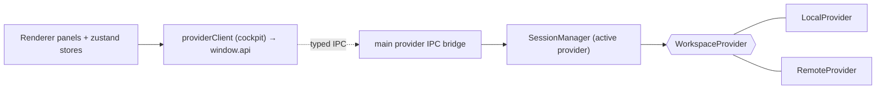

Panels depend only on the `WorkspaceProvider` contract; `LocalProvider` and
`RemoteProvider` are interchangeable implementations selected per project. This
replaces v1's direct per-feature IPC services as the organizing principle.

### Three-Tier Remote Topology

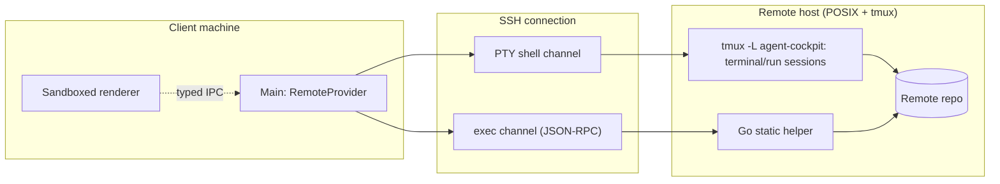

The interactive agent runs inside `tmux` on the PTY shell channel (so it
survives disconnect/restart); the helper serves read/diff/watch on a separate
exec channel so RPC traffic never pollutes terminal scrollback. The host does
the watch/diff/read work and streams results — the client never mounts or
mirrors the tree.

### Remote Transport Provider Boundary

`RemoteProvider` talks to the host through a **mechanism-agnostic
`RemoteTransport` interface** (`electron/main/providers/remote/transportTypes.ts`)
rather than a raw ssh2 client. The wire mechanism is swappable behind a factory;
ssh2 is the default and currently only implementation.

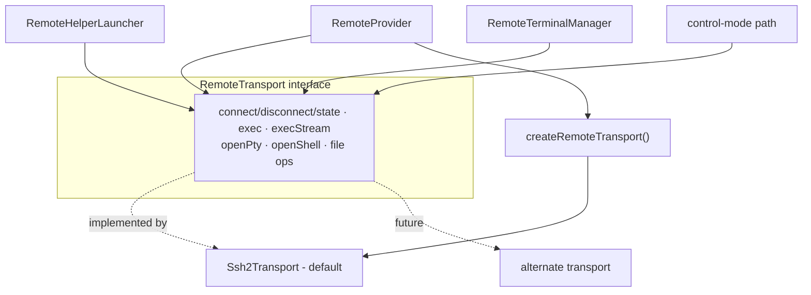

- **`ssh2` is encapsulated in exactly one file.** `Ssh2Transport`
  (`transport.ts`) is the only module that imports `ssh2`/`@types/ssh2`; an ESLint
  `no-restricted-imports` rule enforces this. The old `transport.client()` raw-
  client leak is removed — `RemoteHelperLauncher`, `RemoteTerminalManager`, and
  the control/kill paths depend only on the interface.
- **Operation surface:** lifecycle/state (`connect`/`disconnect`/`state`/
  `onStateChange`), one-shot `exec` (lenient: returns `{stdout, stderr, code}`,
  never rejects on non-zero), long-lived `execStream` duplex for the helper RPC
  (the existing `RpcStream` shape, so `rpcClient.ts` is untouched), `openPty`
  (control-mode) and `openShell` (terminals) PTY channels, a single-SFTP-session
  file-provisioning surface (`uploadExecutable`/`mkdirp`/`exists`), and two
  per-call SFTP byte-read primitives — `stat(remotePath)` and the range-capable
  `createReadStream(remotePath, { start?, end? })`, the Download capability's
  remote byte source (see "Bounded File Export (Download) & Row Context
  Menus"). No ssh2 type leaks through any of these: `createReadStream` returns
  a Node `Readable`, `stat` a plain `StatResult`.
- **Raw-byte channel contract (typed):** `PtyChannel`/`DuplexChannel` `onData` is
  typed `(b: Uint8Array) => void` and delivers wire bytes undecoded, making the
  control-mode raw-byte invariant a typed contract end to end (see the byte
  pipeline in the Terminal Lifecycle section).
- **`~/.ssh/config` alias resolution:** because ssh2 does not read
  `~/.ssh/config`, `Ssh2Transport` resolves a `Host`-alias spec through an in-repo
  resolver (`sshConfigResolve.ts`), applying the alias's `HostName`/`Port`/`User`/
  `IdentityFile` (spec-explicit values win, then config, then default) so
  alias-based projects connect instead of failing `ENOTFOUND`. The host-key check
  below verifies against the **resolved** host. ProxyJump, bastions, and the wider
  OpenSSH config surface (`Match`/`Include`) remain deferred to a future
  native-ssh transport; this resolver stays minimal.
- **Host-key verification:** `Ssh2Transport` verifies the host key against the
  user's `known_hosts` (ssh2 `hostVerifier`), closing the prior silent-accept MITM
  gap; a mismatch surfaces as a typed `RemoteTransportError` with `phase:
'hostkey'`. `hostKeyPolicy` is part of the `connect` options contract so any
  future transport satisfies the same verification. Auth (privateKey from
  `identityPath`, else SSH agent) is a transport responsibility behind `connect`.
- **Selection seam:** `createRemoteTransport()` (`transportFactory.ts`) resolves
  the implementation; with only ssh2 present it returns `new Ssh2Transport()`.
  Adding an alternate is one factory case + one new file — no consumer change.
  Connection status remains owned solely by `ConnectionMachine`; the transport
  only emits transport-level state.

### Per-Session Liveness Model

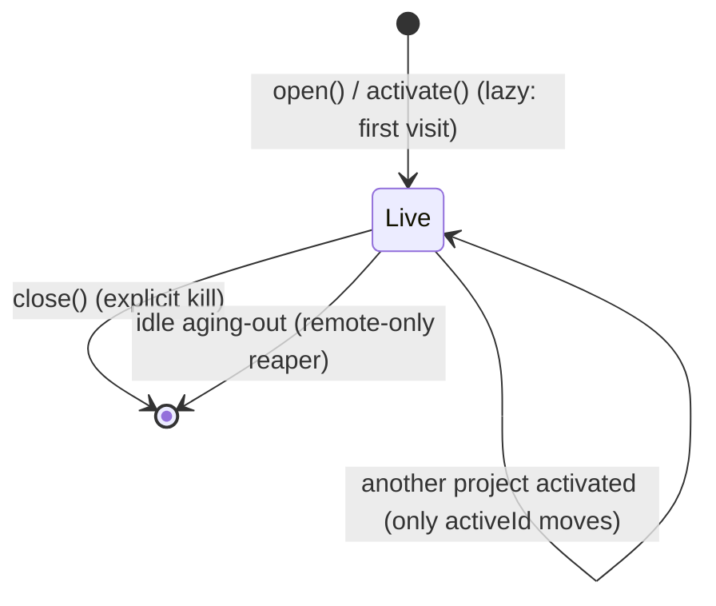

**The session is the liveness unit, not the panel.** `SessionManager` keeps at
most one provider per project and a single `activeId`, but **every live session
stays fully active** — there is no warm/hot distinction and no `suspend()`/
`resume()`. A backgrounded session keeps its terminal, its watch subscription,
and its helper RPC live, so its per-session data (Changes, Workgraph) stays
continuously current regardless of which project is focused. `activate()` only
sets/persists `activeId` (the default target for omitted-`projectId` reads and the
slice panels render); it never pauses another session.

Liveness is **lazy**: a project becomes live when first activated, not
pre-connected on boot; a never-visited project is not connected. Per-session data
is **resident in memory until the session ends**, and a session ends only by
**explicit kill** (`SessionManager.close`) or by **idle aging-out** (the remote-only
reaper below) — losing focus never ends a session. This is the concurrency and
resource model: cost grows with the number of _live_ sessions (one watch
subscription each, no per-session polling), bounded by explicit kill plus aging-out.

Provider reads are addressable by `projectId` (`providerFor(projectId?)` —
explicit id → that session, omitted → active), so any live session's data can be
loaded/refreshed regardless of which project is active; "active" is the default,
not the only, read target. The renderer holds one `byProject[projectId]` slice
per live session in `changesStore`/`beadsStore`, and panels are pure derivations
of `(activeId, perSessionStatus, byProject slice)` (see the Connection State
Machine invariant). A single renderer `panelDataSync` orchestrator drives
load/refresh/clear off per-session connection status + `projectId`-routed watch
events.

### Session Idle Aging-Out (resource bound)

`sessionReaper` (`electron/main/providers/sessionReaper.ts`) bounds the live set
by automatically ending sessions that have gone unused past a configurable
threshold — the same mental model as reaping idle terminal windows. It is the
**first periodic main-process timer** and establishes the canonical pattern for
any future periodic main work: a single `setInterval` at a coarse cadence (~60 s,
independent of the threshold), an **injected clock** for testability, and
**clear-on-quit** (`will-quit` stops the reaper before `closeAll`, so no leaked
interval and no tick during quit).

- **Remote-only in v1:** only `kind === 'remote'` sessions age out (local sessions
  free no SSH/RPC and are exempt); `provider.kind` makes it uniform later.
- **Non-destructive:** aging-out calls the shared `SessionManager.close(projectId)`
  teardown — the same path as explicit kill (eviction listeners → IPC tmux-cache
  disposal → per-session watch stop + renderer slice evict). It detaches the
  control client but never `kill-session`s, so server-side tmux and any running
  agent survive; the **project stays listed** and re-selecting it reconnects and
  re-seeds via the normal `activate()`/`open()` path.
- **Candidate gating:** the active/focused session is never reaped (re-checked
  immediately before `close()` to close the focus race), nor is a session that is
  `connecting`/`reconnecting`/not `connected`. Status is read from the
  `ConnectionMachine` truth (`SessionManager.statusOf`), never a renderer enum.
- **Activity sources:** a runtime `activityAt` map (owned by `SessionManager`,
  not persisted) is touched on focus, on `open()`, and on background control-mode
  `%output` (so a backgrounded agent's output keeps its session alive);
  structural notifications and watch events do not count.
- **Configuration:** `sessionIdleTimeoutMin` in `AppSettings` (default 20; `0`
  disables), read each tick so changes apply without restart. An aged-out session
  sets a distinct `ConnectionStatus.detail` cue so it is not mistaken for a
  network drop. Aging drives status through the existing `ConnectionMachine`
  teardown, not a parallel state.

### Connection State Machine (invariant)

Connection state has **one authoritative owner in main**: a per-project
`ConnectionMachine`
([electron/main/providers/connectionMachine.ts](../electron/main/providers/connectionMachine.ts)).
All state changes flow through it; there is no ad-hoc `setStatus` from scattered
call sites and no parallel "connection-ish" truth that can disagree. This is an
enforceable invariant: reintroducing a second connection state (e.g. a renderer
`ControlSessionStatus` enum) reintroduces the mishmash class of bugs
(disconnect not reflected, terminal not recovering, panels showing stale data).

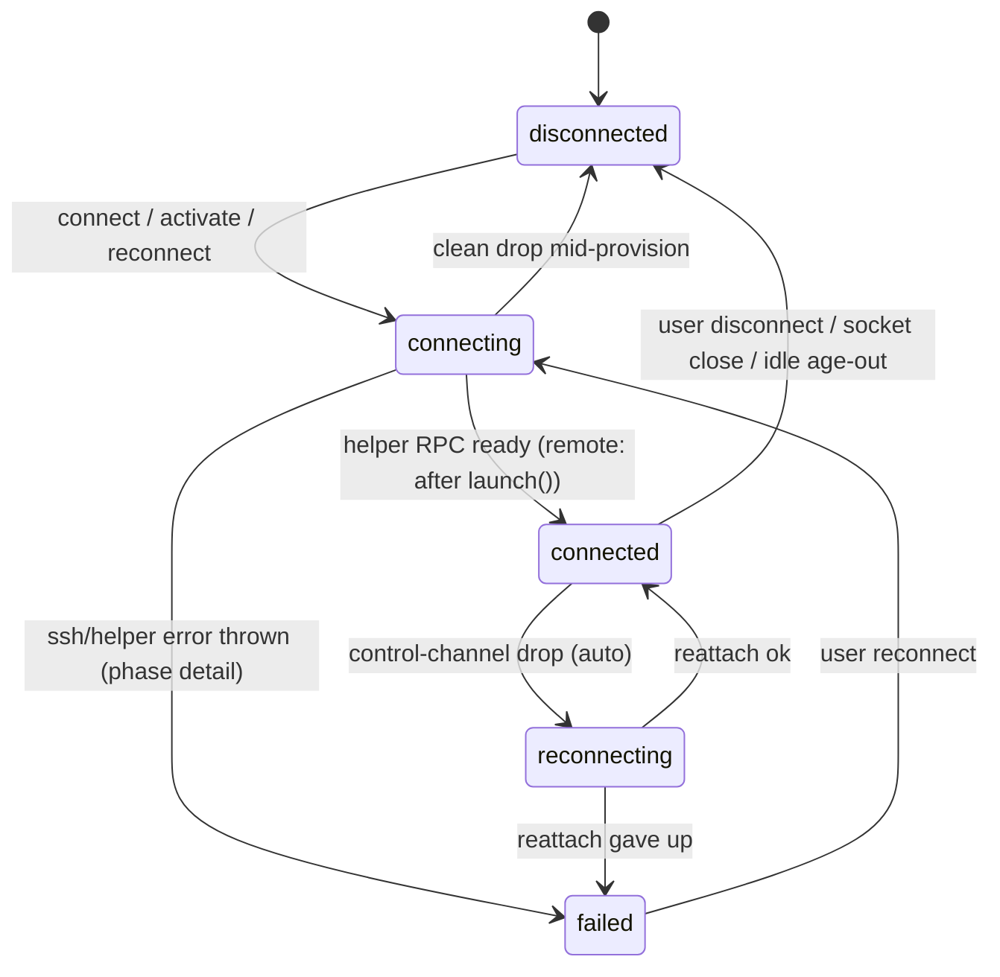

- **Guarded transitions.** Only the edges above are legal; illegal transitions
  are rejected (warn-logged, no-op), never thrown. Concurrent
  `connecting`/`reconnecting` requests coalesce to the in-flight transition so a
  rapid toggle never builds duplicate providers/channels.
- **Remote `connected` means helper-RPC-ready.** For remote, `toConnected()`
  fires **after** `RemoteHelperLauncher.launch()` resolves (RPC proven), not on
  raw socket-up — socket-up maps to `connecting` — so a read issued the moment a
  project reports `connected` never fails "helper unavailable". The
  `connecting → disconnected` edge is legal so a drop during provisioning resolves
  cleanly instead of stranding the machine; `connecting → failed` is the
  thrown-error edge. Local projects short-circuit to `connected` (already "ready")
  and never flow remote transitions.
- **Main is authoritative; renderer derives.** Providers/transport feed events
  into the machine; `SessionManager` forwards the machine's `ConnectionStatus`
  via a single `evt:status`. The renderer's status indicator, terminal control
  session, and the Changes/Explorer/Workgraph panels are **pure derivations** of
  that status (`sessionStore` + `isConnected`/`isDisconnected` selectors); the
  Changes/Workgraph panels additionally derive their per-project `byProject` slice
  off per-session status + watch events (never `activeId` alone). No parallel
  connection truth — and no `suspend()`/`resume()` — may be reintroduced.
- **Status is wired before connect.** `SessionManager` subscribes to provider
  status in `open()` _before_ calling `connect()`, so the first
  `connecting → connected` transition is never dropped (the wire-after-connect
  ordering left the UI stuck on the `disconnected` fallback).
- **Disconnect = teardown, reconnect = rebuild.** On `disconnected`, the terminal
  control session is released, the per-project pane registry entries are disposed
  (`disposeProject` — so a reconnect re-binds output sinks rather than reusing a
  cached entry with no sink), the IPC control/terminal caches for the project are
  evicted (via `SessionManager.onEviction`, so a new provider wires fresh
  notification subscriptions), and panels clear to an explicit "Disconnected"
  state. On reconnect the provider is rebuilt fresh (re-running remote helper
  provisioning), the terminal re-acquires and re-focuses, and panels reload.
  Freeze-and-reattach (preserving scrollback across a disconnect) is a deferred
  future option, not the v1 behavior.

### Control-channel reattach & re-init (epoch signal, invariant)

A remote tmux control channel (`tmux -CC`) reconnects **independently of the SSH
transport and the `ConnectionMachine`**. When the channel drops for a transient
reason — network/keepalive blip, laptop sleep/wake, or the responsiveness
watchdog failing the link — `RemoteTmuxControlManager.scheduleReattach`
([electron/main/providers/remote/tmuxControl.ts](../electron/main/providers/remote/tmuxControl.ts))
opens a **fresh** channel (with a fresh parser) and re-attaches to the surviving
remote tmux session. The `ConnectionMachine` stays `connected` the entire time,
so **no status transition fires**. Re-init therefore cannot be driven off
connection status; it is driven off a **channel-attach epoch**.

- **Epoch signal.** Each control manager (local and remote) keeps a monotonic
  `epoch` bumped on every successful attach — the first open **and** every silent
  reattach — and emits a synthetic `{ type: 'attached', epoch }` notification
  through the same `onNotification` → `evt:tmux` seam as real tmux notifications.
  This unifies first-connect and reattach: both mean "a fresh channel is live".
- **Renderer re-init keyed on epoch, not status.** `controlSession`
  ([src/renderer/tmux/controlSession.ts](../src/renderer/tmux/controlSession.ts))
  keeps a per-project `channelEpoch` (latest announced) and `initializedEpoch`
  (latest re-initialized). When they differ for the active project it runs
  `reinitProject`: an **authoritative** `syncFromTmux` (folds `list-windows` and
  **prunes** windows absent from it — a window closed during the drop replays no
  `%window-close`), reserved-window reconcile, and `restoreActiveWindow` (adopts
  tmux's session-active window via a synthetic `session-window-changed` so a
  reconnect focuses the **last-worked** window, not the first tab). A single-flight
  with a pending re-drain catches an epoch that lands mid-sync. The epoch is
  marked initialized **only when `syncFromTmux` actually read a live (non-empty)
  window list**: a just-attached `-CC` session is briefly not queryable (an
  empty/errored `list-windows`), and marking it initialized then stranded the
  window list until a manual switch. An empty read instead schedules a **bounded**
  retry (~200 ms × 15) so the list converges on its own with no user action, while
  the cap prevents spinning on a genuinely dead session. The boolean "initialized
  once" guard this replaced was the root cause of the stale-window-list /
  stale-display class: it skipped re-init entirely on a reattach.
- **Display restore.** After the window sync, `controlSession` fires
  `subscribeReinit`; `ControlTerminalPanel` mirrors the toolbar **hard refresh**
  for the tab ON SCREEN right now — `hardRecoverTab` (capture-pane re-seed of
  normal-screen panes, so content missed during the drop is recovered; alt-screen
  TUIs are gated to a repaint only, no runaway scroll) plus a `nudgeClientSize`
  resize round-trip that makes tmux re-emit `%output` and SIGWINCH the pane apps,
  plus a `nudgePaneRows` per-pane absolute-height round-trip (sent immediately
  after `nudgeClientSize`, same ordering contract as the toolbar refresh) so
  every pane of a multi-pane stacked split redraws, not just the first. Every
  OTHER visible tab of the project is only QUEUED for this same refresh, run
  lazily the instant it's actually focused — an eager, concurrent refresh of
  every tab was tried first and reverted because it raced tmux's own
  `%layout-change`/`%window-add` catch-up stream after a reattach. See CLAUDE.md
  "Control-mode tab refresh is three-tier" and "Control-mode background-tab
  refresh is lazy" for the full mechanism.
- **Per-project teardown.** `resetControlSession(projectId)` clears only that
  project's lifecycle and **keeps** the shared `evt:tmux` subscription and that
  project's `channelEpoch`, so disconnecting one project never clobbers another
  live one, and a re-acquire that causes no fresh attach (a renderer backend
  switch with tmux still open) still re-inits because `initializedEpoch` is now
  behind the kept `channelEpoch`.
- **Honest status (observability).** The manager exposes
  `onReconnecting`/`onReattached`/`onReattachExhausted` hooks that the
  `RemoteProvider` wires to `machine.toReconnecting()`/`toConnected()`/`toFailed()`
  so a flap shows a `reconnecting` dot. This is observability only — correctness
  of re-init depends on the epoch, never on the status transition, so wiring
  `reconnecting` cannot reintroduce the status-inferred re-init bug.

**Regression check:** on a remote project, force a `-CC` channel flap (kill the
SSH transport, or sleep/wake the host) so it auto-reattaches with **no** user
action: the window list must be correct and the tab ON SCREEN at reattach time
must display correctly, with no manual refresh needed; the tab focused must be
the window the user was last working in (not the first). With 2+ tabs open and
a background tab desynced before the flap, that tab is NOT expected to refresh
until it's actually switched to — by design (see "Control-mode background-tab
refresh is lazy" in CLAUDE.md) — but switching to it must then show it already
correct, with no manual refresh needed either.

### Terminal Lifecycle Decoupling (invariant)

Terminal/xterm lifecycle is **decoupled from React mount and from project
switching**. This is an enforceable invariant, not a preference: violating it
reintroduces the project-switch rebuild class of bugs (blank-until-keystroke,
empty-state flash, keyboard lag, and cross-project output bleed).

- **xterm instances are owned by module-level registries keyed by project
  identity**, never by the React component tree:
  - session-per-tab terminals →
    [`terminalRegistry`](../src/renderer/terminal/terminalRegistry.ts), keyed by
    `(projectId, kind, key)`;
  - control-mode (`-CC`) panes →
    [`controlPaneRegistry`](../src/renderer/tmux/controlPaneRegistry.ts), keyed by
    `(projectId, paneId)`.
    Each xterm renders into a detached container that is **reparented** into the
    current panel host; React views attach/detach, they do not create/dispose.
- **Per-project tmux view state is namespaced by `projectId`**
  ([`tmuxStore`](../src/renderer/tmux/tmuxStore.ts): `byProject` + a single
  `activeProjectId`). The tmux pane id (`%0`) repeats across each project's
  session, so output sinks are keyed by `(projectId, paneId)`.
- **Switching projects only moves the active selection** (`setActiveProject`).
  It MUST NOT dispose/recreate xterm instances, reset a project's view slice, or
  re-seed terminals. A single always-on control-mode subscription routes every
  notification to its project's slice, so all visited projects stay live and a
  return is instant.
- **Disposal is explicit or idle**: only an explicit close (tab/pane/window) or
  the registry idle reaper (detached + untouched past the threshold) disposes an
  instance; the underlying tmux session survives so a later return reattaches.
- **Backend selection** lives in the `terminalBackend` setting; the tmux
  registries are siblings, never active at the same time. Switching tmux
  backends
  ([src/renderer/terminal/backendSwitch.ts](../src/renderer/terminal/backendSwitch.ts))
  kills every cockpit-socket session, disposes both registries, and remounts
  the terminal panel so the chosen backend re-initializes from a clean slate.
- **Control-mode raw-byte invariant.** The `-CC` data pipeline carries raw
  bytes end-to-end: node-pty is opened with `encoding: null`, the shared
  parser is fed `Uint8Array`, and the renderer writes bytes directly into
  xterm; the `capture-pane` seed re-encodes the parser's latin1-mapped reply
  string back to bytes before writing. This matters because tmux's `%output`
  only octal-escapes control bytes (`< 0x20`); every byte `> 0x7E` — the UTF-8
  sequences for non-ASCII glyphs — is emitted verbatim, so any intermediate
  UTF-8 decode truncates multi-byte glyphs to their low byte and corrupts every
  non-ASCII glyph in a TUI (powerline, box-drawing, emoji). Regression check:
  open a control-mode terminal and run a glyph-rich TUI (`vim`, `htop`,
  `claude`); garbled glyphs mean the invariant is broken.

### Cockpit-mux backend (macOS/Linux)

`cockpit-mux` is a standalone Go component under
[`cockpit-mux/`](../cockpit-mux/), not an Electron child implementation. One
daemon per mux home owns PTYs, logical sessions/windows/panes, a libghostty-vt
shadow, and private SQLite keyframes plus raw tails. Its Unix socket lives in a
private `0700` home and validates peer credentials; attach is exclusive and
seeded through a sequence barrier so a new client receives a coherent screen
before live bytes resume. The Go binary remains usable through its terminal
fallback independently of Cockpit.

The daemon returns topology as an epoch-and-revision snapshot, rather than a
bare window list. The epoch changes whenever a daemon starts; its revision is
assigned while that daemon holds the topology lock. Cockpit's middle layer
retains only the newest revision within the active epoch for the active project,
so a late IPC read cannot resurrect a window or pane that a later lifecycle
operation removed, while a recovered daemon's restarted counter is accepted.

#### Cockpit mux topology and focus ownership

The mux daemon, not a Cockpit renderer store, owns selected topology. Each
logical session has exactly one selected window, an ordered window placement,
and one selected pane for **each** of its windows. A window ID is opaque
identity rather than position: `WindowRecord.idx` persists its session-local
placement and the daemon holds that order as `windowOrder`. Switching from
Window A to Window B changes the logical session's active window; returning to
A restores A's saved active pane. Closing the active window selects its next
placement, or the preceding final placement when no successor exists. The daemon
persists this interaction state with the window layout catalog, so the same
selection and order survive renderer reload, a new local/remote client, daemon
recovery, and live handoff. Browser focus is necessarily ephemeral: when
Cockpit makes a daemon-selected pane visible, the renderer focuses that pane's
textarea/xterm; it must never choose a different pane from client-only history.

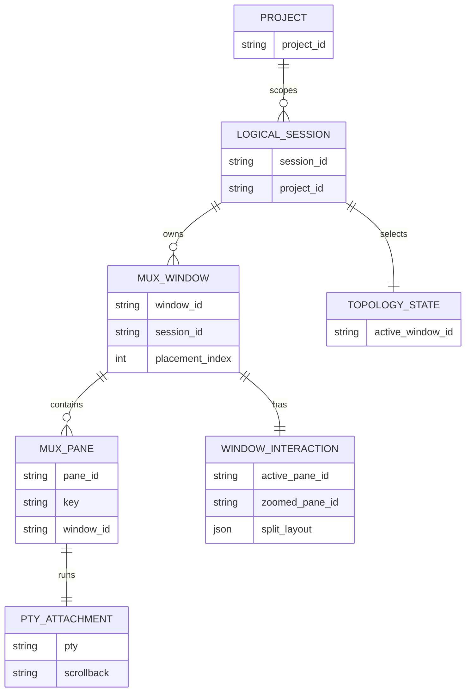

`TopologyState` is represented in the daemon as `activeWindowID`, `windowOrder`,
`activePaneByWindow`, `zoomedPaneByWindow`, and `layoutByWindow`; it is stored
in the private mux catalog rather than in the renderer. The catalog's
`SessionRecord`, `WindowRecord`, and `PaneRecord` preserve identities and
recovery metadata; `WindowRecord.Index` is the durable position projection of
`windowOrder`. The topology and handoff protocol repeat that order explicitly,
and the middleware maps it into `MuxTopologySession.windowOrder`; the renderer
uses it for tab display and previous/next navigation. Live
`managedSession`/`Pane` objects own PTYs, attachments, and screen bytes.

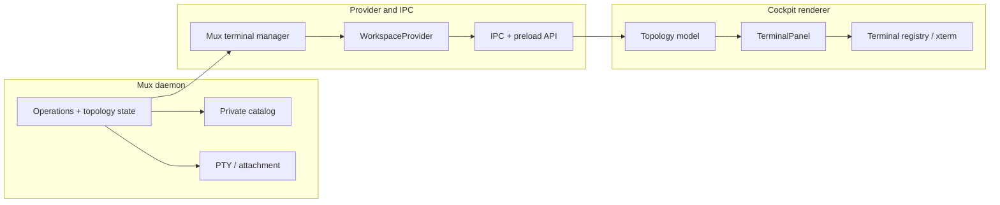

Mux PTYs identify as `xterm-ghostty`. The exact pinned Ghostty terminfo entry is
embedded in the daemon and installed in the private mux home under both macOS
hexadecimal and Linux letter directory conventions, then passed through `TERMINFO`.
This removes any dependency on a host-wide Ghostty installation.

Local and remote providers use the same MessagePack client and terminal manager.
The local launcher verifies a manifest-selected packaged binary before opening the
Unix-socket bridge; the remote launcher detects its POSIX target, verifies the same
artifact checksum before upload, then uses an SSH exec bridge. Release manifests
are append-only and select the newest complete version. On macOS, the packaging sign
hook refreshes manifest hashes after nested artifacts are signed and then re-seals
the outer application.

Fresh macOS/Linux configuration resolves to `cockpit-mux` with the wterm DOM
renderer as its default; the xterm adapters remain independently selectable.
Existing configurations retain their saved backend without a prompt or automatic
migration; users change it explicitly in Preferences. Windows is explicitly
normalized to a tmux backend. WTerm 0.5 supplies a bounded direct Kitty PNG/RGB/RGBA graphics
subset through its DOM overlay. A live mux shadow retains supported direct
graphics in native memory and composes a WTerm-only quiet replay seed under the
attach sequence barrier. That capability negotiation also supplies renderer cell
pixels for PNG placements that omit a grid span; non-direct transports and graphics recovery across a
daemon restart, replacement, or handoff remain excluded.

## Major Data and State Model

- **App-local SQLite** under `userData/` (WAL), schema via ordered idempotent
  migrations tracked in `migrations(version)`. Cockpit tables:
  `agent_cockpit_projects` (registry, full `ConnectionSpec` as JSON, plus
  `sort_order` for the user-controlled tab order and `run_command` for the Run
  panel), `agent_cockpit_active_project` (single-row active pointer), and
  `agent_cockpit_notes` (review notes by project/worktree/file/hunk/block/bead
  target), plus `layouts` (global / `project:<id>`) and `settings`. Legacy v1
  tables (`projects`, `review_state`, `notes`, `review_passes`, `since_seen`)
  remain in the migration history but are not part of the cockpit schema. No
  migration ever touches a repository or beads database. See
  [docs/DESIGN.md](DESIGN.md) for the full schema.
- **Renderer state** is zustand, consumed via selectors and keyed by the active
  project so background-project changes do not re-render the active view.
  External IPC/watch results are pushed into stores from outside React.
  Connection state specifically is a **derived** mirror (`sessionStore`, fed by
  `evt:status` from the main `ConnectionMachine`); the renderer holds no
  independent connection truth (see the Connection State Machine invariant).

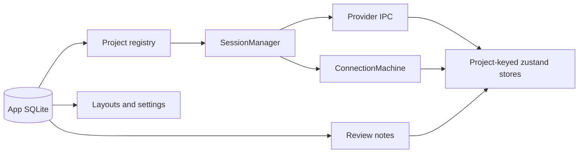

### Workgraph Relationship & State Model (beads_rust) (invariant)

#### Summary

The workgraph normalizes beads issues into `BeadsIssue[]` + `BeadsDep[]` and
derives every rendered state from one pure module
([src/renderer/beads/graphSelectors.ts](../src/renderer/beads/graphSelectors.ts)).
List, Tree, Graph, and TaskDetail are pure derivations of it.

#### Details

- **Dependency direction (authoritative).** A normalized edge is
  `BeadsDep { from = issue_id, to = depends_on_id, type }`. beads*rust stores a
  dependency as *`issue_id` depends on `depends_on_id`\_, so for a `blocks` edge
  **`to` blocks `from`** (`from` is the blocked/dependent node). An issue is
  dep-blocked iff it is the `from` of a `blocks` edge whose `to` is non-terminal.
  `parent-child` edges are `{from = child, to = parent}` — structural hierarchy,
  not a work blocker by themselves. This direction is the single authoritative
  reading; an earlier inverted reading marked the wrong side blocked.
- **Terminal equivalence.** `isTerminal(status)` treats `closed`, `tombstone`,
  and `deleted` identically as done (tombstones are also filtered at the read
  layer in `electron/main/beads/normalize.ts`).
- **Three kinds of "blocked", one `deriveState`.** Precedence `done >
blocked(flag) > in_progress > dep_blocked > child_blocked > ready`:
  - `blocked` — stored `status === 'blocked'` (a deliberate flag) → **red**,
    urgent, sorted first.
  - `dep_blocked` — derived from an open `blocks` dependency → **yellow**,
    informational.
  - `child_blocked` — derived: a parent/epic with ≥1 open child (the epic↔child
    reverse-block, app-derived; beads_rust does **not** auto-block epics) →
    **yellow**, informational.
    Only the flag is red; both derived reasons are yellow and sort below the
    actionable in_progress/ready groups. `openBlockerCount`/`openChildCount` expose
    the derived reasons as independent secondary badges so a node whose primary
    state masks another reason still surfaces it. Colors map to existing Solarized
    tones (red=removed, green=added, blue=accent, yellow=warn, muted=neutral).
- **Graph view** ([graphLayout.ts](../src/renderer/beads/graphLayout.ts))
  traverses both `blocks` and `parent-child` edges and returns typed edges
  (`blocks`, `parent-child`, and the derived `reverse-block` = an open child of
  an epic) drawn distinctly.

## Interfaces and Ownership Boundaries

- **`WorkspaceProvider`** ([src/shared/providers/types.ts](../src/shared/providers/types.ts))
  is the contract every panel depends on and both providers implement.
- **Bounded byte paths (one read, one write).** `WorkspaceProvider.readFileBytes`
  (IPC channel `provider:read-file-bytes`) is the single renderer-facing byte
  READ: stat-gated at `FILE_BYTES_CAP` (10 MiB — one authoring site,
  [src/shared/providers/fileBytesCap.ts](../src/shared/providers/fileBytesCap.ts)),
  whole-file base64 over IPC, no `ref`, no range; the main handler whitelists
  `{ worktreePath }` explicitly rather than forwarding the renderer's options
  wholesale. `WorkspaceProvider.exportFile` (channel `files:save-as`) is the
  single byte WRITE, OUT of the repository to the app host, streaming with no
  bytes over IPC. See "Content Modes & Bounded Binary-Preview Reads" and
  "Bounded File Export (Download) & Row Context Menus".
- **Beads read/write split.** Beads has two distinct paths behind the provider.
  **Reads** (`getTaskGraph`/`getTask`) are read-only — local opens the beads
  SQLite DB `readonly`/`query_only` (open-read-close), remote parses
  `.beads/issues.jsonl` over the helper `readFile` RPC. **Writes**
  (`beadsClose`/`beadsReopen`/`beadsComment`/`beadsCreate`, plus the
  `beadsListComments` read) go through the **`br` CLI**, so `br` owns the audit
  trail, policy gates, WAL handling, and JSONL sync — never a direct SQLite write.
  The argv builders ([electron/main/beads/runner.ts](../electron/main/beads/runner.ts))
  are shared by both transports so they issue identical, injection-safe commands
  (argv only, no shell): local via `runBr` (`spawnSync`), remote via the helper
  **`beadsExec`** RPC (formerly `beadsQuery`, renamed once writes started flowing
  through it). Five IPC channels (`provider:beads-{close,reopen,comment,create,
list-comments}`) carry these; the renderer store reloads the graph on a
  successful mutation and surfaces `br`'s own message inline on failure. This is
  the one app-IPC repository-mutation path (REQUIREMENTS NFR-2).
- **Terminal renderer boundary (`PaneRenderer`).** The control-mode pane registry
  ([src/renderer/tmux/controlPaneRegistry.ts](../src/renderer/tmux/controlPaneRegistry.ts))
  owns pane identity, the raw-byte `%output` sink, the capture-pane seed, the idle
  reaper, and the cell-size cache. The Cockpit-mux terminal registry owns provider
  lifecycle, input/reply routing, output, and geometry. Retained renderer calls
  (`open`, input/reply write, resize, close, history, and broadcast) carry their
  owning project id through preload and main IPC, so a background renderer can
  never resolve a same-key terminal against the currently active provider. Both use the same pluggable
  **`PaneRenderer`** interface ([src/renderer/tmux/paneRenderer/](../src/renderer/tmux/paneRenderer/)),
  selected by the `terminalRenderer` setting. Two adapters implement it:
  **`XtermPaneRenderer`** (`dom`/`webgl`, the default + fallback) and
  **`WtermPaneRenderer`** (`wterm` — `@wterm/dom`'s DOM renderer driven by the
  `@wterm/ghostty` libghostty VT core). Its bounded, DOM-owned canvas overlay
  renders the documented direct Kitty PNG/RGB/RGBA subset. The mux never
  intercepts raw Kitty bytes: it reads libghostty's parsed in-memory registry only
  while composing a WTerm attach seed, and never persists graphics. The terminal invariants — raw-byte
  `ready()`, raw-byte `write(Uint8Array)`, input/reply routing, optional local
  scrollback, non-destructive repaint-from-buffer recover, font-derived cell metrics —
  are interface contracts each adapter honors. DOM rendering (xterm DOM, wterm) shapes/snaps glyphs via the browser
  font engine, so powerline/nerd glyphs align (a canvas reimplementation does not).
  wterm's libghostty WASM is served from the dedicated, fetch-capable
  `cockpit-wasm://ghostty-vt/ghostty-vt.wasm` endpoint. The main process maps that
  one URL to the packaged binary (never arbitrary files or a network resource),
  which avoids Electron `file:` fetch restrictions; the production CSP permits that
  scheme and carries `script-src 'self' 'wasm-unsafe-eval'` for narrow WASM
  compilation only. WTerm graphics never add renderer filesystem privilege: the
  accepted direct subset excludes file-path, shared-memory, and URL media.
- **Typed IPC contract** ([src/shared/ipc/](../src/shared/ipc/)) is the single
  source of truth for channels and the `RendererApi` shape; preload exposes it
  as `window.api`, the renderer wraps it as `cockpit`. The main IPC bridge owns
  input validation at the boundary and routes to the active provider via
  `SessionManager` and to the SQLite store. Control mode adds its own slice:
  `tmuxControl:open|close|command|input|resize|capture-pane` request channels
  and a single `evt:tmux` push channel that carries typed control-mode
  notifications back to the renderer.
- **Link routing (single authority).** `openLinkTarget`
  ([src/renderer/links/openLinkTarget.ts](../src/renderer/links/openLinkTarget.ts))
  is the one renderer module deciding what a clicked link does, shared by
  markdown anchors (TaskDetail + content view) and terminal OSC 8 links (via the
  `linkHandler` on both xterm construction sites). Web URLs go to the OS browser
  (`window.open` → `setWindowOpenHandler` → `shell.openExternal`); local paths
  are resolved + existence-validated + classified by the provider
  (`resolvePath` → `{exists,isDir,insideProject,relPath,absPath}`, run on the
  correct host for local vs remote — the renderer never stats the FS). An
  in-project file opens in the content panel and reveals in the Explorer; an
  out-of-project file opens in the content panel only (`external-file`, no git
  diff); a non-existent path is a no-op.
- **Dev-environment launcher seam (resource caps).** How a project's control-mode tmux
  server is launched on the host is a pluggable `EnvLauncher` (`ensure()` + `wrapExec()`)
  selected by the global `devEnv.mode` setting via `createEnvLauncher`
  ([electron/main/providers/remote/envLauncher.ts](../electron/main/providers/remote/envLauncher.ts)) —
  the same encapsulation pattern as `createRemoteTransport()`. The default `systemd-scope`
  starts the server inside a `systemd-run --user --scope` with a `MemoryMax` cgroup cap
  (default 16 GB) so a runaway OOM-kills inside the scope instead of crashing the host;
  `RemoteProvider.connect()` calls `ensure()` after the helper RPC is proven and before
  `toConnected()`. The cap is **per host**, not per project: the `-L agent-cockpit` socket
  is one tmux server per host (one session per project), so the scope (`cockpit-devenv.scope`)
  bounds the host's whole cockpit workload — a global cap matching the global config;
  per-project caps (a per-project socket) are a future overlay. The scope lives under
  `user@<uid>.service`, so **lingering** (`loginctl enable-linger`) is a host prerequisite
  for the cap to apply and survive disconnects. Where a host can't support the scope
  (no cgroup v2 / no systemd / lingering off / macOS / local), `ensure()` **falls back to
  straight `tmux`, surfaced** as an `uncapped` WARN with the fix — never silently, never a
  hard block. `wrapExec` is identity for both shipped modes (the cap is on the server);
  the reserved `devcontainer` mode would inject `docker exec` there. `tmux` mode is the
  uncapped straight path. Two non-obvious knobs make the cap actually bind on hosts whose
  tmux links libsystemd: the server is started with the systemd user bus **denied**
  (`env -u DBUS_SESSION_BUS_ADDRESS -u XDG_RUNTIME_DIR`) so tmux cannot move each pane
  into its own uncapped `tmux-spawn-*.scope` (which would escape the cap), and with
  **`OOMPolicy=continue`** so an over-allocation OOM-kills only the runaway process and
  leaves the server + other panes running (default policy fails the scope and tears down
  the whole server). The cap only applies to a freshly-created server (an already-running
  uncapped server must be `kill-server`'d to re-cap).
- **Remote helper protocol** is a pinned `PROTOCOL_VERSION = 2`,
  length-prefixed JSON RPC (request/response + server-push `watch` and `callback`
  events) over the SSH exec channel; a mismatch re-provisions once, else
  hard-fails. The version is stated in four places that a test keeps equal (Go
  `ProtocolVersion`, the TypeScript client, `build.sh`, the Makefile). The client
  codec (`HelperRpcClient`, with an event registry) is decoupled from ssh2.
- **Trust boundaries:**

| Boundary                                    | Trusted?    | Notes                                                                                                                 |
| ------------------------------------------- | ----------- | --------------------------------------------------------------------------------------------------------------------- |
| Renderer code                               | No          | No Node/FS; receives only typed payloads.                                                                             |
| Preload                                     | Yes (small) | Forwards typed IPC; no business logic.                                                                                |
| Main process                                | Yes         | Owns providers, PTY/SSH, SQLite, dialogs, watchers.                                                                   |
| Repository content (Markdown/Mermaid/bytes) | No          | Sanitized + sandboxed iframe; large/binary degrade.                                                                   |
| Remote helper                               | Constrained | RPC over SSH: file/git/beads reads plus the `beadsExec` `br`-CLI write seam (argv only, no shell); capped frame size. |
| App-local SQLite                            | Yes         | Under `userData/`, never inside any repo.                                                                             |

## Filesystem Watch Subsystem

The watch subsystem is organized into four separated layers. Policy flows down
(one definition → every consumer); raw events flow up (raw → canonical).

```mermaid
flowchart TD
  P["Layer 1 — Policy<br/>src/shared/watch/policy.ts<br/>classifyWatchPath · deriveWatchSpec<br/>isHiddenFromChanges · WATCH_DEBOUNCE_MS"]
  L["Layer 2 — Mechanism (per transport)<br/>LocalWatchProvider: chokidar + fs.watch<br/>RemoteWatchProvider: WatchSpec over watch.subscribe RPC<br/>Go helper: watches per received WatchSpec"]
  I["Layer 3 — Ingest<br/>electron/main/watch/ingest.ts<br/>normalize → classify → debounce → CanonicalWatchEvent"]
  D["Layer 4 — Dispatch<br/>Main: evt:watch IPC<br/>Renderer: src/renderer/watch/hub.ts<br/>Subscribers by WatchCategory interest"]
  P -->|WatchSpec| L
  L -->|raw (path, op)| I
  I -->|CanonicalWatchEvent| D
```

### Layer 1 — Watch Policy (single source of "what to watch")

`src/shared/watch/policy.ts` is the **only** place that defines what the app
watches and how paths are classified. It has no Node dependencies and is
importable by both main and renderer.

Key exports:

- `WatchCategory = 'working-tree' | 'git-state' | 'beads'` — the three event
  classes panels subscribe by.
- `classifyWatchPath(relPath): WatchCategory | null` — the one place that maps
  a repo-relative path to a category, or `null` when excluded. Encodes:
  - `git-state`: `.git/HEAD`, `.git/packed-refs`, `.git/refs/**`, plus
    `.git/worktrees` and exactly one entry below it (`.git/worktrees/<name>` —
    a linked worktree being added/removed). Unlike `.git/refs/**`, this is
    depth-BOUNDED at directory level: `.git/worktrees/<name>/HEAD` and other
    paths nested inside a worktree's own metadata dir stay noise, so a routine
    commit made inside an already-known worktree doesn't spam a refresh.
  - `beads`: `.beads/beads.db`, `.beads/issues.jsonl` (never `-wal`/`-shm`/`.lock`
    → WAL self-feed suppressed at the policy level).
  - `working-tree`: everything else not excluded.
- Mechanism descriptors consumed by Layer 2: `NEVER_RECURSE` (`node_modules`),
  `DIRECTORY_GRANULARITY` (`.git`, `.beads` — watched at directory level, never
  per-file walked), `GIT_STATE_SIGNALS`, `BEADS_SIGNALS`.
- `WATCH_DEBOUNCE_MS` — the single debounce constant, shared by all transports.
- `deriveWatchSpec(): WatchSpec` — serializable projection of interest/exclusion
  descriptors for the Go helper (the transport cannot import TS modules).
- `CHANGES_HIDDEN_PREFIXES` + `isHiddenFromChanges(relPath, { showAll }): boolean`
  — the display filter for the Changes list (surfacing concern, distinct from
  watching).

### Layer 2 — Mechanism (per transport, policy-driven)

`WatchProvider` contract on the main side: `subscribeWatch(spec: WatchSpec, handler): Promise<WatchSubscription>`.

- **`LocalWatchProvider`** (refactor of
  [`electron/main/providers/local/watch.ts`](../electron/main/providers/local/watch.ts)):
  chokidar for the working tree + targeted `fs.watch` for git-state and beads
  signals. The _what_ (exclusions, signal paths) comes from the `WatchSpec`, not
  inline regexes. Mechanism-safety invariants are enforced here as _how_:
  directory-granularity for `.git`/`.beads` (no per-file descent, no FD pin on
  `beads.db`), gitignore + `node_modules` pruning (EMFILE avoidance).
- **`RemoteWatchProvider`** (`remote/index.ts` + `rpcClient.ts`): sends the
  derived `WatchSpec` in the `watch.subscribe` RPC params. The Go helper
  ([`remote-helper/watch.go`](../remote-helper/watch.go)) stops hardcoding its
  own `excludedDirs` and watches/filters per the received spec.
  `node_modules` + gitignore pruning remain as mechanism concerns in Go.
- Both providers emit raw `(path, op)` events upward to Layer 3.
- **Second, worktree-rooted subscription** (`WorkspaceProvider.subscribeWorktreeWatch`,
  local_repo_explorer-g1je): both mechanisms also expose a second entry point
  rooted at an arbitrary worktree path instead of the project root — a
  working-tree-only mechanism (no `.git`/`.beads` signal watchers, since a
  linked worktree's own `.git` is a pointer FILE, not a directory). Local
  reuses the SAME `createBase` scaffolding as the primary watch (own
  `excludedSegments`, own `createGitignoreFilter(worktreePath)`); remote reuses
  the SAME `watch.subscribe` RPC with a different `cwd`/`token` — the helper
  already supports multiple concurrent, independently-rooted subscriptions, so
  no Go changes were needed. See "Active-external-worktree watch" under
  [Worktree-Aware Reads & Shared Selection](#worktree-aware-reads--shared-selection-invariant)
  for the full design (when it is established, at most how many, and how its
  events are tagged).

**Important operational note:** After changing `remote-helper/*.go`, the dist
binary must be rebuilt (`remote-helper/build.sh`) and the app restarted so the
provisioner re-uploads on reconnect (hash mismatch) — otherwise the remote host
runs the stale helper.

### Layer 3 — Ingest (canonical event stream)

`electron/main/watch/ingest.ts` — one pipeline per active project:

1. Normalizes incoming paths to repo-relative POSIX.
2. Runs `classifyWatchPath` to tag each path with a category (dropping `null`).
3. Debounces + coalesces with the single `WATCH_DEBOUNCE_MS`.
4. Suppresses `-wal`/`-shm` echo (belt-and-suspenders, also enforced at policy).
5. Emits: `CanonicalWatchEvent { categories: WatchCategory[], paths: { rel, category }[], at }`.

This replaces the divergent 150 ms / 200 ms debounce windows and the
renderer-side path classification that previously duplicated logic across stores.

### Layer 4 — Dispatch (central hub)

- **Main** forwards `CanonicalWatchEvent` over a single `evt:watch` IPC carrying
  `categories`, plus an optional `worktreePath` (`WatchPushEvent.worktreePath`)
  — present only for a batch from the second, worktree-rooted subscription
  (local_repo_explorer-g1je); absent for the primary root-rooted watch's
  events, exactly as before this field existed.
- **Renderer** hub (`src/renderer/watch/hub.ts`): subscribers register
  `{ interest: WatchCategory[], onEvent }`. The hub routes canonical events only
  to matching subscribers — panels do not re-implement path filtering.
  `worktreePath` passes through unchanged on `HubWatchEvent`; classification
  is unaffected by it.
  - Changes store → `interest: ['working-tree', 'git-state']` (git-state →
    relist worktrees; working-tree → refresh changeset — unconditionally, so a
    tagged event costs at most one harmless extra refresh; `refresh()` itself
    always reads whichever worktree is CURRENTLY active).
  - Beads store → `interest: ['beads']`.
  - Explorer → `interest: ['working-tree']`.
  - Content panel's FoldingView read cache → `interest: ['working-tree']`,
    matching tagged/untagged events against a discriminated per-entry target
    (see the worktree-watch subsection linked below).
  - Content panel's manual-refresh staleness indicator (`ContentViewer.tsx`'s
    `FileContent`, local_repo_explorer-r97u) → `interest: ['working-tree']`,
    per-mount (not module-scoped like FoldingView's cache), matching an event
    against the ONE currently-displayed `(worktreePath, path)` the same way
    (untagged event ⇒ root selection, `worktreePath`-tagged event ⇒ exact
    string match). A match only sets a passive `stale` flag (a `StatusDot`
    next to a header Refresh `IconButton`) — it deliberately never triggers a
    reload itself (auto-reload was explicitly rejected). Clicking Refresh
    bumps a `refreshToken` that (a) is in the deps of `FileContent`'s own
    diff-bundle/markdown-source fetch effects, and (b) key-remounts whichever
    child view owns its own internal fetch (`RawFile`/`FoldingView`/
    `ImageCompare`/`ImageView`/`HtmlPreview`), forcing every view mode to
    re-read from disk on demand.
- **Changes surface filter:** `ChangesPanel` applies `isHiddenFromChanges(rel, { showAll })`
  from the shared policy to the changeset rows for display, keyed off the
  `showAllChanges` setting (`src/shared/settings.ts`). The changeset stays
  complete in main; surfacing is a renderer concern keyed off the central
  predicate.

### Single-Source Invariant

**"What to watch" has exactly one definition: `src/shared/watch/policy.ts`.**
No layer — local mechanism, remote Go helper, or renderer store — may define a
private watch or exclusion set. The remote helper receives a derived `WatchSpec`
over the `watch.subscribe` RPC and must NOT hardcode its own `excludedDirs`.
Surfacing (hiding `.git`/`.beads` from the Changes list) is a **display** concern
encoded in `isHiddenFromChanges`, distinct from the watch concern — both `.git`
and `.beads` remain watched so their changes drive refresh signals even when they
are hidden from the Changes list.

Violating this invariant reintroduces the divergence class of bugs this subsystem
replaced: remote Changes panel not auto-refreshing on `br` flushes/commits/branch
switches, remote workgraph panel not live-updating, and `.beads` entries
cluttering the Changes list.

## Changes View — Diff Targets

The Changes view supports two selectable diff targets, toggled by a toolbar `Select` in
[`src/renderer/changes/ChangesPanel.tsx`](src/renderer/changes/ChangesPanel.tsx):

- **Working tree vs HEAD** (default): the existing baseline-undefined path — `getChangeset`
  with no baseline, which the providers interpret as HEAD.
- **Branch point**: working tree vs `merge-base(HEAD, parentBranch)`. The parent branch
  is the current HEAD's configured upstream (`@{upstream}`) if set, otherwise
  `origin/HEAD → origin/main → origin/master` (remote-tracking refs only; bare
  `main`/`master` are not used because they would match local branches in a repo
  with no remote, producing a self-referential merge-base equal to HEAD).

### Provider Capability

`resolveBranchPoint(worktreePath, projectId?)` is a first-class method on `WorkspaceProvider`
([`src/shared/providers/types.ts`](src/shared/providers/types.ts)):

- **Local**: `electron/main/git/branchPoint.ts` — runs `git rev-parse --abbrev-ref @{upstream}`,
  then `git symbolic-ref refs/remotes/origin/HEAD`, then tries `origin/main`/`origin/master`
  in order; then runs `git merge-base HEAD <parentRef>`.
- **Remote**: Go handler `handleGitBranchPoint` in `remote-helper/commands.go` applies
  the same rule over the helper RPC (`gitBranchPoint` method, `HelperRpcClient`
  in [`electron/main/providers/remote/rpcClient.ts`](electron/main/providers/remote/rpcClient.ts)).
- Returns `{ parentRef, parentKind: 'upstream' | 'default', mergeBase }` or `null`
  (orphan branch, unrelated histories, or no resolvable parent).

The channel is `provider:resolve-branch-point`; the IPC contract lives in
[`src/shared/ipc/channels.ts`](src/shared/ipc/channels.ts).

### Liveness Invariant

The branch-point baseline stays **live**: on every watch-triggered or manual refresh,
`changesStore.refresh()` re-resolves `resolveBranchPoint` before calling `getChangeset`.
HEAD and the parent branch both advance on new commits; re-resolving on each refresh
keeps the diff correct without freezing a SHA at selection time.

When `resolveBranchPoint` returns `null` (orphan, no upstream + no remote default),
the store falls back to HEAD diff automatically and sets `branchPoint: null` in the
slice so the panel can surface a "no parent" affordance rather than silently showing
an incorrect result.

### Store Integration

`changesStore` ([`src/renderer/changes/changesStore.ts`](src/renderer/changes/changesStore.ts))
extends each `ChangesSlice` with:

- `target: 'head' | 'branchPoint'` — the selected diff target (default `'head'`).
- `branchPoint: BranchPoint | null | undefined` — the last resolved branch point
  (`undefined` = not in branchPoint mode; `null` = no parent resolvable).

The `setTarget(projectId, target)` action patches target, clears the current selection,
and triggers a refresh. `refresh()` derives the `baseline` from the resolved `mergeBase`
(or `undefined` for head/null), then calls `getChangeset` and `getFileDiff` with that
baseline — so the row list and per-file diffs always agree on the same diff target.

### Regression Check

On a branch tracking `origin/main` with local commits, branch-point mode must show
exactly the changes since the branch diverged — not uncommitted-only (HEAD mode), not
the entire repo history. Making a new commit while in branch-point mode and triggering
a watch-refresh must update the diff without requiring the user to reselect the target.
`resolveBranchPoint` should not be called at all when target is `head`.

## Worktree-Aware Reads & Shared Selection (invariant)

Git-worktree awareness spans two layers that must both hold, or opening a file in a
linked worktree fails ("File not found") or shows the main tree's content.

### Shared selection — one authoritative owner

Per-project `(worktrees, activeWorktree)` has exactly **one** owner:
[`src/renderer/worktree/worktreeStore.ts`](src/renderer/worktree/worktreeStore.ts)
(`useWorktreeStore` / `useActiveWorktree`), mirroring the "one authoritative owner"
pattern used for connection state. **Both** the Changes panel and the Explorer are
pure consumers — neither owns the other's worktree state:

- `ChangesPanel` and `followCwd` read/write the selection through `worktreeStore`;
  `changesStore` no longer holds `worktrees`/`activeWorktree` and its `refresh()`
  reads the active worktree from `worktreeStore`.
- `ExplorerPanel` reads `useActiveWorktree()`, lists/opens from that worktree, and
  remounts its tree (key includes the worktree) on a switch.
- **Orchestration is centralized in `panelDataSync`**, not in a panel or a store
  action: it loads/clears/evicts `worktreeStore` off per-session connection status,
  and subscribes to `activeWorktree` transitions to trigger `changesStore.refresh`.
  A same-worktree refresh keeps last-good (no flicker); a switch is detected via
  `changeset.worktree !== activeWorktree` (the provider stamps `changeset.worktree`),
  which clears stale files first. Do not reintroduce a per-panel worktree or route
  cross-store orchestration through a component.

### Worktree-parametrized read surface

The read surface is uniformly parametrized by worktree, base =
`worktreePath || projectRoot`, across **both** transports:

- `FileReadOptions.worktreePath?` and `WorkspaceProvider.listDir(dirPath, worktreePath?)`
  ([`src/shared/providers/types.ts`](src/shared/providers/types.ts)) — threaded through
  `api`, the IPC handlers, and the preload bridge. Additive/optional: an absent
  worktree behaves exactly as before, so a version-skewed helper/renderer degrades to
  root-relative reads instead of erroring.
- **Local**: `localReadFile`/`localListDir` resolve against `worktreePath || rootPath`;
  `getDiffBundle` reads **both** content sides from the worktree `cwd` (previously the
  local path read them from the fixed root — a local/remote asymmetry now erased).
- **Remote**: `RemoteProvider.readFile`/`listDir` forward `worktreePath`; the Go helper
  (`remote-helper/commands.go`) resolves relative targets against it, falling back to
  `remotePath`. Ref reads run in `cwd: base` so a linked worktree on another branch
  reads that branch's HEAD.
- **Renderer call-sites** pass the selection's `worktreePath`: `ContentViewer`
  (rendered), `RawFile`, `ImageCompare`, and `ExplorerPanel` (`listDir` + file-open
  selection). Link resolution (`openLinkTarget`/`resolvePath`) is **not yet**
  worktree-aware — a tracked follow-up.

### Worktree dropdown labels (shared builder)

The worktree picker shown by both panels is built by one shared function,
[`worktreeSelectOptions`](src/renderer/worktree/worktreeOptions.ts): each entry is
`"<workspace> - <branch>"` (workspace = the worktree directory basename; detached
worktrees show a short HEAD), value = the worktree path. `git worktree list
--porcelain` emits the main worktree first, so index 0 is the **primary** workspace:
it is pinned at the top and the rest are sorted by workspace name. Both `ExplorerPanel`
and `ChangesPanel` consume it — do not reintroduce a per-panel `w.branch ?? w.path`
label map.

### Explorer root browsing (Explorer-local override)

The Explorer's dropdown carries one extra, **Explorer-only** entry — `Root (/)` — that
lists the filesystem root so files outside the project can be browsed. This is held in
`explorerStore.rootBrowse` (per project), **not** the shared `activeWorktree`, so it is
NOT a second worktree truth: selecting root never moves the Changes panel, and returning
to the project is just picking a workspace from the same dropdown. When root browsing,
the Explorer reads with base `'/'` (the same worktree-parametrized `listDir` path — no new
read surface) and opens files as absolute `external-file` selections (no git diff). The
Changes panel does **not** offer root. Do not route root browsing through
`worktreeStore.setWorktree` or add root to Changes.

### Regression Check

Add a linked worktree on a branch that adds a file absent from the primary worktree;
select it in Changes. The Explorer must list that worktree and follow the shared
selection, and opening the branch-only file must show its content (no "File not
found") with diff-highlight content matching the worktree — on **both** local and
remote projects. Selecting the primary worktree (or none) must behave exactly as
before (project-root reads). Covered by the linked-worktree case in
`electron/main/providers/local/local.test.ts`, the `remote-helper` `*WorktreePath`
Go tests, and `worktreeStore.test.ts`.

### Active-external-worktree watch (lazy, at most one; local_repo_explorer-g1je)

The worktree-parametrized read surface above makes a sibling/external linked
worktree's files READABLE. Observing EDITS to those files — so the Content
panel's cache and the Changes panel refresh on an external change, the same
way they already do for the primary worktree — needs filesystem watch
coverage, which the primary watch (rootPath/remotePath-scoped) structurally
cannot provide: it can never see outside its own subtree.

**Problem.** Before this bead, a file in a worktree NESTED under the project
root was covered (the primary watch sees it; `FoldingView`'s cache converts
its path to root-relative — local_repo_explorer-w5x0), but a
SIBLING/EXTERNAL worktree (the common `git worktree add ../foo` shape) was
not observable by any watch mechanism at all. `toWatchTarget` (formerly
`toRootRelativePath`) in
[`src/renderer/content/FoldingView.tsx`](../src/renderer/content/FoldingView.tsx)
correctly recognized this and returned an unmatchable target — but nothing
could ever match it, because nothing watched it.

**Design decision — lazy, at most one, follows the SELECTION not the LIST.**
Rejected: an eager watch per known worktree (unbounded N × recursive
watchers, especially costly for a large/`node_modules`-heavy checkout — the
bead's own cost guardrail). Chosen: a per-project, at-most-ONE extra watch
subscription, established ONLY while the project's ACTIVE worktree is
EXTERNAL (neither the root nor nested under it — a nested worktree is
already covered by the primary watch, so a second subscription there would
be redundant). A worktree's extra watch follows the active SELECTION, not
the worktree LIST — the same "liveness is lazy" principle this app already
applies to sessions themselves.

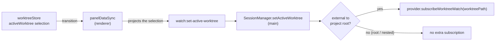

**Renderer is the single driver; main keeps no second truth.** Main has no
other way to learn which worktree the renderer's `worktreeStore` currently
considers active. `panelDataSync`'s existing `activeWorktree` transition
observer (the same one that already triggers `changesStore.refresh`) also
calls `agentCockpit.watch.setActiveWorktree(projectId, activeWorktree)` on
every transition, including to `null` (project switch / worktree-clear) —
one owning site for "detect a worktree-selection transition," not a second,
parallel diffing effect. `SessionManager.setActiveWorktree` (main,
[`electron/main/providers/sessionManager.ts`](../electron/main/providers/sessionManager.ts))
normalizes both the candidate path and the session's own root/remotePath
(from `loadSpec`), classifies external vs. root vs. nested, and reconciles:
a same-target call is a no-op; otherwise it stops any existing extra
subscription and, iff the new target is external AND the session is live,
establishes a new one. It keeps no independent "desired worktree" cache
beyond that reconciliation bookkeeping — the renderer's selection is the
only source of truth for the target, mirrored by an in-flight call-sequence
guard (mirroring `startWatch`'s existing `sessions.get(projectId) !==
provider` pattern) so a superseded call never clobbers a newer one.

**Mechanism (both transports, zero Go changes).**
`WorkspaceProvider.subscribeWorktreeWatch(worktreePath, handler)`
([`src/shared/providers/types.ts`](../src/shared/providers/types.ts)) is
working-tree-only — no `.git`/`.beads` signal watchers, since a linked
worktree's own `.git` is a pointer FILE (`gitdir: ...`), not a directory, so
those signal paths never exist under it to watch in the first place. Local
(`LocalWatchManager.subscribeWorktree`,
[`electron/main/providers/local/watch.ts`](../electron/main/providers/local/watch.ts))
shares the SAME `createBase` scaffolding the primary watch uses (own
`excludedSegments`, own `createGitignoreFilter(worktreePath)` — the
WORKTREE's own `.gitignore`, not the project root's), just rooted
differently and without the primary's dedicated git/beads signal watchers.
Remote (`RemoteProvider.subscribeWorktreeWatch`) reuses the SAME
`watch.subscribe` RPC with a fresh `token`/`cwd` — the Go helper
([`remote-helper/watch.go`](../remote-helper/watch.go)) already keys
subscriptions by token with an arbitrary per-subscription `Cwd`, so a second,
independently-rooted subscription needed no helper changes.

**Event tagging and consumption.** `WatchPushEvent`/`HubWatchEvent` gain an
optional `worktreePath` (see Layers 2/4 above): present only for a batch
from this extra subscription, absent for the primary watch's events. Two
consumers key off the tag:

- **`diffCache`** (`electron/main/providers/diffCache.ts`) — `onWatch(projectId,
paths, worktreePath?)`: a tagged batch drops only entries whose OWN stored
  `worktreePath` equals the tag AND whose path is in the changed set; an
  untagged batch keeps its pre-existing behavior (path-only match, or a
  project-wide clear on a git-state signal) unchanged.
- **`FoldingView`**'s read cache
  (`src/renderer/content/FoldingView.tsx`) — each entry's `watchTarget` is a
  discriminated `{kind:'root'; rel}` (primary/nested worktree, matched by an
  UNTAGGED event) or `{kind:'worktree'; worktreePath; rel}` (external
  worktree, matched ONLY by a TAGGED event for that exact worktree).
  `changesStore.refresh` (via `panelDataSync`'s existing `working-tree`
  handler) needs no gating at all: it already refreshes unconditionally on
  any working-tree event, and always re-reads whichever worktree is
  CURRENTLY active, so a stale-tagged event costs at most one harmless extra
  refresh.

**Unwatched-interval staleness guard.** The extra watch covers ONLY the
currently-active external worktree — the moment the selection moves away,
its subscription is torn down, so an edit made during that unwatched
interval would never arrive as an event. `FoldingView` subscribes
(module-level, alongside its hub subscription) to `useWorktreeStore`
transitions and, on a transition AWAY from a worktree path, evicts every
`kind:'worktree'` cache entry for that path — so reopening the same worktree
later forces a real re-read rather than silently trusting a possibly-stale
cached entry.

**Symmetric lifecycle.** The extra subscription is session-owned exactly
like the primary one: `SessionManager`'s existing `stopWatch(projectId)` now
tears down BOTH the primary AND the extra subscription in one place, so
every existing teardown edge (status → disconnected/failed, eviction,
`closeAll`) stays symmetric for free — no second, independently-called
teardown path was introduced.

**Scope boundary (explicit).**

- Covered: the ACTIVE external worktree, on both transports — Changes
  refresh, FoldingView cache invalidation, and `diffCache` sibling
  invalidation, with symmetric session lifecycle.
- Deferred by design, not a bug: every OTHER known-but-not-active worktree
  stays unwatched. This is handled by the switch-away eviction guard above,
  not by adding more watchers — see the "do not reintroduce" rule in
  CLAUDE.md's "Filesystem watch: single-source what to watch" entry.
- Pre-existing, NOT introduced or fixed by this bead:
  `diffCache`'s NESTED-worktree path-shape mismatch (an untagged event's
  path is project-root-relative while a nested worktree's own cached entry
  stores a worktree-relative path, so they can fail to match) — flagged in
  `diffCache.ts`'s `onWatch` doc comment as a candidate for a small
  follow-up bead.
- Link resolution (`openLinkTarget`/`resolvePath`) remaining
  non-worktree-aware is the already-tracked separate bead noted above.

**Regression check.** With a sibling/external linked worktree active, edit a
tracked file in it externally (outside the app) — the Changes panel must
refresh without a manual action, and toggling a JSON/YAML file's Content view
from Raw to Rendered must show the edited content. Switch the active worktree
away and back without any external edit — the switch-away staleness guard
unconditionally evicts that worktree's cache entries, so the return always
re-reads; the content shown is correct either way (unchanged if nothing
happened to change, current if something did). The already-covered primary
and nested-linked-worktree cases (w5x0) must show no behavior change.
Covered by the worktree-watch describe blocks in
`electron/main/providers/sessionManager.test.ts`,
`electron/main/providers/local/local.test.ts`,
`electron/main/providers/diffCache.test.ts`, `src/renderer/watch/hub.test.ts`,
and `src/renderer/content/foldingView.test.tsx`.

## Bounded File Export (Download) & Row Context Menus

The Changes and Explorer panels offer a per-row context menu (right-click, or
the platform context-menu key) with three actions — **Copy path (fully
qualified)**, **Copy path (relative)**, and **Download** — and Download is the
application's one **bounded file-export write path**: it streams a project
file's bytes OUT to a user-chosen destination on the app host via a native
Save-as dialog.

**Invariant — the read-only model stands.** Repository access is read-only —
the embedded terminal is the only write path INTO a project.
`WorkspaceProvider.exportFile` is the one deliberate, bounded exception: it
copies a file OUT of the repository to a user-chosen destination on the app
host (the Download capability), at explicit user request. It never writes into
the repository, local or remote, and it is not license to reopen the read-only
model. (The `WorkspaceProvider` header doc comment in
[src/shared/providers/types.ts](../src/shared/providers/types.ts) carries this
same statement; the two must not drift.)

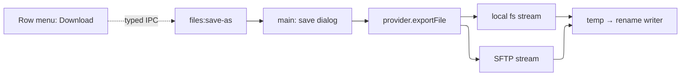

### Why `readFile` is not the byte source

`provider.readFile` is the **text preview/diff channel**, text-only by
construction: the local implementation (`getFile` in
[electron/main/git/files.ts](../electron/main/git/files.ts)) returns
`content: null` for binary content (`looksBinary`) and for files over the
preview `maxBytes` cap, and the remote Go helper's `readFile` RPC returns a
JSON string capped at `maxReadFileBytes` (2 MiB by default —
[remote-helper/commands.go](../remote-helper/commands.go)). Raising the cap
does not make it binary-safe — that channel exists to feed text preview/diff
rendering, and a download built on it would silently save empty or corrupt
output for exactly the files most worth downloading. The text preview path
(`readFile`/`FileReadResult`/`getDiffBundle`) therefore
stays text-only, and there are exactly TWO bounded, deliberately-shaped
exceptions to it — one in each direction, not to be mistaken for each other:

**`maxBytes` is a per-call cap override, not a second channel
(local_repo_explorer-ftbq).** `FileReadOptions.maxBytes` raises `readFile`'s
cap for one call, still entirely within the text-preview contract above — it
is consumed by exactly one caller today: ContentViewer.tsx's structural-fold
size-degrade override (see "The two runtime reclassifications (one rule)"
below). Both transports stay refuse-never-truncate at whatever the effective
cap is (never a partial/truncated string served as if complete): locally
`getFile` already refused rather than truncated at any cap; the remote Go
helper's `handleReadFile` was fixed to match — a file over its effective cap
now refuses (empty content, `truncated: true`, the true `sizeBytes`, read
WITHOUT even opening the file on the working-tree branch) instead of the
prior behavior of silently serving a truncated prefix. The helper clamps any
requested `maxBytes` to a 12 MiB ceiling (`maxReadFileCapBytes`) regardless of
the caller's request, and additionally refuses a response that would exceed
the RPC frame budget once JSON-escaped even under that ceiling (escape-heavy
text can inflate 2-6x) — both guard the same underlying constraint: the RPC
frame codec hard-caps a single message at 16 MiB
(`MAX_MESSAGE_BYTES`/`maxMessageBytes`) and a dropped oversized frame would
otherwise hang the caller's pending RPC forever with no error surfaced on
either side (`main.go`'s `writeFrame` only logs, never replies, on failure).

- **`exportFile` — the bounded byte WRITE (Download).** Whole file, uncapped,
  streamed OUT of the repository to a user-chosen destination on the app
  host; no file bytes ever cross IPC. This section describes it.
- **`readFileBytes` — the bounded byte READ (in-app preview).** Whole file,
  refused (never truncated) above a 10 MiB cap, delivered INTO the renderer
  as base64 over IPC — the one channel that intentionally carries file bytes
  across IPC. See "Content Modes & Bounded Binary-Preview Reads".

### Byte sources and the shared writer (main-only)

- **Remote — SFTP on `RemoteTransport`.** The transport boundary gained two
  byte-read primitives — `stat(remotePath)` and
  `createReadStream(remotePath, { start?, end? })`
  ([transportTypes.ts](../electron/main/providers/remote/transportTypes.ts)) —
  implemented by `Ssh2Transport`
  ([transport.ts](../electron/main/providers/remote/transport.ts)) over ssh2's
  built-in SFTP client. The single-ssh2-import boundary is preserved (the
  ESLint `no-restricted-imports` ban is unchanged), no ssh2 type leaks through
  the interface (`createReadStream` returns a Node `Readable`, `stat` a plain
  `StatResult`), and both are selectable through the same swap seam as every
  other transport method (`createRemoteTransport()` in
  [transportFactory.ts](../electron/main/providers/remote/transportFactory.ts) —
  consumers depend only on the interface). SFTP channel lifecycle: a fresh
  `conn.sftp()` per call, ended exactly once — `stat` ends it in its callback;
  `createReadStream` wires a once-guarded release to BOTH `'close'` and
  `'error'` on the returned stream, so normal EOF, early destroy, a read
  failure, and a transport disconnect mid-stream all release the channel.
  `stat` resolves `{ exists: false, … }` for a missing path rather than
  rejecting. This path **bypasses the helper RPC entirely** (no
  `remote-helper` Go change): a file larger than the helper's 2 MiB cap
  downloads byte-identically. `stat` ships as part of the primitive pair;
  Download itself calls only `createReadStream`, always for the whole file.
- **Local — no new abstraction.** `localExportFile`
  ([electron/main/providers/local/export.ts](../electron/main/providers/local/export.ts))
  streams via Node stdlib `fs.createReadStream`; there is deliberately no
  local mirror of the transport interface.
- **Worktree-parametrized base.** Both sides resolve the source exactly like
  every other provider read: base = `worktreePath || project root` (local
  `rootPath`, remote `remotePath`), with an already-absolute path passed
  through unchanged (the Explorer root-browse shape).
- **One shared writer.** Both transports funnel their stream through
  `writeStreamToDest`
  ([electron/main/providers/exportWrite.ts](../electron/main/providers/exportWrite.ts)):
  `pipeline` into a same-directory temp file, atomically renamed into place
  only on success; on ANY failure the temp is best-effort unlinked and the
  error rethrown — the destination never holds partial/truncated content, and
  the whole file is never buffered in memory.
- **Main-only dialog + write; no bytes over IPC.** The renderer sends a
  descriptor over one channel, `files:save-as`
  ([src/shared/ipc/channels.ts](../src/shared/ipc/channels.ts); renderer shape
  `files.saveAs` in [api.ts](../src/shared/ipc/api.ts) — deliberately not part
  of the `provider:*` group); main resolves the provider **before** showing
  the dialog (so a gone session fails fast instead of flashing a dialog),
  opens `dialog.showSaveDialog` with the source basename prefilled, streams on
  confirm, and returns only the saved path — `null` on cancel, with nothing
  written. The preload bridge only invokes the typed channel; no `fs`, `path`,
  or `dialog` is exposed to preload or the renderer, and no file bytes ever
  cross IPC.

### Future streaming (deferred; the range capability)

`RemoteTransport.createReadStream(path, { start?, end? })` is deliberately
**range-capable** (inclusive byte offsets, `fs.createReadStream` semantics)
even though Download never passes a range. The range parameters exist for a
FUTURE, separately proposed capability — viewing a large remote media file
in-app via range-based streaming/seek — because retrofitting range support
onto the transport boundary later is more disruptive than shaping the
primitive correctly now (ssh2's `sftp.createReadStream` supports
`{start, end}` natively, so it costs nothing today). Streaming/media playback
was an explicit **non-goal** of the work that introduced the primitive: there
is no streaming UI, no media player, no HTTP range proxy, no renderer-facing
range API, and nothing in the repository passes a range. Do not strip
`start`/`end` as unused, and do not build a range consumer ad hoc — a future
streaming proposal MUST start from this primitive rather than inventing a
second remote byte path.

### Row context menus (Changes + Explorer)

The substrate is one shared module,
[src/renderer/files/rowMenu.ts](../src/renderer/files/rowMenu.ts)
(`buildFileRowMenuItems(descriptor, ctx)` → `MenuItemDef[]` for the Radix
`ContextMenu`; `Row` is `forwardRef` so it serves directly as the
`Trigger asChild` target). It lives in `renderer/files/` — a domain-aware
sibling of the presentation-only `ui/` package, following the `worktree/`
precedent. Path semantics:

- **Copy path (relative)** copies the row's path relative to the selected
  worktree/project root, verbatim (Changes: `file.newPath`, the same string
  the row displays; Explorer in-project: `entry.path`).
- **Copy path (fully qualified)** copies `resolveAbsolutePath(...)`: base =
  `activeWorktree || project root`, POSIX join (`absoluteUnder`, whose single
  home is now this module). For a REMOTE project the root is
  `RemoteConnectionSpec.remotePath`, so "fully qualified" means the absolute
  path **on the remote host** — the useful value; there is no local file at
  that path, and it must not be "fixed" into a local path. An already-absolute
  row path (root browse) passes through unchanged.
- **Download** calls `files.saveAs(relPath, { worktreePath, projectId, suggestedName: basename })`;
  main re-resolves the path exactly like every other provider read.

Shipped disabled-state rules — disabled with an explanatory `title`, never
omitted, so the menu's shape (and the capability's discoverability) stays
stable across row types:

- **Directories** (Explorer `DirNode`): Download disabled ("Directories cannot
  be downloaded"); both copy actions stay enabled. No directory archiving.
- **Deleted Changes rows** (`status === 'deleted'`): Download disabled ("This
  file cannot be downloaded" — no working-tree bytes to fetch); both copy
  actions stay enabled.
- **Root-browse rows** (Explorer `Root (/)` mode, files AND directories):
  "Copy path (relative)" disabled ("This path is outside the project") — a
  project-relative path is semantically undefined outside the project. The
  fully-qualified copy and (for files) Download stay enabled.

Right-clicking never changes state: it does not select a Changes file, move
the content selection, toggle Explorer expansion, or consume a reveal target.
Action feedback is the substrate's `useRowMenuFeedback` transient message: the
Explorer renders it as a `role="status"` toolbar span ("Copied
fully-qualified path" / "Copied relative path" / "Downloaded"); the Changes
panel does not yet render it (tracked as a follow-up,
`local_repo_explorer-dpqo`). A canceled save dialog is a clean no-op; a failed
download is logged to the diagnostics log (`rowMenu` scope) rather than
silently dropped; a failed clipboard write is a silent no-op (the NotesPanel
precedent).

### Regression Check

On a LOCAL and a REMOTE project, download (a) a UTF-8 text file, (b) a binary
file, and (c) a file larger than 2 MiB: each saved file must be byte-identical
(`shasum`) to its source — (c) proves the remote helper RPC is not on this
path. Cancel must write nothing and resolve `null`. Abort a transfer
mid-stream: the destination must not exist with partial content (the temp file
is unlinked). With a linked worktree selected, a branch-only file must
download that worktree's bytes. In the menus: a deleted Changes row and a
directory row disable only Download (with their titles), a root-browse row
disables only the relative copy, and right-click changes no
selection/expansion. Covered by `exportWrite.test.ts`, the export cases in
`local.test.ts`, the stubbed-SFTP cases in `transport.conformance.test.ts`,
the factory-level interface case in `remote.test.ts`, `rowMenu.test.tsx`, and
the panel cases in `changes.test.tsx` / `explorer.test.tsx`.

## Content Modes & Bounded Binary-Preview Reads

The Content panel presents every file through one uniform mode model: **Diff**,
**Rendered**, and — text-like content only — **Raw**. Its header owns an
ephemeral Content-body-only zoom state (50–200% in 10% steps, with reset to
100%) and applies it using Chromium CSS `zoom` to the body wrapper only,
leaving application and terminal scale untouched. Which modes a file
offers, which is the default, and which component renders each combination are
all decided in a single authoring site,
[src/renderer/content/modeSwitcher.tsx](../src/renderer/content/modeSwitcher.tsx),
replacing the old per-extension mode values (`'image'`, `'html-preview'`) and
the hand-branched render blocks that used to live in `ContentViewer`. The
model's companion is the application's one **bounded byte READ**,
`WorkspaceProvider.readFileBytes` — the renderer-facing binary-preview channel
that the image views consume — described below in the same terms the Download
work framed its bounded WRITE exception.

### Class model and (class, mode) dispatch (single authoring site)

`classOf(path)` is a **pure, path-only** classifier producing a `ContentClass`
(`markdown | html | image | text | json | yaml | generic-binary`); `modesFor`
computes mode availability, `defaultModeFor` the default, and `viewFor` the
`(class, mode) → component` lookup (`VIEW_DISPATCH`). `ContentViewer`
dispatches on `viewFor`'s result — no other module branches on extension or
mode name. `isJsonPath`/`isYamlPath` extend the same extension-set pattern
`isMarkdownPath`/`isHtmlPath`/`isImagePath` already use: `.json`/`.jsonc` both
classify as `json` (`isJsonPath`; jsonc-parser — the same parser the
structural-folding view below builds on — natively tolerates
JSON-with-comments and trailing commas, so there is no grammar mismatch to
hide); `.json5` deliberately does NOT — its grammar is materially richer than
jsonc-parser handles, so it falls through to `text`, unchanged. `.yaml`/`.yml`
both classify as `yaml` (`isYamlPath`); `.csv`/`.tsv` both classify as `csv`
(`isCsvPath`; the delimiter comes from the extension via `delimiterFor`).
Shipped matrix (`ImageView` and `BinaryPlaceholder`
were new with the content-mode epic; `FoldingView` is a later addition — see
"Content Panel Structural Folding (JSON/YAML)" below — every other cell
reuses a pre-existing component):

| Class            | Diff                              | Rendered                                         | Raw               |
| ---------------- | --------------------------------- | ------------------------------------------------ | ----------------- |
| `markdown`       | `DiffView`                        | `RenderedMarkdown`                               | `RawFile` (plain) |
| `html`           | `DiffView`                        | `HtmlPreview` (sandboxed iframe)                 | `RawFile` (plain) |
| `text`           | `DiffView`                        | `RawFile` (Shiki-highlighted)                    | `RawFile` (plain) |
| `json`           | `DiffView`                        | `FoldingView` (source-mapped structural folding) | `RawFile` (plain) |
| `yaml`           | `DiffView`                        | `FoldingView` (source-mapped structural folding) | `RawFile` (plain) |
| `csv`            | `DiffView`                        | `CsvView` (sortable/filterable table)            | `RawFile` (plain) |
| `image`          | `ImageCompare` (before/after)     | `ImageView` (working-tree image)                 | —                 |
| `generic-binary` | `DiffView` (graceful placeholder) | `RawFile` (graceful placeholder)                 | —                 |

An `external-file` selection (out-of-project, no git baseline) never offers
Diff; its image/generic-binary classes fall back to Raw only (a deliberate
carve-out preserved from the pre-epic behavior — see `modesFor`'s doc
comment). Defaults: markdown/html → Rendered; image/generic-binary → Diff
(the type-appropriate comparison); text-like (`text`/`json`/`yaml`/`csv`) → Diff for
a Changes row, Raw for an Explorer file; external files → Raw.

### What Diff / Rendered / Raw mean

- **Diff is a real textual diff only for text-like classes.** For images it is
  the type-appropriate comparison (`ImageCompare`); for generic-binary it is
  the graceful cannot-compare placeholder (below) — never a fake byte-level
  textual diff.
- **Rendered is the nicest available presentation per class**; **Raw is the
  plainest** (a settled rule — see `RawFile.tsx`'s doc comment). For the
  `text` class both dispatch to the SAME `RawFile` component and the SAME
  single read; a `highlight` prop (`true` for Rendered, `false` for Raw)
  decides whether Shiki tokenization runs at all, so toggling never
  re-fetches.
- **json/yaml's Rendered and Raw are DIFFERENT dispatch cells — unlike
  `text`.** `text`'s Rendered/Raw both dispatch to the same `RawFile`
  instance (a prop toggle, no remount, no re-read). `json`/`yaml`'s Rendered
  dispatches to `FoldingView`, Raw to `RawFile` — two different components,
  so toggling between them unmounts one and mounts the other. `FoldingView`
  owns a module-level read cache keyed `(worktreePath, filePath, gitRef)`
  specifically to absorb this: a Rendered → Raw → Rendered round trip repaints
  from the cache instead of re-reading the file. See "Content Panel Structural
  Folding (JSON/YAML)" below.
- **Raw exists only for text-like classes.** An image or a confirmed binary
  file has no meaningful plain-text presentation — a byte dump helps no one —
  so `CLASS_MODES` omits Raw for both rather than offering a junk view.
- **HTML's Raw is plain text — a deliberate behavior change.** Before this
  model, `.html` had a single highlighted-source view. Now Rendered is the
  sandboxed `HtmlPreview` iframe and Raw is plain text via `RawFile`
  (`highlight` is false), so HTML has no highlighted-source mode at all. This
  is the faithful reading of Rendered-nicest/Raw-plainest, not a regression;
  `html` stays in the highlight language registry solely for `DiffView`'s
  diff sides. (Markdown was never in the registry, so its Raw was already
  plain.)

### Generic-binary is a RUNTIME reclassification (the classifier stays pure)

An extension list can enumerate markdown/html/image reliably but can never
enumerate every binary format, so `classOf` does not try: it **never** returns
`'generic-binary'` — an unrecognized extension classifies as `'text'`
("unknown at classification time"). True binary-ness is resolved at runtime by
the component that already reads the file: `RawFile`'s one existing `readFile`
call reports its outcome upward via `onBinaryConfirmed`
(`RawFileConfirmation`: `text | binary | too-large | missing`, with the size
it already has), and `ContentViewer` derives an **effective class**
(`'generic-binary'` once `binary` is confirmed) and an **effective mode**
(re-derived synchronously in the same render when the current mode falls out
of the reclassified availability — no placeholder flash). Reclassification
changes only availability/default (drops Raw, defaults to Diff); the
dispatch cells reuse the same `DiffView`/`RawFile` components, which render
the shared `BinaryPlaceholder`
([src/renderer/content/BinaryPlaceholder.tsx](../src/renderer/content/BinaryPlaceholder.tsx))
— one component parameterized by `(mode, reason: binary|too-large|missing,
size?, changed?)`, pointing at the Download escape hatch (see "Bounded File
Export (Download) & Row Context Menus") for the binary and too-large reasons.
Diff mode additionally gets git's own signal: a patch carrying the
"Binary files … differ" summary line (`parsePatch`'s `binary` field) renders
the placeholder with `changed: true`; an unmodified/untracked binary — whose
patch is empty and carries no signal — is covered by `RawFile`'s confirmation
threaded through as `DiffView`'s `knownReason`/`knownSize` props.

This is the first of **two** runtime reclassifications `ContentViewer` derives
from a real read result rather than from `classOf`. The second — an oversized
`json`/`yaml` file degrading to `text` — is documented together with it, as
one coherent rule set, in "Content Panel Structural Folding (JSON/YAML)"
below.

Two deliberate boundaries of this mechanism, both settled after review:

- **No extra read, ever.** Classification never triggers a new
  `stat`/`readFile`/`readFileBytes` call — the signal is exclusively the
  outcome of the read `RawFile` was already going to make. An earlier version
  added one fallback `provider.readFile` purely to put a size on the Diff
  placeholder; it was removed outright because it fired a real (if capped)
  byte transfer on remote just to render a placeholder and, ungated by view,
  also fired an unconsumed read for every changed image. The size is simply
  omitted when `RawFile` never mounted (`BinaryPlaceholder` renders gracefully
  without it). See `ContentViewer.tsx`'s `rawFileSize` doc comment for the
  full history; do not reintroduce a fallback.
- **Remote binary detection works too.** `RemoteProvider.readFile` derives a
  real `isBinary` from the Go helper's own NUL-byte sniff (mirroring
  `looksBinary`'s bound and semantics) and, critically, nulls `content` when
  binary — `toFileReadResult` in
  [electron/main/providers/remote/index.ts](../electron/main/providers/remote/index.ts)
  mirrors local's `getFile` contract exactly, so `RawFile`/`HtmlPreview` reach
  their `isBinary` branch on remote instead of always taking the
  `content !== null` text path first (fixed in `local_repo_explorer-r3s6`,
  which also corrected `sizeBytes` to the helper's true stat/blob-length
  rather than a value derived from the — possibly UTF-8-mangled —
  content string). Image previews were unaffected throughout (the image class
  is extension-based and reads via `readFileBytes`, not this path).

### The bounded binary-preview read (`readFileBytes`)

**The read-only model is unchanged.** Repository access stays read-only, and
`exportFile` remains the one deliberate, bounded WRITE exception (see
"Bounded File Export (Download) & Row Context Menus" and the
`WorkspaceProvider` header doc comment in
[src/shared/providers/types.ts](../src/shared/providers/types.ts) — the two
statements must not drift). `readFileBytes` is a READ: it moves bytes INTO
the renderer for preview and never writes anywhere.

`WorkspaceProvider.readFileBytes(path, opts?) → FileBytesResult`
(`{ bytesBase64, sizeBytes, exists, reason }`,
`reason: 'missing' | 'too-large' | 'is-dir' | null`) is the general-purpose
byte source for in-app previews — images today, other binary types (audio,
PDF, …) later with no signature change ("file bytes" names the read, not a
content class). Contract, as shipped:

- **Stat-first, refuse — never truncate.** Both transports stat the resolved
  path first and refuse with metadata only (`reason: 'too-large'`,
  `sizeBytes` set, no bytes) above the cap. A truncated prefix is useless to
  every decode-dependent consumer (a half-read PNG does not render), so
  refusal is both the correct product behavior and the boundary-preserving
  one. A missing path resolves `{ exists: false, reason: 'missing' }` rather
  than rejecting.
- **One cap authoring site.** `FILE_BYTES_CAP` (10 MiB) lives in
  [src/shared/providers/fileBytesCap.ts](../src/shared/providers/fileBytesCap.ts)
  (the `TERMINAL_SCROLLBACK` single-site precedent) with its full
  justification: it bounds a one-shot IPC preview payload, covers virtually
  every repo-committed image, and deliberately exceeds the remote helper's
  2 MiB text-read cap — a remote binary between 2 and 10 MiB previews
  correctly over this primitive when the helper RPC cannot serve it at all.
  It is not a call-site parameter anywhere (a cap parameter would be a bypass
  seam). Anything larger uses the unbounded Download escape hatch.
- **Byte sources.** Local: `localReadFileBytes`
  ([electron/main/providers/local/readFileBytes.ts](../electron/main/providers/local/readFileBytes.ts)),
  a worktree-aware `localStat` + `fs` read. Remote:
  `readFileBytesOverTransport`
  ([electron/main/providers/remote/index.ts](../electron/main/providers/remote/index.ts))
  over `RemoteTransport` SFTP (`stat` + `createReadStream`) — **never** the
  text-only helper RPC. Both resolve base = `worktreePath || project root`,
  exactly like every other provider read.
- **Base64 over IPC.** The one channel that intentionally carries (capped)
  file bytes across IPC: `provider:read-file-bytes` →
  `window.api.provider.readFileBytes`
  ([src/shared/ipc/channels.ts](../src/shared/ipc/channels.ts) /
  [api.ts](../src/shared/ipc/api.ts)). Worst-case renderer allocation for a
  just-under-cap file is ~13.4 MiB — a tolerable one-off, not a steady
  footprint. An existing 0-byte file yields `bytesBase64: ''` (falsy but
  valid): consumers branch on `reason === null`, never on `bytesBase64`
  truthiness.
- **No range, ever.** This is a whole-file read gated by the prior size
  check. `RemoteTransport.createReadStream`'s optional `{start, end}` remains
  reserved for the separately-proposed future streaming capability (see
  "Future streaming (deferred; the range capability)" — that non-goal is
  reinforced, not weakened, by this primitive): `readFileBytesOverTransport`
  never passes a range, a bounded preview needs none (refuse-over-cap makes a
  partial read pointless), and a conformance test pins the SFTP fake's
  recorded stream opts to `{start: undefined, end: undefined}`.
- **`ref` (git-object read at a baseline; local_repo_explorer-bn8a).**
  `FileBytesOptions.ref`, when set, reads the file's bytes AT that git ref
  instead of the working tree — the byte-safe counterpart to
  `FileReadOptions.ref`, added to serve the image-diff baseline preview (see
  "Image views and the baseline-side decision" below). It applies the SAME
  size gate and refuse-never-truncate contract as the working-tree path above
  (still `FILE_BYTES_CAP`, still no partial bytes) — an ADDITION to the v1
  contract, not a rework of it. Byte sources, mirroring the non-ref split:
  - **Local:** `localReadFileBytes`'s `ref` branch calls
    `simpleGit.binaryCatFile` — the SAME plumbing `getFile`'s text-preview ref
    branch already uses (electron/main/git/files.ts), so no new git shell-out
    is introduced. No filesystem inode exists to stat first, so the cap is
    checked AFTER the read (mirroring `getFile`'s existing ref-branch shape),
    but it still refuses rather than truncates.
  - **Remote:** a dedicated `readFileBytes` RPC on the Go helper
    (remote-helper/commands.go's `handleReadFileBytes`) — reusing the SAME
    `git show ref:path` mechanism `readFile`'s ref branch already runs, with
    two deliberate differences: the ENCODING (a `[]byte` result field, which
    `encoding/json` marshals as base64 directly — byte-faithful, unlike
    `readFile`'s `Content string` field, which substitutes invalid UTF-8 with
    U+FFFD at the JSON boundary — see "Generic-binary is a RUNTIME
    reclassification"'s "Remote binary detection works too" bullet above and
    local_repo_explorer-r3s6) and the cap contract (refuse over
    `FILE_BYTES_CAP`, mirrored into Go as `maxRefBytesCap` since Go cannot
    import the TS constant — same mirroring precedent as `binarySniffBytes`).
    `RemoteProvider.readFileBytes` routes a `ref`-bearing call through this RPC
    — **never** SFTP (filesystem-only, cannot serve a git-object read) and
    **never** the text-only `readFile` RPC. `repoRelative()` gives `git show`
    the repo-relative POSIX pathspec it expects.
  - **Absence, not an error.** A path absent at `ref` (an added file, which has
    no baseline version) resolves `{ exists: false, reason: 'missing' }` on
    both transports — a failed `binaryCatFile`/`git show` is caught and mapped
    to this outcome, never left to reject — exactly like a missing
    working-tree path, so callers do not need a separate "absent at baseline"
    case.
  - **Boundary enforcement.** The IPC handler's opts whitelist was extended
    (deliberately, not bypassed) to forward `{ worktreePath, ref }` — still
    only these two named fields, never the renderer's `opts` wholesale.
  - **Graceful staleness.** A remote helper built before bn8a lacks the
    `readFileBytes` RPC method entirely; the call rejects with an "unknown
    method" error, which the renderer's existing catch path already maps to
    the `'unreadable'` pane state — no crash, no hang, and the provisioner
    re-uploads a current helper on the next reconnect (hash mismatch).

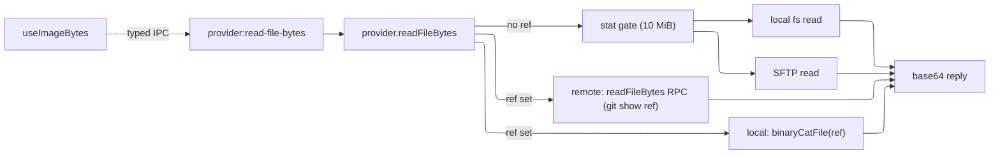

### Image views and the baseline-side decision

The image bug this epic fixed: the old image compare's `makeDataUrl` stub
returned `null` unconditionally, so BOTH panes silently read "(unavailable)"
— no image ever rendered. Now `useImageBytes`
([src/renderer/content/useImageBytes.ts](../src/renderer/content/useImageBytes.ts))
fetches bytes via `readFileBytes` and builds a **`data:` URL**
(`data:<mime>;base64,<bytes>` — the bytes already arrive base64-encoded, so
there is no Blob/`createObjectURL` indirection and nothing to revoke); a
small local extension→MIME map is the one place deciding which extensions
render as images at all (an unrecognized extension degrades to `unreadable`,
never a wrong-MIME URL). `ImagePaneBody` renders every pane state in one
place, exclusively via `` (script-inert even for SVG bytes);
`ImageView` (Rendered) and both of `ImageCompare`'s panes share the hook.

**The "before (baseline)" pane (local_repo_explorer-bn8a):** the v1 limitation
recorded here — `readFileBytes` had no `ref`, so the baseline pane was
hardcoded to an explicit `'no-baseline-preview'` state for every
add/modify/delete/rename case — is **lifted**. `ImageCompare` now calls
`useImageBytes(previousPath, worktreePath, { ref: baseline })` for the
"before" pane (`previousPath` = `oldPath ?? filePath`, so a rename reads the
content at its OLD name) exactly like the "after" pane calls it for the
working tree, sharing every state (`loading`/`shown`/`absent`/`too-large`/
`unreadable`) and the same `ImagePaneBody` rendering — no
`'no-baseline-preview'` state exists anymore. An added file (no baseline
version) resolves the SAME way a deleted working-tree file always has: the
failed ref read maps to `reason: 'missing'` → the `'absent'` state ("Not
present in the working tree.") — deliberately not a new, baseline-specific
message, and never faked from the working-tree image. See "The bounded
binary-preview read (`readFileBytes`)" above for the `ref` byte-source detail.

### Regression Check

Run the epic's end-to-end gate: `npm run verify:content-modes` (builds, then
drives the REAL built app via Playwright —
[scripts/screenshots/verify-content-modes.mjs](../scripts/screenshots/verify-content-modes.mjs)).
It asserts the full (class × mode) matrix on rendered evidence: exact offered
modes per class; real added/removed diff rows; Rendered vs Raw observably
different (token-color spans present vs absent; markdown heading elements vs
literal `#` source); real image pixels (`naturalWidth > 0`) on **both** the
baseline (`ref`-read) pane and the working-tree pane for a MODIFIED image
(local_repo_explorer-bn8a), the `'absent'` text for an ADDED-only image's
baseline pane (no fabricated pixels), with the literal "(unavailable)" and the
retired "Baseline preview unavailable" text both asserted globally absent;
the generic-binary placeholders naming Download and Raw NOT offered once
binary-ness is confirmed; the gutter-alignment invariant across Wrap/mode
round-trips; and an uncaught-renderer-error gate. Recorded outcome
(2026-07-31, pre-bn8a): 41/41 local checks passed against the then-current
assertions (the "before" pane's hardcoded `no-baseline-preview` text). bn8a
updated the script's image assertions to match the shipped `ref`-capable read
(described above) — **a fresh run has not been executed as part of this
change**; re-run before relying on a post-bn8a pass count. The remote pass is
**opt-in** (`AC_VERIFY_REMOTE_HOST`/`_USER`/`_PATH`, precondition in the
script header) and remains **explicitly SKIPPED** in the last recorded run —
the remote transport path (including the new `readFileBytes` RPC) exists but
has not been exercised against a live host, so remote parity is not asserted
here. Unit coverage: the `readFileBytes` cases (including the `ref` branch) in
`local.test.ts`, `remote-rpc.test.ts` (`toFileBytesResult`), and
`transport.conformance.test.ts` (including the no-range pin, non-ref path
only); the Go `handleReadFileBytes` cases in `commands_test.go`; and the
renderer cases in `content.test.tsx`, `useImageBytes.test.ts`, and
`modeSwitcher.test.ts`.

## Content Panel Structural Folding (JSON/YAML)

For the `json` and `yaml` classes, **Rendered** (`VIEW_DISPATCH`'s
`'folding-view'` cell, rendered by
[src/renderer/content/FoldingView.tsx](../src/renderer/content/FoldingView.tsx))
is **source-mapped structural folding**, not a re-parsed/re-rendered value
view. The pipeline parses ONLY for structure — region boundaries, document
boundaries, anchor/alias linkage — never for value. Every character
`FoldingView` renders is a literal `content.slice(...)` of the exact source
`readFile` returned: no pretty-printing, re-indenting, key reordering, or
comment dropping. Collapsing a region hides exactly `[region.headerEnd,
region.end)` behind an "N items" placeholder chip; everything outside that
span — including the opening delimiter, a block scalar's `|`/`>` indicator
line, and any trailing content on the closing line — stays literal, visible
source. Because no value graph is ever materialized (`.toJS()`,
`JSON.parse`, and `yaml.parse` are never called anywhere in the fold
pipeline — grep-pinned by a dedicated regression test, `foldModel.test.ts`'s
"guardrail: never materializes a re-serialized JS value"), comments,
formatting, key order, number precision, and YAML anchors all survive
automatically: there is no serialization step that could drop or reorder
them.

### The fold model (single owning module)

`src/renderer/content/folding/` is the single owning module for fold-region
derivation. `foldModel.ts` defines the pure data model shared by both
formats: `FoldRegion` (`[start, end)` the full collapsible span, `headerEnd`
the point a collapsed placeholder actually starts replacing, `kind`,
`itemCount`, `depth`), `FoldDocument` (a JSON file is always exactly one
document spanning the whole file; a YAML stream is one per `---`-separated
document), `AnchorLink` (a YAML `&name` definition plus every `*name` alias
referencing it, scoped to the single document both appear in), and
`FoldModel` (`{ format, documents, regions, anchors, errors }`, `regions`
sorted start-ascending then end-descending — outer container before its
inner children) — plus `lineStartOffsets`/`offsetToLine`, a binary-search
line index shared by every downstream consumer. Every offset in the model is
a UTF-16 code-unit index into the original source string, never a byte
offset.

`jsonFold.ts` builds regions via `jsonc-parser`'s `parseTree` — a
structure-only DOM whose container nodes carry `offset`/`length`/`children`
and never a materialized value — tolerating JSONC (comments, trailing
commas via `allowTrailingComma`) and excluding single-line containers from
folding (folding one gains nothing). `yamlFold.ts` builds regions and anchor
links from `yaml`'s Document layer (`parseAllDocuments` + each node's
`range` tuple), never the value-resolving `.toJS()`; anchor scope resets per
document (the same `&name` in two documents produces two independent
`AnchorLink` entries), and a definition's own `&name` token — never included
in the node's own `range` — is located by a bounded backward scan tolerant
of whitespace/`#`-comments. Both extractors are total: malformed input never
throws, and parse/recovery errors land in `model.errors` instead.

Structured-clone safety is load-bearing, not incidental: the worker/cache
delivery below sends a `FoldModel` across a Web Worker `postMessage`
boundary, and `structuredClone` throws on a cycle — exactly the shape a
resolved YAML alias graph would take if this module ever built one. Keeping
the model range-only plain data (numbers/strings/booleans/plain
objects/arrays; no class instances, library node references, functions, or
cycles) is what avoids ever constructing that cycle. Round-trip tested per
fixture in `jsonFold.test.ts`/`yamlFold.test.ts` ("round-trips every fixture
through `structuredClone`").

### Worker/cache delivery (second instance of the highlight pattern)

The delivery shape deliberately mirrors `highlight/`'s worker/cache pipeline
(below) — one recognizable worker-offload pattern in this codebase, not two.
`foldCore.ts`'s `computeFoldModelSync(text, format)` is the ONE function
both an ES-module Web Worker (`foldWorker.ts`) and an inline main-thread
fallback (`foldClient.ts`) call, so their output is identical by
construction; only the delivery differs. `foldClient.ts`'s
`computeFoldModel` fronts both with a content-addressed cache (key: format +
text length + the full text) and transparently falls back to inline compute
if the worker fails to start, errors, or is running under test
(`workerDisabled` latch) — a caller never sees the difference. `useFoldModel`
is the progressive-enhancement hook (`loading → ready | unavailable`; a
`null` input or a compute failure resolves to `unavailable` with no broken
pane; a stale in-flight result from a fast input change is discarded).

The cache is capped at `MAX_FOLD_CACHE_ENTRIES = 8` — deliberately smaller
than the highlighter's 32-entry token cache below. A fold-cache entry is
dominated by its key, which embeds the FULL source text; this view
specifically targets JSON/YAML files up to the near-threshold size
`structuredFoldMaxMb` allows (~10 MB by default), and a user realistically
has several such files open/recently viewed in one session, so 32 entries
would bound a worst case around 320 MB of retained source text for a
convenience cache — 8 entries bounds it to ~80 MB while keeping useful hit
behavior across tab/reselect churn.

The worker offload is load-bearing here, not merely defensive: a measured
timing finding on ~10 MiB fixtures found `computeFoldModelSync` takes
roughly 220–300 ms for JSON but roughly 4.3–4.9 SECONDS for YAML (~15–20x
slower at the same byte size) — long enough to visibly freeze the renderer
main thread if run inline, which is exactly what the worker exists to
prevent for a realistically-sized YAML file.

### View dispatch and the ContentViewer branch

`modeSwitcher.tsx`'s `ViewKind` gains `'folding-view'`, and
`VIEW_DISPATCH.json.rendered`/`VIEW_DISPATCH.yaml.rendered` are its only two
cells — `ContentViewer` has exactly one new branch, rendering `FoldingView`
with the file's `(worktreePath, filePath, format, gitRef, wrap)` and an
`onBinaryConfirmed` callback. `FoldingView` owns its own `readFile` call (see
"What Diff / Rendered / Raw mean" above for why this differs from `text`'s
shared-instance model) and reports the same `RawFileConfirmation` shape
`RawFile` does, so the reclassification signal below is available regardless
of which component actually performed the read.

`src/renderer/content/foldingRows.ts` is the pure row-projection layer
between the fold model and FoldingView's render.
`visibleFoldRows(lineStartOffsets, regions, collapsed)` walks regions
(re-sorted defensively) and produces the ordered `FoldRow[]` FoldingView
actually renders — an ordinary `LineRow` for a visible original line, or one
`FoldedRow` per collapsed region's header line (carrying
`prefixEnd`/`suffixStart` so the renderer can re-attach the still-visible
prefix/suffix around the placeholder). Rows are always in ascending
ORIGINAL line order; folding hides rows, it never renumbers or mutates them,
so tokens computed once over the full original content
(`useHighlightedTokens`) stay indexed by that same original line everywhere
(`tokenLines[row.line]`), never by visible-row position. `groupRowsByDocument`
is a pure post-pass on top of `visibleFoldRows`'s unchanged output —
bucketing an already-projected `rows` list into per-document groups only
when `documents.length > 1` — rather than a second, forked projection; a
single-document file (every JSON file, most YAML files) never runs it at all
and renders through the identical single-document path.

Resolving an EXCLUSIVE end offset (`region.end`, `region.headerEnd`,
`row.suffixStart`) to a line is its own small trap: see the CLAUDE.md entry
"Folding view: resolve exclusive-end offsets with `lastTouchedLine`, never
`offsetToLine`" for the mechanism and the real bug it fixed.

### The two runtime reclassifications (one rule)

`ContentViewer` performs two runtime reclassifications from a real read
result, both living in `ContentViewer` (`effectiveCls`) rather than in the
pure, path-only `classOf` — because both signals (true binary-ness, true
byte size) are only knowable once a real read has happened (see
"Generic-binary is a RUNTIME reclassification" above):

1. **Confirmed binary → `generic-binary`.** Unchanged from the content-mode
   epic — `rawConfirmation?.kind === 'binary'`.
2. **Confirmed-text, oversized json/yaml → `text`.** A `json`/`yaml`-classified
   path whose CONFIRMED-text size (`rawConfirmation.kind === 'text'` —
   never an as-yet-unknown `null`, and never the sizeless `'missing'`
   outcome) exceeds `structuredFoldMaxMb * 1024 * 1024` (strict `>`)
   downgrades `cls` to `'text'` — the file falls back to the plain
   Shiki-highlighted line view (the SAME `RawFile`-backed `text` Rendered
   cell every other text file uses) instead of the structural fold view.
   Folding a very large document is the more expensive presentation (see the
   timing finding above), so this is a cost/benefit fallback, not a
   correctness one.

   **Reachable via a per-read cap override (local_repo_explorer-ftbq).**
   `getFile`'s `DEFAULT_MAX_BYTES` (256 KiB, `electron/main/git/files.ts`)
   caps an ordinary text read, and — before this fix — neither `FoldingView`
   nor `RawFile` ever overrode it, so any file large enough to exceed
   `structuredFoldMaxMb`'s 1 MB minimum always returned `truncated: true` and
   rendered the too-large placeholder before `oversizedStructured` was ever
   evaluated: the branch had unit coverage against mocked confirmations, but
   was a dead path end to end. ContentViewer.tsx now computes
   `structuredReadMaxBytes` — `structuredFoldReadMaxBytes(structuredFoldMaxMb)`
   (src/shared/settings.ts, 2x the threshold) — for json/yaml-classed paths
   ONLY (keyed on the pure `cls`, see the correctness note below), and passes
   it as `maxBytes` to BOTH `FoldingView` and `RawFile`. A file strictly
   between the threshold (T) and the raised cap (R = 2T) now reads
   successfully and this branch fires for real; a file above R still refuses
   (the generic too-large placeholder), so `effectiveCls` correctly stays
   json/yaml rather than degrading for a non-`'text'` confirmation. Remote
   parity: the Go helper accepts the same `maxBytes` override, clamped to a
   12 MiB effective ceiling (an RPC frame-size constraint — see "Why
   `readFile` is not the byte source" above) and made refuse-never-truncate to
   match local exactly (previously it truncated silently instead of refusing
   — a separate bug this fix also closes).

   **Correctness detail: keyed on `cls`, never `effectiveCls`.** If the read
   cap were derived from `effectiveCls` instead of the pure `cls`, it would
   self-defeat: once the degrade fires, `view` switches `folding-view` →
   `raw-file`, and `effectiveCls` is ALREADY `'text'` by the time `RawFile`
   mounts for that degraded view — so a naive `effectiveCls === 'json' ||
effectiveCls === 'yaml'` guard would be false for that very mount, RawFile
   would read at the DEFAULT (smaller) cap, refuse, report `'too-large'`,
   un-set `oversizedStructured` (which requires `kind === 'text'`), flip
   `effectiveCls` back to json/yaml, remount `FoldingView`, which reports
   `'text'` again — degrading again, in an infinite mount loop. Keying on the
   pure, unchanging `cls` gives the SAME file the SAME cap in every mode
   (folding, degraded-rendered, and Raw), which is what makes the state
   machine stable. `content.test.tsx` asserts every `readFile` call for the
   same selection (across a FoldingView→RawFile remount) requested the
   identical `maxBytes`, specifically to guard this invariant.

`confirmedBinary` wins outright over the size degrade — ordering matters, so
a json/yaml-PATH file whose bytes turn out to be binary always lands on the
binary placeholder, never the size-degraded text view. Neither
reclassification is visible in the mode switcher itself: `CLASS_MODES` gives
`json`/`yaml`/`text` the identical 3-mode array, so only `view` (which
component renders) changes, never which modes are offered — and neither
reclassification ever writes the persisted `contentMode` setting; both are
synchronous DISPLAY corrections for the current render only.

`structuredFoldMaxMb` (Preferences → "Structural fold max size (MB)", default
10, bounds `STRUCTURED_FOLD_MAX_MB_MIN`/`_MAX` = 1/100 — a value below the
minimum falls back to the default rather than clamping up, the same
asymmetric shape as `workgraphColumnsSoftCap`) is a SEPARATE setting from
`FILE_BYTES_CAP` (the 10 MiB binary-preview read cap — see "The bounded
binary-preview read" above): they gate different read paths for different
reasons. `FILE_BYTES_CAP` bounds a base64-over-IPC BYTE read for binary
preview; `structuredFoldMaxMb` bounds a much more expensive PARSE (not just a
read) of already-confirmed TEXT content. The two share a same-order-of-
magnitude default only coincidentally.

### Known, accepted behaviors

- **Find searches unfolded text only.** Find-in-file (`useFindInContent`)
  walks the rendered DOM; a collapsed region's hidden lines are not in the
  DOM, so a match inside a folded region is not found until that region is
  expanded. `findable` includes `'folding-view'`; this is a documented v1
  limitation, not a bug.
- **Every fold-model failure degrades to the plain highlighted view, never
  blank.** An `unavailable` model (compute failed, or inputs not ready) or a
  model carrying `errors` (malformed input recovered only a partial region
  list) both ignore `regions`/`documents`/`anchors` entirely and render the
  same plain Shiki-highlighted rows the `text` class uses, with a visible
  notice explaining why. Zero foldable regions or an empty file are NOT
  notice-worthy — an empty/valid `regions` array renders identically to
  "nothing to fold".
- **A `.jsonc` file classifies as `json` but is not Shiki-highlighted.**
  Shiki's `json` grammar entry only recognizes the `.json` extension (see
  "Content Panel Highlighting" below); a `.jsonc` file's Rendered/Diff
  highlighting is plain, unhighlighted text. This is a highlight-registry
  gap, not a folding defect — folding itself works identically for both
  extensions.

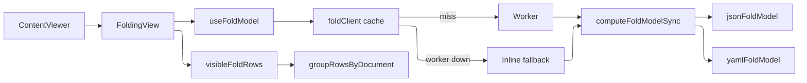

### Regression Check

In the running app: open a `.json` and a `.yaml` file from Changes or
Explorer — Rendered dispatches to the folding view
(`data-testid="folding-view"`), every foldable object/array/map/sequence/
block-scalar shows an always-visible chevron (keyboard-operable,
`aria-expanded` tracks state), and collapsing one replaces it with an "N
items" chip while gutter line numbers stay the file's ORIGINAL numbers
(never renumbered) and stay aligned across a Wrap toggle. Open a
3-document YAML stream — all three documents render, stacked, each in its
own labelled `role="region"` ("Document i of N") separated by a visible
(but `aria-hidden`) band, with file-global (not per-document) line numbering
throughout. Open a file with `&anchor` definitions and `*alias` references —
each carries a small glyph badge (`&N`/`*N`) with a Radix tooltip explaining
the linkage, reachable by Tab. Lowering Preferences' 'Structural fold max
size (MB)' below an open json/yaml file's size — but leaving the file's size
within twice that threshold — DOES now produce the plain highlighted line
view (local_repo_explorer-ftbq): no fold toggles, the file's real content
visible, no too-large placeholder (see 'The two runtime reclassifications
(one rule)' above). Raise the file further, past twice the lowered threshold,
and it correctly falls back to the too-large placeholder instead (folding
view stays dispatched, never degrading for a refused read). Toggle
Rendered → Raw → Rendered on the same file — no second read fires (the
module-level read cache serves the second Rendered mount).

Unit/component coverage: `foldModel.test.ts`, `jsonFold.test.ts`,
`yamlFold.test.ts`, `foldClient.test.ts`, `useFoldModel.test.tsx`,
`foldingRows.test.ts`, `foldingView.test.tsx`. The end-to-end matrix is
extended by `npm run verify:content-modes`
([scripts/screenshots/verify-content-modes.mjs](../scripts/screenshots/verify-content-modes.mjs))
— see its own Regression Check entry above for the harness's general shape.

## Content Panel CSV/TSV Table View

For the `csv` class, **Rendered** (`VIEW_DISPATCH`'s `'csv-view'` cell, rendered
by [src/renderer/content/CsvView.tsx](../src/renderer/content/CsvView.tsx)) is a
read-only, sortable, filterable table. Diff and Raw reuse `DiffView`/`RawFile`
unchanged.

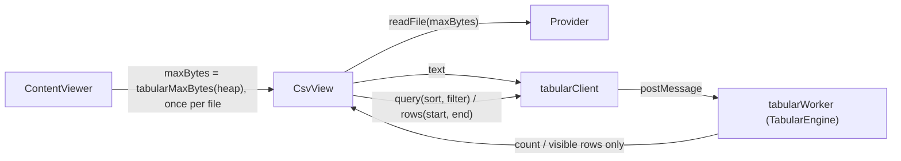

**Ownership.** The parsed table lives in exactly one place: a per-file Web
Worker (`tabularWorker.ts`, created and terminated by `tabularClient.ts`, with
an inline fallback under test or if the worker cannot start — the same shape as
`foldClient.ts`). `TabularEngine` (`tabular/tabularCore.ts`, pure) parses RFC-4180
records once; sort and filter never copy rows or cells — they build a
`Uint32Array` of body-row indices (4 bytes/row), and the view fetches only the
window of rows in its viewport (fixed row height, windowed rendering). The main
thread therefore never holds the parsed table and never blocks on it.

**Memory budget — one definition.** `tabularMaxBytes(heapStats)`
(`tabular/tabularCap.ts`) is the single source of "how large a file may be
loaded into the table": `clamp(heapHeadroom × 0.25 ÷ 8, 1 MiB, 32 MiB)`, where
`heapHeadroom` is the renderer's `jsHeapSizeLimit − usedJSHeapSize`
(`performance.memory`) and 8 is a conservative bytes-of-heap-per-file-byte
expansion factor for per-cell JS strings. A roomier heap is bounded by the hard
ceiling so sort/filter stay interactive; a pressured heap shrinks the budget but
never below the floor, so small files always work. When heap stats are
unavailable a fixed 8 MiB fallback applies. `ContentViewer` evaluates it **once
per opened file** (state initializer — `FileContent` remounts per selection)
and passes it to `CsvView` as the read cap, so the cap is stable for the file's
lifetime. The budget is an estimate of the renderer's own headroom, not of
system RAM.

**Over-budget behavior (deliberately NOT a reclassification).** `CsvView` reads
with `maxBytes = budget`; a file over it comes back `truncated`, and the view
shows a notice (size and budget) instead of parsing. Unlike the json/yaml
oversize degrade, `effectiveCls` is NOT changed, and `CsvView` does **not**
report `too-large` through `onBinaryConfirmed`: that budget is a memory
decision, not the file-read cap, and reporting it would make Diff claim the
file is too large to diff. It reports only `text`, `binary` and `missing`, so a
binary `.csv` still reclassifies to the generic-binary placeholder. Raw uses
the default read cap, unchanged. Because nothing flips `effectiveCls` on this
outcome, none of the json/yaml mount-loop hazard (see that section) applies.

**Known limits.** Remote `readFile` is hard-capped at 2 MiB by the helper RPC,
so a remote CSV above that shows the over-budget notice even when it is under
the local budget. Rows are fixed-height with truncated cells (the full value is
the tooltip), so the view is not wrappable and is excluded from find-in-file.
The first record is always treated as the header.

Unit/component coverage: `tabularCore.test.ts`, `tabularCap.test.ts`,
`csvView.test.tsx`, plus the csv cases in `modeSwitcher.test.ts` and
`content.test.tsx`.

## Content Panel Tabs

The Content panel shows a project's **open files as tabs** instead of a single
selection. State is one `{ tabs, activeId }` slice per project in
[src/renderer/content/selectionStore.ts](../src/renderer/content/selectionStore.ts)
(`useContentSelection`); pure open/close/activate/parse logic lives in
[src/renderer/content/tabState.ts](../src/renderer/content/tabState.ts) and the UI in
[src/renderer/content/ContentTabs.tsx](../src/renderer/content/ContentTabs.tsx), hosted by
`ContentPanelHost` (`workspace/panels.tsx`).

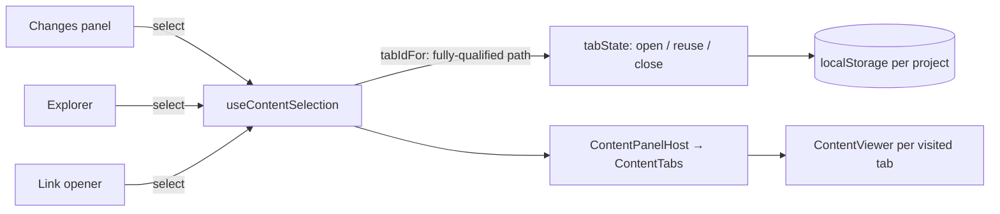

- **Identity.** A tab's id is the file's fully-qualified path (`resolveAbsolutePath`:
  worktree-or-project-root joined with the relative path; absolute for external files). The
  same file opened from Changes, Explorer, a link, or the root-browse Explorer is one tab, and
  the same relative path in two worktrees is two tabs. Re-opening an existing tab replaces its
  selection with the latest opener's (`kind`/`baseline`/`oldPath`) and activates it. The label
  is the filename; the full path is the tab's `title`.
- **Writers are unchanged.** Changes, Explorer, and `openLinkTarget` call
  `select(projectId, selection)`, now meaning "open or activate". A plain file open still
  carries no `baseline` (see CLAUDE.md "A plain file-open selection must never carry a
  `baseline`").
- **Per-tab view state.** Every tab that has been in front stays mounted (hidden with
  `invisible` + `pointer-events-none`, **not** `display:none`, so scroll offsets survive), so
  its `ContentViewer` keeps its mode, zoom, scroll, and find state. Tabs restored from a
  previous run mount lazily on first activation, so a restart issues no reads for every
  remembered file. Switching projects remounts (state is not carried across projects), and
  hidden tabs keep their data subscriptions live.
- **Closing.** Closing the active tab activates its right neighbour, else the left; closing
  the last tab restores the empty state. Middle-click and Delete/Backspace on a focused tab
  also close; arrow keys/Home/End move between tabs.
- **Persistence.** Each project's slice is saved to `localStorage`
  (`agent-cockpit:content-tabs:v1:<projectId>`) on every change and read once (cached, so
  selectors stay referentially stable) the first time a project is read. Parsing is defensive:
  malformed entries are dropped, a dangling active id falls back to the first tab, and an
  unreadable store degrades to no tabs. A restored tab whose file has since been removed shows
  the viewer's normal missing-file state. The key is versioned; changing the stored shape needs
  a new version and a migration.
- **File naming trap.** The pure module is `tabState.ts`, not `contentTabs.ts`: on a
  case-insensitive filesystem `./ContentTabs` resolves to `contentTabs.ts` before
  `ContentTabs.tsx`.

Unit/component coverage: `tabState.test.ts`, `tabPersistence.test.ts`, and the tab cases in
`contentPanelHost.test.tsx`.

## Content Panel Highlighting

The Content panel supports **Shiki-based syntax highlighting** for the text-class
**Rendered** view and the **Diff** view (Raw is deliberately plain — see "Content
Modes & Bounded Binary-Preview Reads"). Supported languages (TypeScript/TSX, JavaScript/JSX, Java, Python, Rust, Go, HTML,
CSS, JSON, YAML, and shell — bash/sh/zsh) are defined entirely by the language registry below;
extending the set is a registry-only change. Markdown highlighting uses a separate
pipeline (`rehype-highlight` in `markdown.tsx`) and is not part of this subsystem.

### Language Registry (single authoring site)

`src/renderer/content/highlight/languages.ts` is the **one place** that maps file
extensions to Shiki TextMate grammars. Adding a new language is two changes: one entry in
the `ENTRIES` map + one fine-grained grammar import. No other module in the highlight
pipeline changes. `resolveLanguage(filePath)` is the public API; it returns a `LangId`
or `null` for plaintext fallback. (The `json` grammar entry recognizes only the `.json`
extension — a `.jsonc` file classifies as `json` for folding purposes, but its
highlighting is plain; see "Content Panel Structural Folding (JSON/YAML)"'s "Known,
accepted behaviors".)

### Highlighter core (worker-offloaded + cached)

`src/renderer/content/highlight/highlighter.ts` is the public entry
(`tokenizeLines(code, langId, theme) → TokenizeResult`, per-line token arrays +
theme `fg`/`bg`, never HTML). It is a thin **cache + Web-Worker client** — the pattern
"Content Panel Structural Folding (JSON/YAML)"'s fold pipeline deliberately mirrors as
its own, second instance of the same shape:

- The actual Shiki tokenize lives in `tokenizeCore.ts` (`shiki/core` + the
  pure-JavaScript RegExp engine — still no Oniguruma WASM, no `wasm-unsafe-eval`
  CSP, nothing extra to package) with its own promise-memoized core + lazy,
  per-language grammar loading.
- It runs in an **ES-module Web Worker** (`tokenizeWorker.ts`, built with vite
  `worker.format: 'es'` because the grammars are dynamic-imported) so a large
  file no longer freezes the renderer main thread. If the worker can't start or
  errors — and under test, where there is no functional `Worker` — it falls back
  to inline `tokenizeInline`; output is identical because both call the same core.
- A **content-addressed token cache** (keyed by `code`+`lang`+`theme`, entry-count
  bounded) fronts both paths, so a re-opened file, a diff↔raw toggle, or an
  unchanged-theme re-render never re-tokenizes.

### CodeTokens render boundary

`src/renderer/content/highlight/CodeTokens.tsx` is the **render seam** that turns a
`TokenLine[]` into React elements:

- `CodeTokens` renders a whole `<pre><code>` block (used by `raw` mode).
- `CodeLineTokens` renders one line's tokens as `<span>` elements (used by `diff` mode,
  one line at a time).

Text content is preserved verbatim inside `<span>` text nodes — no `dangerouslySetInnerHTML`
— so the find-in-content pass (CSS Custom Highlight API over text nodes) works over
highlighted code (AC5). This boundary is also the **future edit-toggle seam** (FR7): a
future editable mode can mount a CodeMirror 6 renderer alongside this read path without
changing any call site.

### Progressive enhancement hook

`useHighlightedTokens(content, lang, theme)` returns `{ state: 'plain' }` synchronously
so first paint is immediately readable, then resolves tokens asynchronously and flips to
`{ state: 'ready', lines, fg, bg }`. Re-runs on content, language, or theme change.

For large files, each diff/raw row carries `content-visibility: auto` +
`contain-intrinsic-size`, so the browser skips layout/paint of off-screen rows
(the dominant cost of thousands of token spans) while keeping every row in the
DOM. That is a deliberate alternative to node-removing windowing: find-in-content
walks the rendered DOM (a `TreeWalker`), so removing rows would break it —
`content-visibility` preserves find, the wrap toggle, and note anchors.

### Rendered/Raw wiring (text class)

`RawFile.tsx` is the single component behind BOTH the text-class Rendered and
Raw modes; a `highlight` prop (from the active mode) decides whether
`resolveLanguage` + `useHighlightedTokens` + `CodeTokens` run at all. Rendered
(`highlight=true`) tokenizes when the language is supported, with the plain
progressive first-paint fallback; Raw (`highlight=false`) always renders plain
and performs NO tokenization work (the hook's `lang=null` no-op branch). The
file is read exactly once regardless of toggling. The binary/too-large/
missing cases render `BinaryPlaceholder` under Rendered and the original terse
messages under Raw (the loading state is unchanged in both).

### Diff bundle — one round trip + cache

`ContentViewer` opens a changed file via a single provider call,
`getDiffBundle(worktreePath, path, baseline) → { patch, newContent, oldContent }`
(WorkspaceProvider; helper RPC `getDiffBundle` on remote, composed locally),
instead of the old `getFileDiff` + 2× `readFile`. On remote that collapses three
serialized SSH round trips into **one**; the helper reads the new side from the
working tree, the old side via `git show <baseline>:<path>`, and the patch via
`git diff` in one region (tolerant — added/deleted files yield a null side). A
main-process `DiffBundleCache` (`providers/diffCache.ts`, keyed per project by
worktree+path+baseline) serves re-opens / mode toggles with **zero** round trips;
the existing filesystem watch invalidates it precisely (changed paths dropped; a
git-state signal — HEAD/packed-refs/refs — clears the project as the baseline
moved). (Remote `readFile` separately honors `opts.ref` via the same `git show`
capability, fixing the old "raw at baseline" working-tree read.)

### Diff mode wiring

`DiffView.tsx` receives both sides' content from the bundle (it issues **no**
`readFile` of its own) and tokenizes each side in full via `tokenizeLines`. Full-
side tokenize preserves cross-line grammar state (multi-line strings, block
comments, template literals). For each rendered diff line,
`pickTokenLine` maps the 1-based `PatchLine.oldLine`/`newLine` to the correct token array
entry (0-based index):

- `del` lines → old-side token array (keyed by `oldLine`)
- `add` lines → new-side token array (keyed by `newLine`)
- `context` lines → new-side first, old-side fallback

Add-only files (no baseline) tokenize only the new side; delete-only files tokenize only
the old side; absent sides render plain. The existing add/delete background tints and
old/new line-number gutters are preserved. Fallback to plain diff on unsupported language,
files exceeding 256 KiB, or tokenize failure.

### Theme reactivity

Both `RawFile` and `DiffView` subscribe to `useSettingsStore(s => s.settings.theme)` so
a Settings → theme toggle recolors live without a reload.

### Bundle shape

Shiki grammars are emitted as separate lazy chunks by Vite. Only the 8 initial grammars
are in the bundle; adding a language is a registry entry + one new grammar import.

## Explorer File Icons

The Explorer file tree renders **VS Code-style icons** to differentiate folders from files
and to show recognizable brand logos for known filetypes (replacing the earlier
`▸`/`▾`/`·` glyphs). A curated subset of [Material Icon Theme](https://github.com/material-extensions/vscode-material-icon-theme)
SVGs (MIT) is **vendored into the repo** under `src/renderer/explorer/icons/svg/` — only the
~24 icons actually rendered, not the full upstream set. `material-icon-theme` is a
dev-only dependency used to source the SVGs; there is **no runtime dependency**, and the
vendored copies plus license/version provenance are recorded in
`src/renderer/explorer/icons/ATTRIBUTION.md`.

### Color rule

File-type brand logos render in their **own published colors** (the fill is baked into the
SVG). The three theme-tinted glyphs — `folder`, `folder-open`, and the generic `file`
fallback — have their fixed fill normalized to `fill="currentColor"` at vendor time, so the
renderer tints them with the app `text-dim` token and they stay cohesive with the Solarized
UI in either theme.

### Icon registry (single authoring site)

`src/renderer/explorer/icons/fileIcons.ts` is the **one place** that maps a file's base name
to a vendored icon. Adding a new filetype icon is two changes: drop its SVG under `svg/` +
add one import and one mapping entry. `resolveFileIcon(name)` is the public API and returns
an `IconId` using this resolution order:

1. **Exact lowercase filename** (`package.json` → `nodejs`, `Cargo.toml` → `rust`,
   `Dockerfile` → `docker`, `.gitignore` → `git`, …) — so project-marker files beat their
   bare extension.
2. The **`tsconfig*.json` pattern** → `tsconfig`.
3. **File extension** (`ts` → `typescript`, `tsx` → `react_ts`, `py` → `python`,
   `sh`/`bash`/`zsh` → `console`, image extensions → `image`, …).
4. The generic **`file`** fallback for everything else.

`getIconSvg(id)` returns the raw SVG markup; `isTintedIcon(id)` reports whether an id is in
the tinted set (`file`, `folder`, `folder-open`).

### Render boundary

`IconSvg.tsx` is the render primitive: it draws a vendored SVG (raw markup, injected via
`dangerouslySetInnerHTML` — the assets are trusted and repo-vendored) inside a fixed 16px
box, applying `text-dim` only when the icon is tinted. `FileTypeIcon` (resolves a filename
to its icon) and `FolderIcon` (open/closed, always tinted) wrap that primitive.

### Explorer wiring

`ExplorerPanel.tsx` renders the icons in the `Row` `prefix` slot: `DirNode` shows the
expand chevron plus a `FolderIcon` (open icon when expanded), and `FileNode` shows a
chevron-width spacer plus a `FileTypeIcon`, keeping the icon column aligned across folders
and files. Listing, selection, and reveal-scroll behavior are unchanged.

## Application Menu

The app installs a **custom Electron application menu** at `app.whenReady()` via
`electron/main/menu.ts`. This replaces Electron's default menu and is an architectural
fact because it governs which keyboard accelerators are owned by the menu vs. the renderer.

The key difference from the default: `role: 'reload'` (Cmd/Ctrl+R) is **omitted** so the
renderer's Cmd/Ctrl+R view-switch shortcut reaches the `keydown` handler in
`CockpitWorkspace.tsx`. `role: 'forceReload'` (Cmd/Ctrl+Shift+R) is retained for developer
use. All other standard menu roles and items (Edit, Window, Help, macOS app menu) are
preserved. The menu is cross-platform (macOS app menu block + Win/Linux file/quit item).

Future menu items (e.g. a "Go to project" action) should be added to `electron/main/menu.ts`.

## Keyboard Shortcuts

The app has two application-level view-layout shortcuts, handled by a `keydown` listener
in `CockpitWorkspace.tsx`:

- **Cmd/Ctrl+E** → `choosePreset('edit')` — switch to Edit workspace layout
- **Cmd/Ctrl+R** → `choosePreset('review')` — switch to Review workspace layout

`metaKey` is used on macOS; `ctrlKey` on Win/Linux; no other modifiers. Both call
`preventDefault()`. These shortcuts persist the chosen layout per project via
`localStorage` (existing `choosePreset` behavior). Cmd/Ctrl+R works reliably only because
the custom application menu removes the `reload` accelerator from the Electron menu (see
Application Menu above).

Cockpit mux terminal topology shortcuts are frontend commands, independent of
the selected terminal renderer: Cmd/Ctrl+T creates a window; Cmd/Ctrl+D and
Cmd/Ctrl+Shift+D split right/below; Cmd/Ctrl+Alt+Arrow moves pane focus;
Cmd/Ctrl+Shift+[ / ] moves window focus; Cmd/Ctrl+W closes the selected window;
and Cmd/Ctrl+Shift+Z toggles pane zoom. `muxKeyboard.ts` reduces these chords
before xterm or WTerm can observe them, and `TerminalPanel` dispatches the same
daemon operation for both renderer choices. `byobuKeybindings` is enabled by
default (and can be explicitly disabled); with it enabled,
Shift+Arrow moves panes and the two-second Ctrl+A prefix accepts z/n/p/a
(zoom, next/previous window, literal Ctrl+A). The Cockpit mux header contains
window identity tabs only, not topology-manipulation buttons.

## Panel Focus

Activating a panel has **two distinct concerns** that are deliberately separated:
**visual focus** (which Dockview panel/tab is active) is owned entirely by Dockview
(`panel.api.setActive()`); **keyboard focus** (DOM focus, so typing/Tab/shortcuts target the
panel) is routed through one shared seam, `src/renderer/workspace/panelFocus.ts`.
Without this seam, `api.addPanel()` would make a new panel visually active but leave keyboard
focus wherever it was — the original "open a panel, can't type in it" bug.

### Focus registry (single seam)

`panelFocus.ts` maps a `PanelId` to a focus handler. It is a pure module (no React/DOM) with
three behaviors that make it robust against real ordering/threading:

- **Pending focus** — `focusPanel(id)` for a panel whose handler has not mounted yet (the
  common `addPanel` case: the active-panel event fires before the new panel's effect
  registers) records the id as pending; the handler fires the instant it registers.
- **Suppression** — `setFocusSuppressed(true)` makes `focusPanel` a no-op so the cascade of
  `setActive` calls during programmatic layout/preset application does not thrash focus.
- **Force** — `focusPanelForce(id)` moves focus even while suppressed, for explicit intents
  (project-switch restore, Ctrl+\`).

### Focusable host + per-panel overrides

`PanelHost` (`panels.tsx`) wraps every panel in a focusable root (`tabIndex={-1}`,
layout-neutral) and registers a focus handler keyed by the panel id. The default handler
focuses the wrapper **only when focus is not already inside the panel** (a containment guard,
so clicking an element inside an inactive panel is not refocused away). A panel may override
the default with its own target via `usePanelFocusOverride` (`panelFocusContext.tsx`): the
**Terminal** panel overrides to dispatch `FOCUS_TERMINAL_EVENT` (focusing the active xterm
pane through the existing, proven path that both the session and control-mode backends listen
for), and the **Run** panel overrides to focus its command input.

### Activation wiring

`CockpitWorkspace.tsx` drives the seam at every activation site: `onDidActivePanelChange`
calls `focusPanel(panel.id)` (covers tab clicks and menu-opens), `loadLayout` wraps layout
application in `setFocusSuppressed(true)` cleared on the next animation frame, and
`restoreFocusedPanel` + the Ctrl+\` handler call `focusPanelForce`. This generalized the
former terminal-only `FOCUS_TERMINAL_EVENT` special case to all panels via their registered
handlers. `focusMemory.ts` is unrelated — it is `localStorage` persistence of _which_ panel
was last active per project, not a focus mechanism.

### Revealing a panel without focus

A programmatic reveal that must not take the keyboard (a terminal's `cockpit open`
showing the Content panel) does not use `panel.api.setActive()`: it activates the
panel's group and emits `onDidActivePanelChange`, whose handler writes the focus
memory unconditionally and calls `focusPanel`, and `withFocusSuppressed` silences only
the last. `src/renderer/workspace/panelReveal.ts` makes the panel the visible tab of
its own group with `group.model.openPanel(panel, { skipSetGroupActive: true })`: no
activation event, so the registry, the focus memory and the `lastActivePanelId` guard
are untouched. It declines when showing the panel would hide the Terminal or the group
in use, because Dockview's default renderer detaches a hidden tab's DOM and drops focus
with it. See Terminal Callback Socket, "Showing Content without moving keyboard focus".
`PanelHost`'s root carries `data-panel-id` so tests and DevTools can see which panel
holds the focus.

## Terminal Callback Socket

A terminal-to-app channel. A process in a cockpit terminal pane — a user, or an
agent — runs `"$COCKPIT_CLI" open <path>` and the file opens as a tab in the
Content panel of the pane's own project, local or remote, on both the tmux and the
cockpit-mux backends. The channel is general and versioned (a length-prefixed
JSON request/reply envelope with a default-deny operation allowlist, `open` being
the only operation), not an "open" socket, so later operations reuse it. This
section describes what is built: the transport, the environment injection, the
remote helper's listener, the `cockpit` CLI, and the renderer leg that opens the
file as a Content tab without moving keyboard focus. The numbered requirements are in
[docs/requirements/terminal-callback-socket.md](requirements/terminal-callback-socket.md), the
implementation detail in [docs/design/terminal-callback-socket.md](design/terminal-callback-socket.md)
and the verification in [docs/test/terminal-callback-socket.md](test/terminal-callback-socket.md).

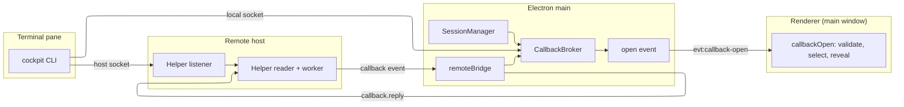

Sources (as built): [electron/main/callback/broker.ts:82](../electron/main/callback/broker.ts#L82),
[electron/main/callback/listener.ts:46](../electron/main/callback/listener.ts#L46),
[electron/main/callback/remoteBridge.ts:54](../electron/main/callback/remoteBridge.ts#L54),
[electron/main/callback/rendererForward.ts:30](../electron/main/callback/rendererForward.ts#L30),
[electron/main/providers/sessionManager.ts:220](../electron/main/providers/sessionManager.ts#L220),
[remote-helper/callback_service.go:87](../remote-helper/callback_service.go#L87),
[remote-helper/cockpit_cli.go:106](../remote-helper/cockpit_cli.go#L106),
[src/renderer/workspace/callbackOpen.ts:126](../src/renderer/workspace/callbackOpen.ts#L126).

- **Local project:** main's `CallbackBroker` owns the unix socket and decides each
  request in-process.
- **Remote project:** the project's own helper owns the socket on the host
  (`electron/main/callback/` never opens a remote socket). It validates the
  envelope, the allowlist and the operation's arguments at the edge, applies its
  own burst limit (10/s), forwards what survives to main over the existing helper
  RPC stream as a `callback` event carrying a request RE-ENCODED from the
  validated fields only (unknown fields a same-user process put in the frame never
  reach main), and relays main's `callback.reply` back to the CLI. `remoteBridge`
  turns each event into a call of the SAME decision function the local listener
  uses, bound to the project whose helper stream delivered it — never to whichever
  project is ambiently active. Main re-validates everything: the helper's checks
  spare a round trip and bound what a stream can carry, but main is the
  authority.
- **One decision function:** `CallbackBroker.handle(projectId, request)` validates
  the envelope, applies the allowlist, the per-project burst limit (10/s) and the
  connection-status gate (only `connected` is served), checks the argument bounds,
  replies `dispatched`, and only THEN classifies the path asynchronously (its
  provider RPCs, such as `listWorktrees`, may queue behind slow helper methods and
  must never sit on the reply path). Classification builds a `ContentSelection`
  from the canonical path the CLI sent (worktree path plus relative path, the same
  inputs the Explorer uses, so the tab id equals the Explorer's; an external path
  keeps its logical form) and never carries a `baseline`.

### Identity and trust

The project is the one that owns the socket a request arrived on; a request can
never name another. `pane` (`{kind: 'tmux' | 'mux', id}`, read by the CLI from
`COCKPIT_CALLBACK_MUX_KEY`, which wins when present, else `TMUX_PANE`) is
attribution metadata only: main cannot verify it. No secret exists. Access control
is the filesystem: the socket directory is 0700 (`lstat`-verified: a real
directory, owned by the user, no group or other access, or the project's callback
fails closed) and the socket is explicitly 0600; on Linux the helper also checks
the peer uid with `SO_PEERCRED` (it fails closed). Any process of the same user can
connect, which is the accepted trust boundary. Everything is bounded: frames are
length-prefixed with a 64 KiB cap, one request per connection, a 5 s read deadline
from accept (absolute, so a trickling peer is cut off), at most 32 concurrent
connections on main's listener (a connection past the cap is dropped without a
reply, so the CLI exits 3) and 16 on a helper's (a connection past the cap is
answered `rate-limited`, under a write deadline, and closed, so the CLI exits 4),
and `open` only reads and displays. Callback traffic never feeds the `ConnectionMachine`; the broker only
reads a session's status.

### Socket location

`<h>` is the first 12 hex characters of SHA-256(projectId); `<hosthash>` the first
8 of SHA-256(host name), because a remote home may be shared over NFS between
hosts and a socket is reachable only on the host that bound it. A path over the
90-byte guard (counted in bytes; the OS limit is 104 on macOS and 108 on Linux and
the takeover temp name needs a few more) or one that could not be injected into an
environment falls back to a short per-user `/tmp` directory, which never disables
the feature.

| Project | Primary                                                                                              | Fallback                               |
| ------- | ---------------------------------------------------------------------------------------------------- | -------------------------------------- |
| Local   | `<userData>/callback/<h>.sock`                                                                       | `/tmp/ac-cb-<uid>/<h'>.sock`           |
| Remote  | `$XDG_RUNTIME_DIR/agent-cockpit/callback/` (else `~/.agent-cockpit/callback/`) `<hosthash>-<h>.sock` | `/tmp/ac-cb-<uid>/<hosthash>-<h>.sock` |

`<h'>` (local fallback only) hashes the resolved `userData` path together with the
projectId, because two profiles that share a projectId (a copied `store.db`) must
never share a socket. The remote helper takes no launch arguments: main sends the
`projectId` in the handshake and the helper returns the absolute `callbackSock`
and `cliPath`, so the location never matters to main or to the CLI.

### Listener lifecycle and takeover (invariant)

A local listener follows the session-owned watch: it is started on the edge into
`connected` (and awaited before any terminal or control-mode attach is created,
because terminals read the socket path at creation), and stopped on
`disconnected`/`failed` and on eviction. A remote listener is bound by the helper
at the handshake and lives exactly as long as the helper's RPC stream: when the
stream ends the helper releases the socket path first, then exits;
`RemoteProvider.disconnect()` (called by `SessionManager` on close, reconnect and
shutdown) stops the bridge and ends the helper channel. There is no second
teardown path.

The **newest listener always wins the path unconditionally**. The new owner binds a
uniquely named temporary path in the same directory, `chmod`s it 0600 and `rename`s
it over the real one (atomic, so the path is never briefly absent). A stale
predecessor — a helper left alive by a half-open ssh drop — stays bound to an inode
nothing can reach. Every owner unlinks on close only if the path's inode is still
its own (an `lstat` device + inode identity, with the runtime's own unlink-on-close
turned off), so a stale owner can neither hold the path nor delete the newer
socket. A fixed temporary name would let an old listener's close unlink a new one.

### Remote reply path

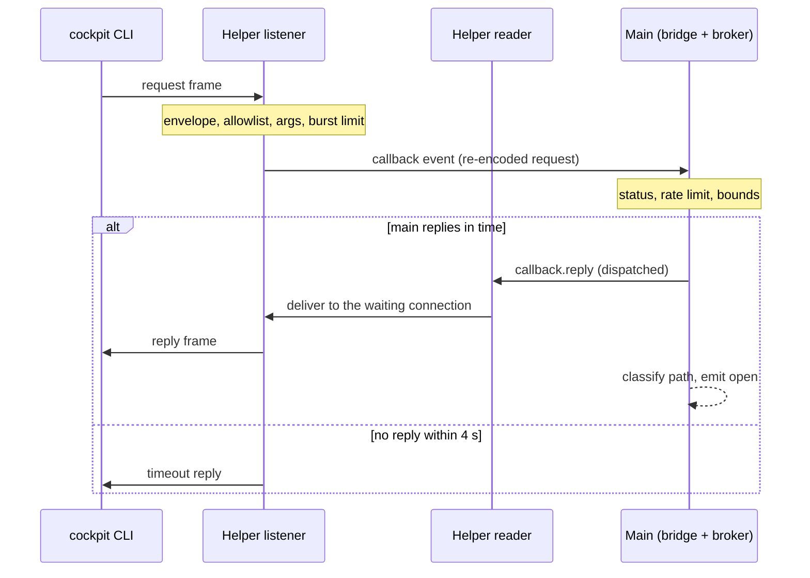

Sources (as built): the helper's reader/worker loop
[remote-helper/main.go:114](../remote-helper/main.go#L114), the forward and reply handling
[remote-helper/callback_service.go:124](../remote-helper/callback_service.go#L124) and
[remote-helper/main.go:154](../remote-helper/main.go#L154) (`callback.reply` answered inline by the reader), and the
bridge [electron/main/callback/remoteBridge.ts:54](../electron/main/callback/remoteBridge.ts#L54).

The helper's forward timeout (4 s) is shorter than the CLI's 5 s deadline so that
`timeout` can reach the user; it means "no confirmation", not "the tab did not
open". A request still pending when the helper's RPC stream ends is answered
`not-connected`, as is one whose event cannot be written (a dead stream) or whose
event queue (one writer goroutine, 64 events) is full behind a stalled stream.
The helper relays main's reply re-stamped with the CLI request's own id and turns
anything malformed into `internal` (relayed error text is capped at 512 bytes and
cut on a character boundary), so correlation never depends on main. The `connId`
that correlates an event with its `callback.reply` comes from ONE counter for the
life of the helper process, not one per listener: a second handshake replaces the
listener, and per-listener ids restarting at 1 would let a late reply meant for
the old listener's request answer a different CLI's request on the new one. The
replaced listener releases its socket path and answers its pending requests at
once; draining its old connections happens in the background so the handshake
that replaced it is never held for the grace period.

Main registers its `callback` handler on the helper's client BEFORE the handshake
is sent (`RemoteHelperLauncher`'s `onClient` hook), not after `launch()` returns:
the listener serves from inside the handshake, so a request from a pane that
outlived the previous app run can reach main as an event ahead of the handshake
reply, and a handler registered later would miss it (the CLI would then wait out
the helper's 4 s and report `timeout`). An early request is answered by the
broker's normal status gate (`not-connected` while the session is still
`connecting`).

### Helper concurrency: reader and worker (invariant)

The helper is a reader plus one worker. The reader decodes frames, answers
`callback.reply` **inline** (it never waits on anything), and pushes every other
request onto an **unbounded** FIFO that the worker drains in arrival order. So a
slow `beadsExec`, diff or status can neither delay main's reply to a pending
`cockpit open` nor block the reader, while every existing method keeps the ordering
it had when the read loop was also the executor. At EOF the callback listener is
released first (nothing can answer a forwarded request any more, and the path must
be free for the next helper), then the worker finishes what was already accepted —
every request that arrived before EOF is still executed. Do not route
`callback.reply` through the queue, bound the queue, or make the reader execute
methods: each reintroduces the blocking the split exists to remove.

### The `cockpit` CLI

A multi-call mode of the helper's Go binary: invoked as `cockpit` (a symlink) or
`remote-helper cockpit …` it dispatches **before** `bootstrapPath()` and before
anything that could start the RPC server or read stdin. `open <path>` makes the
path absolute from the logical working directory (`$PWD` when it names the current
directory) plus a lexical clean, computes the canonical form (the symlink-resolved
PARENT directory joined with the base name, so a symlinked file inside a worktree
is not misclassified as external), reads `COCKPIT_CALLBACK_SOCK` and the pane
identity, sends one request and prints nothing on success. Exit codes: 0
dispatched, 2 usage, 3 not connected (no socket in the environment, nothing
listening, the connection closed before a reply, or an app `not-connected`), 4
rejected (`unsupported-op`, `bad-request`, `rate-limited`), 1 anything else
(including no confirmation within the 5 s deadline).

- **Local:** the same Go source is already built per host platform and shipped
  with `remote-helper/dist` (electron-builder's `extraResources`); the macOS signer
  signs the darwin binary with the app's identity like the mux binaries and
  refreshes the manifest hashes. Before each local listener binds, the app links
  `<userData>/callback/bin/cockpit` to the host's entry of that manifest
  (packaged: the app resources; dev: the built dist), atomically and idempotently,
  under a directory created 0700 and verified like the socket directory. A failure
  is logged once and never fails a session; `COCKPIT_CLI` then dangles. The link is
  one path per user data directory, so it follows the app instance that bound last:
  a Linux AppImage's resources are a per-run mount, so between runs the link
  dangles (a surviving pane's `$COCKPIT_CLI` reports "No such file or directory";
  nothing is running to answer it anyway) until the next start re-links it; dev
  runs share one profile, so a second checkout or worktree re-points the link at
  its own built `remote-helper/dist`, and deleting a checkout or rebuilding its
  `dist` leaves it dangling until the next start. It is refreshed only when a
  listener binds, never in the background.
- **Remote:** at startup the helper retargets `~/.agent-cockpit/bin/<os>-<arch>/cockpit`
  (0700 directories, atomic temp link plus rename) at its own executable and
  reports it as `cliPath`. The link has a FIXED name per os/arch (the per-os/arch
  directory exists because dispatch keys on the program name and an NFS home can be
  shared between hosts of different architectures); what changes is its target,
  and the newest helper launch wins. That target is an immutable build: the
  uploaded helper's file name is keyed on the build's source hash (see Helper
  provisioning), so no other app build can overwrite the bytes under the link.
  Protocol skew between the CLI the link names and a listener of another build is
  what the envelope's `v` is for.

### Environment injection (invariant)

Variables reach a pane by the mechanism that actually reaches it for that backend, and never
through a typed shell command (a typed `NAME=value` echoes into pane output and shell history).
The central fact: **a tmux pane inherits its SESSION environment, never the attaching client's**.
The session environment is the server's global environment — copied from whichever process
STARTED the server — plus whatever tmux copies in from a client through `update-environment`.
So variables placed on a client either do nothing, or, for the process that starts the server,
stamp one project's values into every project's panes.

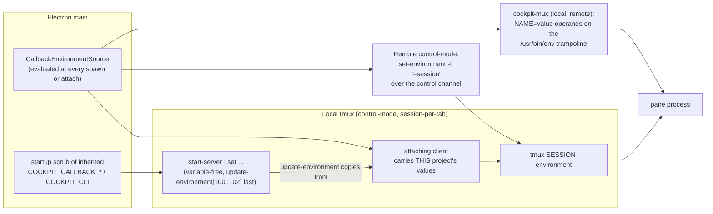

Sources (as built): the variable-free server start
[electron/main/providers/local/tmuxServer.ts:131](../electron/main/providers/local/tmuxServer.ts#L131)
and the attaching client's environment
[electron/main/providers/local/tmuxServer.ts:190](../electron/main/providers/local/tmuxServer.ts#L190); the
local-only option tail [src/shared/tmux/terminalConfig.ts:86](../src/shared/tmux/terminalConfig.ts#L86); the
remote session environment
[electron/main/providers/remote/tmuxControl.ts:464](../electron/main/providers/remote/tmuxControl.ts#L464);
the mux operands [src/shared/callback/env.ts:106](../src/shared/callback/env.ts#L106) applied at
[electron/main/providers/remote/muxTerminal.ts:243](../electron/main/providers/remote/muxTerminal.ts#L243);
the startup scrub [electron/main/callback/envScrub.ts:22](../electron/main/callback/envScrub.ts#L22).

| Backend                                    | Mechanism                                                                                                                                                                                                                                                                                                                |
| ------------------------------------------ | ------------------------------------------------------------------------------------------------------------------------------------------------------------------------------------------------------------------------------------------------------------------------------------------------------------------------ |
| Local tmux (control-mode, session-per-tab) | One **indexed** `update-environment` element per variable (`[100]` socket, `[101]` version, `[102]` CLI) on the local server only, last in the `start-server ; set …` chain; tmux copies the values from the attaching client into the session on create and on `-A` attach, and strips them when the client lacks them. |
| Remote control-mode                        | `set-environment -t '=<session>'` over the control channel (stdin, not remote argv), after the data handler is wired, before `attached` is emitted, on every attach and reattach; the wait is bounded and an expired wait leaves the command's reply entry in the FIFO.                                                  |
| cockpit-mux (local and remote)             | `NAME=value` operands on the `/usr/bin/env BYOBU_DISABLE=1 /bin/sh -c …` trampoline at all three creation sites (`session.create`, `pane.split`, `window.new`), plus the app-chosen `COCKPIT_CALLBACK_MUX_KEY`.                                                                                                          |

Invariants (each reintroduces a cross-project leak or a silently absent feature if broken):

- **The server-start process is variable-free**, in isolated and ephemeral runs too, and the shared
  server never exits when its last session goes (`exit-empty` is `off` in every opener; an ephemeral run
  is cleaned up by an explicit `kill-server` at quit). A server that exits would be restarted by the next
  client, which carries one project's values.
- **`update-environment` is local-only and indexed.** The shared option source gains a flag: the local
  argv opener includes the tail, both remote shell openers filter it out, so a remote variable-less attach
  never strips. It is one element per name, never a plain `set -g` and never repeated `-ga`; an element holds
  exactly one name, so a space-separated value would match nothing. This is a documented exception to "one
  option source for both openers".
- **The inherited environment is scrubbed at startup**, unconditionally and before any spawn: the app is
  routinely launched from inside a cockpit pane. The `COCKPIT_MUX_*` overrides are kept. A project's values
  are added to each spawn explicitly, never to `process.env`.
- **A local session's pending listener bind is awaited before any terminal or control-mode attach is
  created** (`SessionManager.open()`, and `callbackReady` for the IPC handlers that address the provider
  directly): terminals read the socket path at creation, so one made before the bind would start without the
  variables for the life of its tmux session, and a variable-less `-A` attach would make the server-wide
  entries strip the values its session already held.
- **Every command that applies them is explicitly addressed** to the project's own session (never to the
  ambiently active project).
- **The shared-session gate is captured with the object that names the session** (`deterministicSessionNames`
  at its creation): a gated object injects nothing and sets no entry of its own. Entries are server-global, so
  an entry a non-gated object set earlier still applies to a gated object's attaches, whose variable-less client
  strips the callback variables of that session — accepted, because this app never puts values into a shared
  session. Mux sessions are namespaced by the raw project id and are not gated.
- **If the indexed form is rejected** (an old tmux), each element is retried alone and one structured
  diagnostic names the reason (`update-environment-set-failed` with the tmux version, or `tmux-command-failed`
  without a version claim); only the callback variables are lost.

A remote project's values are exactly what its helper reported in the handshake, evaluated at each attach or
spawn, and are absent while the helper's stream is closed. Remote session-per-tab terminals, panes created by
the in-pane `cockpit-mux` commands, and panes of a shared session (`deterministicSessionNames`) do not get the
variables.

### Known limitations

- The first pane of a **brand-new remote control-mode session** exists before the manager can set the session
  environment, so it lacks the variables until a new tab is opened (accepted; one swappable function).
- **Already-running shells never gain new variables**; re-attaching to a surviving pane does not retrofit it.
  They keep working across an app restart because the socket path is deterministic.
- A variable-less attach to the shared tmux server (a user running `tmux -L agent-cockpit attach` in their own
  terminal) strips the variables from that session; a local control client never re-attaches, so that project's
  new tabs lose the feature until restart.
- Old helper builds accumulate on remote hosts (about 4 MB per os/arch per source change); there is no pruning.
- A symlinked remote project root cannot be canonicalized without a realpath RPC, so a path under it is
  classified as an external file.

### Renderer: `evt:callback-open` and the no-focus reveal

Main pushes each classified `open` the broker emits to the renderer as
`evt:callback-open` `{projectId, selection}` (`forwardCallbackOpens`,
`electron/main/callback/rendererForward.ts`, wired in `registerIpc`). It goes to the
**main window only**: the diagnostics window is among `BrowserWindow.getAllWindows()`
and has no Content panel, so it is never a broadcast. `projectId` is the project whose
socket carried the request, never the ambiently active one. The selection is copied
field by field (`kind` of `file` or `external-file`, `path`, `worktreePath`), so the
unverified `pane` attribution stays in main and a `baseline` cannot cross. A push with
no live main window is logged, since the CLI was already answered `dispatched`. The
preload exposes it as `events.onCallbackOpen`, which returns its unsubscribe.

In the renderer, `initCallbackOpenSync` (`src/renderer/workspace/callbackOpen.ts`;
`AppShell` subscribes for its lifetime and releases on unmount):

1. validates the payload and rebuilds the selection from the validated fields only. A
   malformed payload, an empty project id, a `change` kind, or a shape main never
   produces is ignored and logged: a `file` is relative to its worktree (or the project
   root when `worktreePath` is empty) with no `..` segment and a `worktreePath` that is
   empty or absolute; an `external-file` is an absolute path with no `..` segment and
   no worktree;
2. records the tab with `useContentSelection.select(projectId, selection)`, first and
   unconditionally, so a reveal that declines or throws never loses the open; the tab
   for the same fully-qualified path is activated, not duplicated;
3. only when `projectId` is the **active** project, asks the workbench to show the
   Content panel (`workspaceControlsStore.revealContent(projectId)`, published by
   `CockpitWorkspace`). A non-active project only records its tab: the active project
   is never switched, the layout is never touched and nothing is revealed on its behalf.
   The workbench also refuses (`not-loaded`) while Dockview still shows ANOTHER
   project's layout. `activeId` flips before the layout effect rebuilds the panels, so
   acting then would reveal in, and save, the previous project's layout; `loadLayout`
   records which project's layout is loaded (`loadedRef`) and the reveal and every
   saved-layout write key on that, never on `activeId`. The tab shows once the switch
   completes.

An open that reaches a renderer which is not subscribed (the window is reloading, or
`AppShell` has not mounted yet) is lost: nothing queues or replays it, the CLI was
already answered `dispatched`, and no tab is recorded.

#### Showing Content without moving keyboard focus (invariant)

The user is typing in the terminal that ran the command, so the open must neither take
the keyboard nor rearrange what they are working in. `panelReveal.ts` (in
`src/renderer/workspace/`) therefore **never activates anything**. It makes Content the
visible tab of ITS OWN group with `group.model.openPanel(panel, { skipSetGroupActive: true })`:
no activation event is emitted (Dockview re-emits a group's active-panel change
globally only when that group is the active one), so there is no focus-memory write, no
`focusPanel` call and the `lastActivePanelId` guard is untouched.

`panel.api.setActive()` under `withFocusSuppressed` is not a substitute. `setActive`
makes the group the active group (exiting a maximized group) and fires
`onDidActivePanelChange`; its handler writes the persisted focus memory
unconditionally, records `lastActivePanelId` and calls `focusPanel`, and
`withFocusSuppressed` silences only that last call. The memory would still be
overwritten (the next project switch-back would `focusPanelForce` Content), the
active-group highlight would move while keystrokes keep going to the terminal, and the
suppression flag is a global that also swallows a genuine `focusPanel` in the same
window.

Dockview's default `onlyWhenVisible` renderer DETACHES a hidden tab's DOM, so showing
Content in a group replaces what that group shows and drops DOM focus if the replaced
panel held it. The reveal therefore decides by layout:

| Content is…                                                                                                   | Outcome                                                                   |
| ------------------------------------------------------------------------------------------------------------- | ------------------------------------------------------------------------- |
| the visible tab of its own group (the Edit and Review defaults)                                               | left alone (`already-visible`); only the tab strip changes                |
| a background tab of a group that is not in use                                                                | becomes that group's visible tab, the group is not activated (`revealed`) |
| tabbed behind the Terminal                                                                                    | declined (`withheld-terminal`): it would hide the terminal                |
| a background tab of the group in use: Dockview's active group (it follows DOM focus) or the one holding focus | declined (`withheld-active-group`)                                        |
| anywhere while another group is maximized                                                                     | declined (`withheld-maximized`): maximize is never exited                 |
| closed, with room to add it without resizing the terminal                                                     | re-added inactive, then shown without activating its group (`added`)      |
| closed, with no such room                                                                                     | declined (`withheld-no-room`)                                             |

A declined reveal leaves the tab recorded, writes one renderer log line saying why
(`logDiagnostic`: the main window's console and log store, visible in DevTools or the
launching terminal; the Diagnostics window shows main-process entries only) and raises
a **status-bar cue**: `StatusRegion` shows "Opened <file> in Content (hidden)" in an
always-mounted `role="status"` live region, with a **Show** action and a tooltip
carrying the path and the reason (`openCueStore`). The cue is renderer-only state and
not part of the saved layout. It is replaced by a newer decline, dismissed by an open
that did show the panel, by Show, or after 15 s, and shown only while its project is the
active one. Show is the user's explicit request, so it goes through the workbench's own
`openPanel` (which exits a maximized state and takes the focus); the automatic path
never does.

A closed panel is re-added without activating anything: under the Changes group (the
Edit view's own slot for it), else as a new column at the right edge; one
view-independent rule, because the Review view's Content slot is a root-level column
that reference-plus-direction placement cannot express. **The terminal is never resized
by the add.** Adding a group makes Dockview equalize EVERY sibling in the splitview it
joins (`Sizing.Distribute`): measured against the real presets, the Review view's
terminal fell from 430 to 288 high (it shares the right column with Changes) and either
right-edge fallback cut its width from 720 to 480. The terminal group is therefore
pinned at its current size (`group.api.setConstraints`, min == max, restored in a
`finally`) for the add. Dockview's equalizing skips inflexible views and its resize
absorption clamps to [min, max], so the terminal cannot change, by construction, and
the other groups split what is left (in Review, Changes and Content share Changes' old
cell). The terminal is never carved: when Changes shares the terminal's group the right
edge is used, a Changes cell under 200px (too short to split) falls back to the right
edge, and when the right edge leaves under 200px for the columns that are not the
terminal's the add is declined, because a group added without room lands OUTSIDE the
container (measured: 100px past the edge when the terminal is alone). The Panels
menu's `openPanel` is not reused: it adds to the ACTIVE group (usually the terminal's)
and activates the new panel. A panel added `inactive` into a brand-new group has no
visible tab and renders blank until its group is activated, so the re-add also calls
`openPanel(…, { skipSetGroupActive: true })`. The saved layout follows the reveal: a
re-added panel is saved by Dockview's buffered layout-change event, but a tab switch in
a group that is not the active one emits none of the events that listener watches, so
`CockpitWorkspace` saves the layout itself after a `revealed` outcome (otherwise a
restart would restore the old visible tab).

Options not adopted for the declined layouts, so the next decision is informed: moving
Content out of the shared group (`panel.api.moveTo({ group, position, skipSetActive:
true })`) would show it and keep the terminal's focus but rearranges a layout the user
chose; a floating group covers part of the terminal and is serialized with the layout;
leaving a maximized group resizes the terminal; a badge on the hidden Content tab would
change a title that is serialized into the layout (the status-bar cue above, which is
renderer-only state, shipped instead). Declining, recording and saying why never
rearranges, hides or refocuses anything.

### Regression Check

- `cd remote-helper && go vet ./... && go test ./...` pins the wire codec (the same
  fixtures the TypeScript reference replays), the edge allowlist, argument
  validation, burst limit and frame cap, the re-encoded forwarding, the
  process-wide `connId`, the over-cap `rate-limited` reply, the takeover inode
  check, the reader/worker split, the CLI's exit codes and its dispatch before
  `bootstrapPath()`.
- `npx vitest run electron/main/callback electron/main/providers/remote` pins the
  bridge and its registration before the handshake, the handshake-derived
  environment, the provider lifecycle, the hash-keyed atomic helper upload and
  `replaceExecutable`'s cleanup and SFTP fallback, and the CLI link, and runs one
  test with the real Go helper, the real CLI and the real broker
  (skipped, with a stated reason, when no Go toolchain is present).
- On a live remote project: a pane's `"$COCKPIT_CLI" open README.md` returns
  silently; while a slow `br` write is running it still returns promptly; killing
  the ssh transport makes the CLI exit 3 within 5 s and a reconnect takes the
  socket path over without a stale predecessor deleting it.
- `npx vitest run src/renderer/workspace src/renderer/shell electron/main/callback/rendererForward.test.ts electron/main/ipc`
  pins the renderer leg against the REAL Dockview in jsdom (the full `CockpitWorkspace`
  with the real `PanelHost`): for every Content layout (visible, hidden in its own
  group, tabbed with the Terminal, a background tab of the active group or of the group
  holding the focus, another group maximized, closed) DOM focus stays on the same
  attached element, no activation event is emitted, the focus memory is untouched and
  `focusPanel` is never called; a plain `setActive()` on the same tab is pinned to DO
  emit one (the reason the reveal never uses it). Re-adding a closed Content panel is
  asserted never to change the terminal's size in the real presets (Edit, Review, both
  right-edge fallbacks, Changes tabbed with the terminal) and to be declined when there
  is no room. It also pins the payload validation and shapes, the non-active-project
  rule, the refusal while another project's layout is loaded, the status-bar cue and
  its Show action, and the main-window-only send.
- `npm run typecheck` also type-checks the test support (`src/renderer/testing`) and
  this feature's tests (`tsconfig.renderer-tests.json`, `tsconfig.main-tests.json`),
  which `tsconfig.renderer.json` and `tsconfig.main.json` exclude from the production
  projects.
- `npm run test:e2e:callback` drives the built app (isolated profile, `TMUX_TMPDIR`,
  tmux socket and hidden window): a real `"$COCKPIT_CLI" open README.md` typed into the
  focused terminal adds the Content tab, the terminal keeps the keyboard (the next
  command typed is run by the shell), a closed Content panel is re-added without taking
  focus, with the terminal maximized the open is declined and the status cue's Show
  exits maximize and takes the focus, and an open aimed at a background project's
  socket records its tab there with no switch and no reveal.

## Configuration and Environment Contracts

### Local Terminal Process Ownership

Packaged Cockpit starts its local mux daemon detached and without an owner pipe
by default, so active panes survive Electron quit/relaunch. The optional
`COCKPIT_MUX_EPHEMERAL=1` mode adds an inherited owner pipe for isolated tests
and development runs whose guardian owns teardown; EOF cancels that daemon's
server context, including after parent SIGKILL. For panes launched by that daemon,
teardown enumerates the private PTY session and signals its current members
(TERM, bounded grace period, then KILL), not just the shell PID, so helpers such
as `gitstatusd` are included. During live handoff, the session-leader ID and
its original start-time identity are transferred, and the replacement records
PID/start-time identities only while
the original leader is verifiable. After that identity disappears, cleanup
signals only recorded identities that still match; it does not discover targets
from SID alone. For an owned pane, the daemon holds its exited shell unreaped
until same-session cleanup completes, preventing numeric SID reuse during the
scan. The adopted-pane fail-closed policy accepts a narrow race where a helper
created after the last sample can survive. See
[`docs/operations/process-lifecycle.md`](operations/process-lifecycle.md) for
the evidence and accepted limitation.

Cockpit-mux sessions are daemon-owned live processes, not Electron-owned child
processes. Normal app quit only disconnects the client; it does not stop the
daemon or reap session history. An explicit pane/session close reaps its catalog
and history. Stopping the daemon itself terminates active process groups; daemon
restart restoration is not required. Production tmux sessions follow a separate
contract: they survive UI disconnects and app restarts and are removed only by
explicit user action. No automatic TTL is applied to detached production tmux
sessions, because a detached session may still contain a running agent.

E2E, isolated development, and `bin/run-isolated` runs set `AC_TMUX_SOCKET` to a
unique socket and `AC_TMUX_EPHEMERAL=1`. The latter makes app shutdown
(`will-quit`) kill that exact server, as detached run guardians also do. It does
not turn `exit-empty on`: every opener keeps `exit-empty off`, because the server
is started by a process that carries no terminal callback variables, and a server
that exits when its last session goes would let the next client, which does carry
one project's values, start it. E2E
guards reject direct Playwright invocation with a non-isolated socket. The default
`agent-cockpit` tmux server is never targeted by automated teardown.

For confirmed causes, unresolved historical evidence, and the cleanup
acceptance commands, see
[Process Lifecycle and Leak Findings](operations/process-lifecycle.md).

- **Terminal callback environment:** a cockpit terminal pane of a project with a live callback
  socket has `COCKPIT_CALLBACK_SOCK` (the project's socket), `COCKPIT_CALLBACK_VERSION` (the
  callback protocol version) and `COCKPIT_CLI` (the absolute path of the `cockpit` CLI; locally it
  contains a space on a default macOS profile, so the documented form is `"$COCKPIT_CLI" open
<path>`), and in a cockpit-mux pane `COCKPIT_CALLBACK_MUX_KEY` (the pane's terminal key). The app
  removes inherited `COCKPIT_CALLBACK_*` and `COCKPIT_CLI` from its own environment at startup and
  keeps `COCKPIT_MUX_HOME`/`COCKPIT_MUX_BIN`/`COCKPIT_MUX_EPHEMERAL`. `PATH` is not modified.
- **Remote host prerequisites:** an SSH account, `tmux`, and the ability to run
  the uploaded static helper binary. No package manager, language runtime, or
  root. Hosts are assumed POSIX (macOS/Linux); Windows remote hosts are out of
  scope. Beads **writes** on a remote project additionally require `br` on the
  remote host's PATH (run by the helper's `beadsExec` RPC); beads **reads** parse
  `.beads/issues.jsonl` directly and do not need `br`.
- **SSH auth:** an explicit identity file when provided, otherwise the SSH agent
  at `$SSH_AUTH_SOCK`. Secrets and full key paths are never logged. Auth is a
  `RemoteTransport` responsibility behind `connect`.
- **Host-key verification:** `Ssh2Transport` verifies the host key against the
  user's `known_hosts`; a mismatch is a typed `phase: 'hostkey'` error, not a
  silent accept.
- **Idle aging-out:** `sessionIdleTimeoutMin` (default 20 min; `0` disables)
  bounds the live remote-session set; see the Session Idle Aging-Out section.
- **Helper provisioning:** the matching prebuilt binary is selected from the
  local `remote-helper/dist` manifest by `uname -sm`, SFTP-uploaded to
  `~/.agent-cockpit/helper-<version>-<sourceHash12>-<os>-<arch>` (the name is
  keyed on the build's source hash, so one path is one build for good; a manifest
  without a hash keeps the unkeyed `helper-<version>-<os>-<arch>`), and run over
  an exec channel. Every write goes to a temporary name beside the target and is
  renamed into place (`posix-rename@openssh.com`, or remove-then-rename on an SFTP
  server without it; the temporary is removed on any failure), so the final name
  never holds a partial file and a helper still running from it keeps its inode. A
  present file is skipped when it reports the current source hash and replaced the
  same way when it does not (a damaged upload). Old builds are not pruned: each
  source change leaves one more binary (about 4 MB) per os/arch in
  `~/.agent-cockpit/`, as the mux binaries there also accumulate. At startup the
  helper retargets the `cockpit` CLI link under `~/.agent-cockpit/bin/<os>-<arch>/`
  at itself (see Terminal Callback Socket).

## Linked Documents

- [docs/REQUIREMENTS.md](REQUIREMENTS.md) — objective, scope, FR/NFR,
  acceptance criteria.
- [docs/DESIGN.md](DESIGN.md) — implementation design, flows, full schema, and
  phasing.
- [docs/TEST_PLAN.md](TEST_PLAN.md) — test strategy, scope, and the
  better-sqlite3 ABI constraint.
- [docs/requirements/terminal-callback-socket.md](requirements/terminal-callback-socket.md) —
  the numbered terminal callback socket requirements.
- [docs/design/terminal-callback-socket.md](design/terminal-callback-socket.md) — the terminal
  callback socket implementation design.
- [docs/test/terminal-callback-socket.md](test/terminal-callback-socket.md) — the terminal callback
  socket scenarios, evidence and verification gaps.
