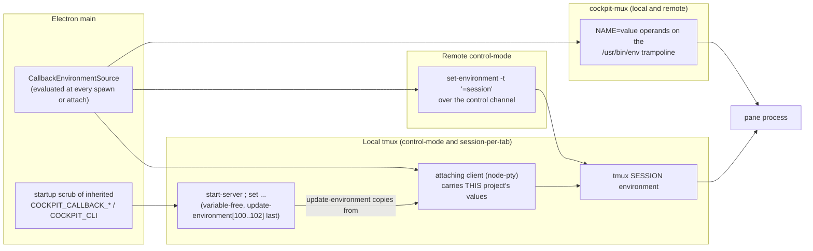

<!-- AI NOTE: doc_standard=engineering-docs-standards; version=2; doc_kind=design_breakout -->

# Terminal Callback Socket and `cockpit open` — Design

## Summary

A process in a cockpit terminal pane runs `"$COCKPIT_CLI" open <path>`; the file opens as a
Content tab of the pane's own project. The transport is a per-project unix socket (a
length-prefixed JSON request/reply envelope with a default-deny operation allowlist) served by
main for a local project and by the project's own remote helper for a remote one; both end in
one decision function and one renderer event. The socket's path reaches the pane through the
pane's environment, applied by the mechanism that actually reaches a pane on each backend.

This breakout is the implementation-level design. The requirements it realizes are in
[docs/requirements/terminal-callback-socket.md](../requirements/terminal-callback-socket.md)
(cited as "requirement N"), the stable structure and invariants in
[docs/ARCHITECTURE.md](../ARCHITECTURE.md) ("Terminal Callback Socket"), and the verification
in [docs/test/terminal-callback-socket.md](../test/terminal-callback-socket.md). The master
entry is UC-4 in [docs/DESIGN.md](../DESIGN.md).

## Diagram

How one `open` travels, for a local and a remote project:

```mermaid
sequenceDiagram
  participant P as Pane shell
  participant C as cockpit CLI
  participant L as Listener (main, or the helper)
  participant B as CallbackBroker
  participant R as Renderer (main window)
  P->>C: "$COCKPIT_CLI" open README.md
  Note over C: absolute path from the logical PWD,<br/>canonical = EvalSymlinks(parent) + base
  C->>L: one framed request {v, id, op: open, pane, args}
  L->>B: decide(projectId of this socket, request)
  Note over B: envelope, allowlist, rate limit,<br/>status = connected, argument bounds
  B-->>L: {ok: true, result: {status: dispatched}}
  L-->>C: reply frame
  C-->>P: exit 0, no output
  B->>B: classify the canonical path (listWorktrees)
  B->>R: evt:callback-open {projectId, selection}
  R->>R: select(projectId, selection); reveal Content without focus
```

How the variables reach a pane on each backend (a tmux pane inherits its SESSION environment,
never its attaching client's):



Sources (as built): the decision function
[electron/main/callback/broker.ts:108](../../electron/main/callback/broker.ts#L108), the listener
[electron/main/callback/listener.ts:46](../../electron/main/callback/listener.ts#L46), path
classification [electron/main/callback/classify.ts:81](../../electron/main/callback/classify.ts#L81),
the renderer push
[electron/main/callback/rendererForward.ts:30](../../electron/main/callback/rendererForward.ts#L30),
the renderer handler
[src/renderer/workspace/callbackOpen.ts:126](../../src/renderer/workspace/callbackOpen.ts#L126),
the CLI [remote-helper/cockpit_cli.go:106](../../remote-helper/cockpit_cli.go#L106), the startup
scrub [electron/main/callback/envScrub.ts:22](../../electron/main/callback/envScrub.ts#L22), the
variable-free server start
[electron/main/providers/local/tmuxServer.ts:131](../../electron/main/providers/local/tmuxServer.ts#L131),
the attaching client's environment
[electron/main/providers/local/tmuxServer.ts:190](../../electron/main/providers/local/tmuxServer.ts#L190),
the mux operands [src/shared/callback/env.ts:106](../../src/shared/callback/env.ts#L106) used at
[electron/main/providers/remote/muxTerminal.ts:243](../../electron/main/providers/remote/muxTerminal.ts#L243),
and the remote session environment
[electron/main/providers/remote/tmuxControl.ts:464](../../electron/main/providers/remote/tmuxControl.ts#L464).

## Key Design Rationale

- **An identity, not a secret.** Earlier designs treated the per-pane value as an access secret
  (HMAC, an install secret, rotation, "never reaches the renderer"). It is an identity — which
  project and which pane a request comes from — and access control is the socket's filesystem
  permissions alone. That removes the secret machinery and makes per-pane identity free: tmux
  already puts `TMUX_PANE` in every pane, and the mux gets an app-chosen key.
- **Environment placed on a tmux client does not reach panes.** A pane inherits the **session**
  environment, merged from the server's global environment, and the global environment is copied
  from whichever process STARTS the server. So variables on the node-pty client, or a typed
  `NAME=value tmux …`, either do nothing or — for the process that starts the server — stamp one
  project's values into every project's panes. Only per-**project** values (socket path, protocol
  version, CLI path) are injected on tmux, so session-level injection suffices; per-pane identity
  comes from `TMUX_PANE`.
- **Newest listener wins the path, atomically.** A stale predecessor (a helper left alive by a
  half-open ssh drop) must not hold the path, and a fixed temporary name would let an old
  listener's close unlink a new one. The new owner binds a uniquely named temporary socket and
  `rename`s it over the real path; every owner unlinks on close only if the path's inode is still
  its own.
- **Answer first, classify afterwards.** Classification needs `listWorktrees`, which on a remote
  project queues behind whatever slow method the helper is running; the broker therefore replies
  `dispatched` after its cheap checks and classifies asynchronously.
- **The helper validates at its edge.** Frame cap, read deadline, connection cap, envelope, the
  operation allowlist, the operation's arguments and a burst limit are checked in the helper, so
  a same-user process cannot make main parse arbitrary bytes or hold the RPC stream; main
  re-validates everything and stays the authority.
- **`open` is broader in scope than the planned signaling operations.** Its caller already has the user's
  privileges and `open` only displays, so it accepts `external-file` paths and opens for a non-active project. The
  draft agent-signaling proposal's NFR2 forbids reaching outside the origin pane's project; the `review` and
  `focus` operations it adds keep that narrower scope on top of this transport, which does not enforce it for them.
- **One decision function.** The local listener and the remote event path call the same
  `CallbackBroker.handle(projectId, request)`, with the project taken from the socket or helper
  stream that delivered the request — never from the request, never from the ambiently active
  project.

Alternatives considered and rejected:

- **Secret per-pane or per-project tokens (HMAC):** the value is an identity, not an access secret.
- **`tmux new-session -e` / `new-window -e` / `split-window -e`:** an unknown `-e` is a hard usage
  error on older tmux (it would fail the remote `-CC` connect, the same class as a failing
  `set -g` in a `&&` chain), `-A` ignores `-e` for an existing session, and renderer-composed
  commands would have to change.
- **Variables on the node-pty client or a `NAME=value` shell prefix:** does not reach panes, can
  leak one project's values into every project's panes through the server's global environment,
  and typing it echoes into pane output and shell history.
- **An OSC escape sequence from the terminal:** no reply channel, no authentication (any printed
  file could trigger opens), and tmux control mode and the mux shadow are not known to forward
  unknown OSC sequences.
- **One endpoint per remote host:** impossible with several projects per host.
- **A reverse ssh socket forward:** unnecessary, the helper already has an RPC stream to main.
- **Localhost TCP:** reachable by every local user and, with care, by browsers.

## Walkthrough

Example: project A (a local control-mode project at `/work/a`, active) and a pane in its tmux
session.

1. Opening the session binds A's socket first: `SessionManager.open()` waits for the broker's
   bind (`callbackReady`), so the first terminal already sees `COCKPIT_CALLBACK_SOCK`. The
   broker links `<userData>/callback/bin/cockpit` to the host's helper binary before binding.
2. The pane's shell has `COCKPIT_CALLBACK_SOCK=<userData>/callback/<h>.sock`,
   `COCKPIT_CALLBACK_VERSION=1`, `COCKPIT_CLI=<userData>/callback/bin/cockpit` and tmux's
   `TMUX_PANE=%3`.
3. The user types `"$COCKPIT_CLI" open docs/plan.md` in `/work/a`. The CLI makes the path
   absolute from the logical `$PWD` (`/work/a/docs/plan.md`), resolves the canonical form
   (`/work/a/docs/plan.md`), and sends `{v:1, id:1, op:'open', pane:{kind:'tmux', id:'%3'},
args:{path, canonicalPath}}`.
4. The listener accepts one frame, hands the request to `handle('A', …)`; the broker finds A
   `connected`, takes a rate-limit token, validates the arguments and replies
   `{id:1, ok:true, result:{status:'dispatched'}}`. The CLI exits 0 and prints nothing.
5. The broker lists A's worktrees, matches the canonical path against the canonical roots and
   emits `{projectId:'A', selection:{kind:'file', path:'docs/plan.md', worktreePath:'/work/a'}}`.
6. Main forwards it as `evt:callback-open` to the main window only; the renderer validates the
   payload, records the tab with `select('A', selection)` and, because A is the active project,
   shows the Content panel without moving keyboard focus. The tab is `plan.md`, its hover
   `/work/a/docs/plan.md`; the next keystroke still goes to the shell.

If A were disconnected, step 4 would reply `not-connected` (exit 3); if the pane belonged to a
project whose session was never activated in this run of the app, there would be no socket and
the CLI would exit 3 with "no such socket".

## Details

### Envelope, wire and limits

Frames are length-prefixed JSON (the codec the helper RPC stream already used, extracted to
`src/shared/wire/frame.ts` and mirrored in Go). A request is `{v, id, op, pane?, args}`; a reply
`{id, ok:true, result}` or `{id, ok:false, error:{code, message}}`. The callback protocol version
is 1 (`COCKPIT_CALLBACK_VERSION`); the helper RPC protocol version is 2, pinned together in the Go
constant, `rpcClient.ts`, `build.sh` and the `Makefile` by a test, and a mismatch re-provisions
the helper once. Error codes: `unsupported-op`, `bad-request`, `rate-limited`, `timeout`,
`not-connected`, `internal`. `open` args are `{path, canonicalPath?}` (`path` absolute, non-empty,
no NUL, at most 4096 bytes; `canonicalPath` absolute and omitted when the CLI cannot compute it);
the result is `{status:'dispatched'}`. Limits: 64 KiB frames, one request per connection, a 5 s
read deadline counted from accept (absolute, so a trickling peer is cut off), 32 concurrent
connections on main's listener (Node drops a connection past the cap without a reply, so the CLI
exits 3 "connection closed before a reply") and 16 on a helper's (a connection past the cap is
answered `rate-limited` under a write deadline and closed, so the CLI exits 4), and a burst limit
of 10 requests per second per project. Shared fixtures (`src/shared/callback/fixtures/`) are replayed by both the
TypeScript reference and the Go mirror, so the two cannot drift.

### CallbackBroker

`handle(projectId, raw)` runs the cheap checks in a fixed order — envelope, allowlist, the
per-project token bucket, the connection status (only `connected` is served), the operation's
argument bounds — and returns the reply synchronously. `open` then dispatches classification
without awaiting it. A classification failure (the session ended, an RPC error) is logged with a
diagnostics entry and opens nothing. The broker owns the local listener per project: it prepares
the socket directory, ensures the CLI link, binds, and unlinks on stop (inode-checked); starts
and stops are serialized per project, and a bind failure disables that project's callback with one
structured log line without ever failing the session.

### Socket location and the listener

Paths follow requirement 4. The directory is created 0700 and verified with `lstat`; the socket
is chmod'd 0600 after bind. The local listener enforces the frame cap, the read deadline and
`maxConnections`, and binds the takeover temporary name described above. `SessionManager` starts
it on the edge into `connected` and stops it on `disconnected`/`failed`, on eviction and in
`closeAll` (which unlinks synchronously because the app does not await it at quit). Closing the
session-owned watch and the callback listener share the same symmetric teardown edges.

### Path classification

`classifyOpenTarget` takes the logical path, the canonical path, the provider's worktree roots
and the project root candidates. It matches the canonical path against the deepest containing
worktree and returns `{kind:'file', path: relative, worktreePath: worktree}`; with no worktree
match it falls back to the project root with `worktreePath: ''`; otherwise
`{kind:'external-file', path: logical, worktreePath: ''}`. When the CLI sent no canonical form
and the LOCAL project root is itself a symlink, a logical path under the configured root is
rewritten to the root's realpath and the worktree match is retried (git reports canonical roots,
and the Explorer reads from them, so without the retry the same file would get a second tab).
Remote classification never calls a realpath RPC or `resolvePath`. A selection never carries a
`baseline`.

### Environment injection

Values come from a `CallbackEnvironmentSource` (`src/shared/callback/env.ts`), evaluated at every
terminal creation or attach and never cached, so a listener that rebinds or a helper that
reconnects is picked up by the next terminal. A set that cannot be injected (empty, or a NUL or
line break) yields no environment and one log line, never a partial set.

**Local tmux (control-mode and session-per-tab).** The shared server options are one source,
`TMUX_SERVER_OPTIONS` (`src/shared/tmux/terminalConfig.ts`); the three callback elements are a
**local-only** tail: `tmuxServerOptionArgs` (the local argv opener) includes them,
`tmuxServerOptionShell` (both remote shell openers) filters them out, so a remote variable-less
attach never strips. They are applied as one indexed element per variable
(`update-environment[100..102]`), last in the `start-server ; set …` chain. `startTmuxServer`
(`providers/local/tmuxServer.ts`) is the one place that starts the server for both local openers:
a spawn through `withNativeArch` with the callback variables removed from its environment, so the
server's global environment stays clean. The attaching node-pty client carries the project's
values (`tmuxClientEnv`); tmux copies them from the client into the **session** on create and on
`new-session -A` attach (so the first pane of a new session has them and a re-attach refreshes
them), and strips them when the client lacks them. If the chain fails, each element is retried
alone and one structured diagnostic is logged per reason and socket: `update-environment-set-failed`
(tmux rejected the indexed form — an unknown, invalid or ambiguous option, or not an array — with
the tmux version named) or `tmux-command-failed` (anything else, no claim about the version). Every
tmux spawn here is bounded to 5 s. A local session's pending listener bind is awaited before any
terminal or control-mode attach is created — `SessionManager.open()` waits, and
`callbackReady(projectId)` serves the IPC handlers that address the provider directly
(`tmuxControlOpen`, `terminalOpen`, `terminalSplit`, `terminalNewWindow`) — because terminals read
the socket path at creation and a terminal made before the bind would start without the variables
for the life of its tmux session, while a variable-less `-A` attach would make the server-wide
entries strip the values its session already held. No status event is delayed and a remote session
is never held back.

**Remote control-mode.** The client environment is the ssh shell's, which main does not control, so
main applies the values with `set-environment -t '=<session>' NAME value` over the control channel
(commands travel on the control stdin, not remote argv) on every attach and reattach. In
`remote/tmuxControl.ts` the order is: wire the data handler, send the `set-environment` commands,
await their replies under a bounded timeout (`SESSION_ENVIRONMENT_TIMEOUT_MS`, 3 s), run the
first-pane strategy, and only then emit `attached` — so reserved windows (`persistent`, `run-1`,
`respawn-pane -k`) inherit the values. When the timeout expires main stops waiting but **leaves the
command's entry in the pending-reply FIFO** (removing it would desync every later reply), and a user
command issued in that window may create a window without the variables. The commands are issued
on that manager's own channel, with an explicit project; a late command from a replaced channel
rejects instead of landing on the new one. Nothing is stripped when the project has no values.

**cockpit-mux (local and remote).** The shell is spawned by the daemon, not tmux, and the daemon
sets no pane identity. The values — plus `COCKPIT_CALLBACK_MUX_KEY=<terminal key>` — are added as
`NAME=value` operands to the existing `/usr/bin/env BYOBU_DISABLE=1 /bin/sh -c …` trampoline at all
three creation call sites (`session.create`, `pane.split`, `window.new`) through a per-provider
environment passed to `RemoteMuxTerminalManager` (the local mux uses the same manager with local
values). There is no daemon protocol change; operands are argv, so spaces are safe; the key is
app-chosen, so it is known before the pane exists.

**Session-per-tab (local)** uses the local tmux mechanism through the node-pty client; no
`NAME=value` prefix is ever added to a typed `tmux … new-session` command. **Remote session-per-tab**
gets nothing (limitation in requirements).

**The shared-session gate.** The decision to inject is a constructor argument of each object that
names a tmux session (`LocalProvider`, `RemoteProvider`, and each `LocalTmuxControlManager`, built by
`createLocalControlManager` from the one settings read that also names its session), so there is no
later settings read to diverge. A gated object injects nothing, sets no `update-environment` entry
of its own and logs a note (`callback injection disabled … reason=deterministic-session-names`);
it does not make the server stop stripping (requirement 12). The provider logs its session-per-tab
note whenever the setting is on, including under the mux backend, where that manager is unused and
mux injection stays on.

**The startup scrub.** `startupScrub.ts` is the first import of main's entry, so by the time any
other module is evaluated `process.env` carries no `COCKPIT_CALLBACK_*` / `COCKPIT_CLI`. The scrub
logs the removed NAMES (never values). `withoutCallbackEnv` additionally filters the server-start
environment, so it stays variable-free even if something put a value into `process.env` later.

### Remote helper

One listener per helper, started by the handshake when the client names a project (`projectId`
param; absent, nothing is started, so an older or callback-less client is unaffected). The handshake
result gains `callbackSock` and `cliPath`, both omitted when callback is unavailable (no usable
directory, bind failure, no CLI link), with one structured stderr line saying why — the handshake
itself never fails for it. A second handshake in the same process replaces the listener.

- **Socket path** (`callback_path.go`): primary `$XDG_RUNTIME_DIR/agent-cockpit/callback/` (only when
  absolute), else `~/.agent-cockpit/callback/`; past the 90-byte guard, when not injectable or with
  neither a runtime dir nor a home, the `/tmp/ac-cb-<uid>/` fallback — which never disables the
  feature. Only the leaf directory is created 0700 and `lstat`-verified (a real directory, not a
  symlink, owned by the user, no group/other bits); pre-existing parents are not ours to judge. A
  failed check disables the project's callback; it does not retry elsewhere. Hash vectors are pinned
  against the TypeScript implementation.
- **Edge validation.** Besides the frame cap, read deadline and connection cap, the helper validates
  the envelope, applies the `open` allowlist and validates the arguments, then applies a burst limit
  (a token bucket in front of the forward). `bad-request`, `unsupported-op` and `rate-limited` are
  answered without a round trip and keep working while main is unresponsive; a request refused for its
  own merits never spends the burst budget.
- **Forward path.** The helper pushes `callback` events `{connId, request}` where `request` is
  RE-ENCODED from the validated fields only, so nothing else a same-user process put in the frame
  reaches main. `connId` comes from ONE counter for the life of the helper process (a second handshake
  replaces the listener, and per-listener ids restarting at 1 would let a late reply answer another
  CLI's request). Main answers with the `callback.reply` RPC `{connId, reply}` → `{delivered}`;
  `delivered: false` (late, duplicate or unknown id) is not an error. The helper re-stamps the reply with
  the CLI request's own id and turns anything malformed into `internal`; relayed messages are capped at
  512 bytes and cut on a character boundary. One writer goroutine drains a bounded queue (64) of events
  and the 4 s forward timer starts at once, so a stuck output stream cannot stretch the answer past it
  (a full backlog answers `not-connected` at once). A request still pending when the RPC stream ends is
  answered `not-connected`.
- **Reader and worker** (`main.go`, `queue.go`). The reader decodes frames, answers `callback.reply`
  inline and pushes every other request onto an unbounded FIFO that one worker drains in arrival order.
  At EOF or a framing error the callback listener is released first (nothing can answer a forwarded
  request any more, and the path must be free for the next helper), then the worker finishes what was
  already accepted.
- **Takeover and teardown** (`callback_listener.go`). Unique temporary bind in the socket's directory,
  `chmod 0600`, `rename` over the path; `SetUnlinkOnClose(false)` plus an `lstat` identity (device +
  inode) check before unlinking. `Close` unlinks first, stops accepting, wakes idle connections
  (`not-connected`), gives in-flight ones 750 ms to finish writing, then drops the rest. A replaced
  listener releases its path and answers its pending requests at once while its old connections drain in
  the background, so the replacing handshake — which runs on the helper's single worker — never waits for
  the grace period. A crash between bind and rename can leave a `*.tmp` socket name behind (microseconds
  wide, never reachable by name).

### Main-side bridge

`HelperRpcClient` has an event registry (`onEvent(name, handler)`, an unsubscribe function; a throwing
handler never breaks the stream; `watch` events are still routed per token and are also visible to the
registry), `handshake(projectId?)`, `callbackReply` and `isClosed`. `RemoteProviderDeps.handleCallback`
switches the feature on for a project: the launcher sends the project id and the provider bridges events
through `bridgeRemoteCallbacks` (`callback/remoteBridge.ts`) into the production
`CallbackBroker.handle(projectId, request)` — gated on THAT project's connection status, replying
`dispatched` before classification. The bridge is registered by the launcher's `onClient` hook, which
runs on each new client BEFORE the handshake is sent: the listener serves from inside the handshake, so
a request from a surviving pane can reach main as an event ahead of the handshake reply, and a handler
registered after `launch()` returns would drop it (the CLI would then wait out the helper's 4 s and
report `timeout`). An early request meets the broker's status gate and is answered `not-connected` while
the session is still `connecting`; a launch that fails after the hook ran unregisters the bridge. The
project's environment is derived from the handshake (`callback/remoteEnvironment.ts`), evaluated at every
control-channel attach and mux spawn, and is absent while the helper's stream is closed (a dead helper
serves nothing, so a new terminal is not pointed at it). Teardown has one path: `RemoteProvider.disconnect()`
(called by `SessionManager` on close, reconnect and shutdown) stops the bridge and ends the helper
channel, which closes the listener and unlinks the socket.

### The `cockpit` CLI

A multi-call mode of the helper's Go binary: invoked as `cockpit` (a symlink) or
`remote-helper cockpit …`, it dispatches **before** `bootstrapPath()` and before anything that could
start the RPC server or read stdin. `open <path>` makes the path absolute from the logical working
directory (Go's `os.Getwd` returns `$PWD` when it names the current directory) plus a lexical clean;
`canonicalPath` is `EvalSymlinks` of the parent joined with the base name, omitted when the parent
cannot be resolved. It reads `COCKPIT_CALLBACK_SOCK` and the pane identity (the mux key wins over
`TMUX_PANE`), sends one request, and prints nothing on success. Exit codes: **0** dispatched; **2**
usage (also an unknown command, no or extra or empty path, an unknown option; `--` ends options;
`help` prints usage and exits 0); **3** not connected (no or relative `COCKPIT_CALLBACK_SOCK`, nothing
listening or no such socket, the connection closed before a reply, or an app `not-connected`); **4**
rejected (`unsupported-op`, `bad-request`, `rate-limited`); **1** anything else (a `timeout` or
`internal` reply, a malformed or mismatched reply, no confirmation within the 5 s deadline, the working
directory unknown). `COCKPIT_CALLBACK_VERSION` is not consulted; the envelope's `v` covers skew. Text
received from the app has its control characters replaced before it reaches the user's terminal.

- **Local CLI.** No separate artifact: the same Go source is built per host platform and shipped by
  electron-builder's `extraResources` as `remote-helper/dist/helper-<version>-<os>-<arch>`. Before every
  local listener bind the broker calls an injected `ensureCli` hook (`callback/cliLink.ts`), which links
  `<userData>/callback/bin/cockpit` to the host's entry of `manifest.json` (packaged:
  `<resources>/remote-helper/dist`; dev: the built `remote-helper/dist`), under directories created 0700
  and verified like the socket directory, replaced atomically, idempotent, never throwing, logging a
  change once and a failure once per reason. A host the dist has no build for (an Intel Mac) gets one
  warning and a dangling `COCKPIT_CLI`. The link is one path per user data directory and follows the app
  instance that bound last: a Linux AppImage's resources are a per-run mount (so between runs the link
  dangles until the next start re-links it), and dev runs share one profile, so another checkout or
  worktree re-points it at its own built dist. It is refreshed only when a listener binds.
- **Remote CLI link.** At startup the helper creates `~/.agent-cockpit/bin/<os>-<arch>/cockpit` (both
  directories 0700 and `lstat`-verified, atomic temporary link plus rename, idempotent) pointing at its
  own executable and reports it as `cliPath`. The link has a fixed name per os/arch (dispatch keys on the
  program name, and an NFS home can be shared between hosts of different architectures); every helper that
  starts retargets it, so the newest launch wins.
- **Helper provisioning.** The uploaded helper is named
  `helper-<version>-<sourceHash12>-<os>-<arch>` (a manifest without a usable hash keeps
  `helper-<version>-<os>-<arch>`), so one path is one immutable build: another app build, or an older one,
  writes a different file and cannot swap the bytes under the link. Every write — the first upload as well
  as a replacement — goes to `<name>.incoming-<uuid>` beside the target and is renamed into place (the
  rename is `posix-rename@openssh.com`; an SFTP server without it falls back to remove-then-rename, which
  is not atomic: the name is briefly absent, and a failure between the two steps leaves it absent, which
  the next provision simply uploads again), and the temporary is removed on any failure. That way the final
  name never holds a partial file and a helper still running from that path keeps its inode instead of
  failing the upload with "text file busy". A present file that does not report the build's source hash is
  replaced the same way. **Old builds are not pruned**: each source change leaves one more static binary
  (about 4 MB) per os/arch in `~/.agent-cockpit/`; deleting by age could remove the file a running helper
  or the link still uses, so they are removed by hand, and the one `readlink
~/.agent-cockpit/bin/<os>-<arch>/cockpit` names is the one to keep.
- **Signing.** `scripts/sign-macos.mjs` selects the helper manifest's darwin binary (the local CLI), signs
  it with the app's identity like the mux binaries, refreshes the helper manifest's hashes after signing
  changes its bytes, and `codesign --verify --strict`s it; a missing or malformed helper manifest fails
  the package.

### Renderer

Main pushes each classified open as `evt:callback-open {projectId, selection}` to the main window only
(`forwardCallbackOpens`), copying the selection field by field so the unverified `pane` and any future
field (above all a `baseline`) stay in main; a push with no live main window is logged. The renderer
handler (`initCallbackOpenSync`, subscribed by `AppShell` for its lifetime) validates the payload at the
boundary — kind `file` or `external-file` only, per-kind shape checks, no NUL, no `..` segment — records
the tab first and unconditionally, and only for the active project asks the workbench to show Content
(`panelReveal.ts`). The reveal rules, the terminal-size pin, the status-bar cue and the loaded-project
guard are specified in [docs/ARCHITECTURE.md](../ARCHITECTURE.md) ("Showing Content without moving
keyboard focus"). An open that reaches a renderer which is not subscribed (the window is reloading, or
`AppShell` has not mounted) is lost: nothing queues or replays it, the CLI was already answered
`dispatched`, and no tab is recorded.

### Failure handling

- **Listener cannot bind** (path too long even after fallback, permissions, `lstat` failure): the project's
  callback is disabled with one structured log line and a diagnostics entry; terminals still open, without
  the variables for that project. It never fails the session.
- **Helper restarts or the connection flaps:** the path is stable and the newest listener wins it; in
  between, the variable is absent and the documented `"${COCKPIT_CLI:?…}"` form explains why. The broker
  also refuses while the machine is not `connected`, even if the helper is still alive.
- **Main restarts while panes survive:** the socket path is deterministic and identity needs no stored
  state, so surviving panes keep working once their project is re-activated; until then the CLI reports
  not-connected.
- **Project removed:** listener closed, socket unlinked (inode-checked).
- **Old tmux:** see the diagnostics above; only the callback variables are lost.

### Known limitations

A variable-less attach to the shared server (for example the user running `tmux -L agent-cockpit attach` in
their own terminal) strips the variables from that session; a local control client never re-attaches, so that
project's new tabs lose the feature until restart; an attach from project B's pane would point the session at
B's values. Already-running shells never gain new variables, and re-attaching to a surviving pane does not
retrofit it (a new tab does). Panes made by the in-pane cockpit-mux commands lack the variables (a follow-up
could have that CLI forward the calling pane's `COCKPIT_CALLBACK_*` in its request). Remote session-per-tab is
out of scope: that backend types `tmux … new-session -A` into an interactive shell, so every app-created pane is
either the first pane of a new session or an existing pane, and a post-hoc `set-environment` has no ordering
point; supporting it would need a detached pre-create (create the session, `set-environment`, `respawn-pane -k`,
driven over stdin by a `tmux -C` exec client) before the typed attach. The first pane of a brand-new remote control-mode session lacks the variables: the manager
cannot set the session environment before that pane exists. The shipped behavior is to accept it
(`acceptFirstPaneLimitation`, one swappable `FirstPaneStrategy` that runs after the variables were applied and
before `attached`); the alternatives are adopting that initial window as the reserved `persistent` window so the
first real tab is created after `set-environment`, or a `respawn-pane -k` of the fresh pane (which needs a way to
tell a brand-new session apart, for example comparing `#{session_created}` with `#{client_created}`). Old helper
builds accumulate on remote hosts. A tab-count cap is deferred.

## References

- [docs/requirements/terminal-callback-socket.md](../requirements/terminal-callback-socket.md) — the numbered requirements.
- [docs/ARCHITECTURE.md](../ARCHITECTURE.md) — "Terminal Callback Socket": structure, invariants, the no-focus reveal.
- [docs/test/terminal-callback-socket.md](../test/terminal-callback-socket.md) — scenarios, evidence and verification gaps.
- [electron/main/callback/](../../electron/main/callback/) — broker, listener, paths, classification, bridge, environment sources.
- [remote-helper/](../../remote-helper/) — the Go listener, CLI and reader/worker split.
